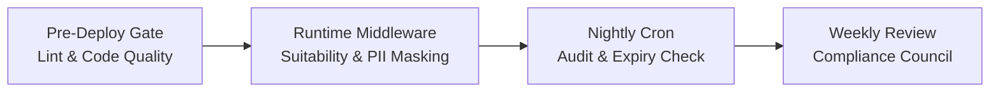

# FintekPro Regulatory Compliance Policy (RCP v1.0)

**Standard Version**: RCP-1.0.0  
**Effective Date**: October 2026  
**Governing Authority**: FintekPro Legal, Regulatory & Compliance Council  
**Statutory Jurisdiction**: SEBI (Securities and Exchange Board of India), RBI (Reserve Bank of India), FIU-IND (Financial Intelligence Unit), and Digital Personal Data Protection Act, 2023 (DPDP)

---

## 1. Regulatory Scope & Executive Mandate

FintekPro operates as a financial technology platform powering SEBI-registered Investment Advisers (RIAs), Research Analysts (RAs), Chartered Accountants (CAs), and Mutual Fund Distributors (MFDs).

The **FintekPro Regulatory Compliance Policy** establishes enforceable operational, engineering, and data standards to guarantee 100% adherence to:
1. **SEBI (Investment Advisers) Regulations, 2013** (including 2020 Amendments).
2. **SEBI (Research Analysts) Regulations, 2014**.
3. **Prevention of Money Laundering Act, 2002 (PMLA)** and FIU-IND circulars.
4. **RBI Foreign Exchange Management Act, 1999 (FEMA)** & Liberalised Remittance Scheme (LRS).
5. **Digital Personal Data Protection Act, 2023 (DPDP Act)** and SEBI Cybersecurity Framework.

---

## 2. SEBI Investment Advisory Governance (IA Regulations 2013)

### 2.1 Fiduciary Duty & Segregation of Advisory vs. Distribution (Reg 15 & 22)
- **Fiduciary Primacy**: In all client engagements, the RIA operates strictly as a fiduciary. Recommendations must be driven purely by client suitability, not by product-level commercial incentives.
- **Direct Code / Zero Commission**: Advice rendered by fee-only RIAs must recommend **Direct Plans** for mutual funds and institutional share classes. Accepting commissions, kickbacks, or volume-based broker brokerage-sharing for advisory accounts is **strictly prohibited**.
- **Transparent Fee Schedules**: Advisory fees must comply with SEBI fee caps (either fixed cap $\le ₹1,25,000$ per annum per family or $\le 2.5\%$ AUA per annum). All fees must be billed via traceable banking channels.

### 2.2 Client Suitability & Annual Recertification (Reg 17)
- **Mandatory Assessment**: No investment proposal or model portfolio recommendation may be issued without a completed, verified Risk Profile recorded in [`risk-suitability-engine.ts`](file:///Users/sangrammohanty/Documents/GitHub/FintekPro/server/services/risk-suitability-engine.ts).
- **Hard Suitability Interceptor**: Any transaction where product risk level exceeds client risk profile is automatically blocked by [`suitability-gate.ts`](file:///Users/sangrammohanty/Documents/GitHub/FintekPro/server/middleware/suitability-gate.ts) with an HTTP 403 `SUITABILITY_BREACH`.
- **Annual Validity Limit**: Risk profiles automatically expire after **365 days**. The platform halts new advisory allocations until a fresh assessment is submitted.

### 2.3 Regulatory Disclosures & Conflict of Interest (Reg 19)
- **Mandatory Disclosure Header**: Every advisory dossier, proposal, and research note must disclose:
  - Affiliations with brokers, AMCs, custodians, or depository participants.
  - Personal material interest or holdings in recommended securities.
  - Mandatory disclaimer: *"Investment in securities market are subject to market risks. Read all scheme related documents carefully."*

---

## 3. Anti-Money Laundering (PMLA) & KYC/CKYC Standards

Implemented via [`sebi-compliance-service.ts`](file:///Users/sangrammohanty/Documents/GitHub/FintekPro/server/services/sebi-compliance-service.ts) and [`kyc-compliance-checker.ts`](file:///Users/sangrammohanty/Documents/GitHub/FintekPro/server/kyc-compliance-checker.ts):

1. **Identity Verification & Central KYC (CKYC)**:
   - Mandatory PAN authentication against NSDL / Income Tax database.
   - CKYC identifier retrieval and KYC Registration Agency (KRA) status verification (CVL, NDML, DOTEX, CAMS, Karvy).
2. **PEP & Sanctions Screening**:
   - Automated screening against Politically Exposed Persons (PEP) lists and OFAC / UNSC sanctions regimes.
   - High-risk / PEP clients require enhanced due diligence (EDD) and Compliance Officer sign-off.
3. **Suspicious Activity Monitoring (FIU-IND)**:
   - Transactions exhibiting sudden volume spikes ($> 5\times$ historical profile), uncharacteristic structuring, or third-party bank funding trigger automated Suspicious Transaction Reporting (STR) flags for internal compliance review.

---

## 4. FEMA & Cross-Border Investing Guidelines (RBI LRS)

Implemented via [`fema-compliance-service.ts`](file:///Users/sangrammohanty/Documents/GitHub/FintekPro/server/services/fema-compliance-service.ts):

1. **Overseas OTC CFD Prohibition**:
   - Under RBI FEMA Master Directions, remitting funds abroad under the Liberalised Remittance Scheme (LRS) for margin trading, forex speculation, or offshore Contracts for Difference (CFDs) is **illegal**.
   - FintekPro strictly prohibits and blocks any integration with unauthorized offshore forex/CFD broker portals.
2. **Permitted Foreign Equity Investment**:
   - Outbound investments in US equities (via the Alpaca Hub / Vested integration) are restricted to permissible equity assets under the $250,000 USD annual LRS ceiling.
   - Real-time tracking of Form A2, Tax Collected at Source (TCS at 20% beyond ₹7 Lakhs), and FEMA compliance documentation.

---

## 5. Data Privacy, PII Masking & 7-Year Audit Trail (DPDP Act 2023)

Implemented via [`audit-trail.ts`](file:///Users/sangrammohanty/Documents/GitHub/FintekPro/server/middleware/audit-trail.ts) and [`sebi-audit-service.ts`](file:///Users/sangrammohanty/Documents/GitHub/FintekPro/server/services/sebi-audit-service.ts):

1. **PII Masking in Transit and Logs**:
   - **Aadhaar**: First 8 digits must be masked (`XXXX-XXXX-1234`). Full Aadhaar numbers are **never** stored in plain text or emitted to logs.
   - **PAN**: Masked in application logs (`ABCDE****F`).
   - **Bank Account & Demat**: Masked to last 4 digits on all UI views and client exports.
2. **Cryptographic Standards**:
   - Data at rest encrypted using **AES-256-GCM**.
   - Data in transit enforced via **TLS 1.3**.
3. **Statutory 7-Year Retention & WORM Logging**:
   - SEBI regulations mandate that all advisory communication, risk assessments, proposals, and trade orders be preserved for a minimum of **7 years** in an immutable Write-Once-Read-Many (WORM) audit ledger.

---

## 6. AI Advisory System Governance (FASP-AI v1.0)

1. **AI as Decision Support System (DSS) Only**:
   - AI algorithms are decision-support tools. AI **never executes transactions autonomously**.
   - All trade triggers, portfolio allocations, and tax rebalances require human confirmation (client OTP or RIA digital approval).
2. **Explainability Layer**:
   - Every algorithmic recommendation must expose: inputs utilized, quantitative models applied, and intermediate factors considered.
3. **No Deterministic Profit Claims**:
   - AI outputs must never promise returns (*"guaranteed 12%"*, *"risk-free investment"*).
   - Recommendations must state downside volatility ranges, drawdown risks, and historical benchmark contexts.
4. **Model Versioning & Audit Immutability**:
   - Every AI-generated report must carry `model_version`, `engine_version`, and UTC `calculation_timestamp`.

---

## 7. Compliance Verification & Escalation Cadence

- **Runtime Enforcement**: Express middleware (`suitability-gate.ts`, `audit-trail.ts`, `kyc-compliance-checker.ts`).
- **Nightly Verification**: Scheduled jobs run every 24 hours to identify expired KYC/risk profiles and flag compliance anomalies.
- **Critical Violation Alerts**: Severe non-compliance events (suitability bypass attempts, PII leakage, unauthorized margin trades) immediately dispatch alerts via `opsAlertService` to the Compliance Officer.

---

*FintekPro Legal, Regulatory & Compliance Council*  
*SEBI Registered Advisory Platform Architecture*
