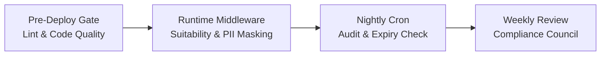

# FintekPro Regulatory Compliance Policy (RCP v1.0)

**Standard Version**: RCP-1.0.0  
**Effective Date**: October 2026 (Updated November 2026)  
**Governing Authority**: FintekPro Legal, Regulatory & Compliance Council  
**Statutory Jurisdiction**: SEBI (Securities and Exchange Board of India), RBI (Reserve Bank of India), CBDT / Income Tax Department, DPDP Act 2023, MeitY, FIU-IND (Financial Intelligence Unit / PMLA), IRDAI, PFRDA, AMFI, and CERT-In

---

## 1. Regulatory Scope & Executive Mandate

FintekPro operates as a unified financial technology and advisory platform powering SEBI-registered Investment Advisers (RIAs), Research Analysts (RAs), Chartered Accountants (CAs), and Mutual Fund Distributors (MFDs).

The **FintekPro Regulatory Compliance Policy** establishes enforceable operational, engineering, and data standards to guarantee 100% perpetual audit compliance across all governing authorities:
1. **SEBI (Mutual Funds) Regulations, 1996** and **AMFI Code of Conduct**.
2. **SEBI (Portfolio Managers) Regulations, 2020** (including Regulation 23(2) statutory ₹50L minimums).
3. **SEBI (Alternative Investment Funds) Regulations, 2012** (including Regulation 10(c) statutory ₹1Cr minimums & AI Framework).
4. **SEBI (Investment Advisers) Regulations, 2013** (including 2020 Amendments and Regulation 22 segregation).
5. **SEBI (Research Analysts) Regulations, 2014**.
6. **Income Tax Act, 1961** (Sections 111A, 112, 112A, 55(2)(ac), 206C(1G), and CBDT circulars).
7. **Prevention of Money Laundering Act, 2002 (PMLA)** and FIU-IND circulars.
8. **RBI Foreign Exchange Management Act, 1999 (FEMA)**, Liberalised Remittance Scheme (LRS), and Digital Lending Guidelines (DLG).
9. **Digital Personal Data Protection Act, 2023 (DPDP Act)** and MeitY AI Directives.
10. **CERT-In Cyber Security Directions** and SEBI Cyber Security and Cyber Resilience Framework (CSCRF).

### 1.1 Category-Specific & Multi-Regulator Operating Procedures (SOPs)

Because product classes and regulatory jurisdictions operate under distinct statutory rules, operational execution across FintekPro is governed by dedicated Standard Operating Procedures:

#### A. Product & Asset Class Operational SOPs
- **Financial Product Distribution Master Policy**: [`DISTRIBUTION_POLICY.md`](file:///Users/sangrammohanty/Documents/GitHub/FintekPro/docs/DISTRIBUTION_POLICY.md) (Commercial distribution of Regular Plans, corporate bonds/OBPP, insurance, fixed deposits; SEBI IA Reg 22 Chinese wall, 100% trail payouts, pre-trade TER disclosures, zero-rebating, zero-commission-bias AI).
- **Financial Product Distribution Desk SOP**: [`SOP_FINANCIAL_PRODUCT_DISTRIBUTION.md`](file:///Users/sangrammohanty/Documents/GitHub/FintekPro/docs/SOP_FINANCIAL_PRODUCT_DISTRIBUTION.md) (Partner & sub-broker NISM-V-A onboarding, AMFI active ARN checks, advisory vs distribution segregation pre-trade gate, trail reconciliation, TDS 194H, SCORES redressal).
- **Mutual Funds & SIF Operating Policy**: [`SOP_MUTUAL_FUNDS.md`](file:///Users/sangrammohanty/Documents/GitHub/FintekPro/docs/SOP_MUTUAL_FUNDS.md) (Pooled AMC trust units, universal fund realization NAV cut-offs, SEBI SIF ₹10L framework, liquidity stress testing, EOP Category 1/2 governance, anti-cash drag guardrails).
- **Universal Model Portfolio Performance & Alpha Monitoring Policy**: [`SOP_MODEL_PORTFOLIO_MONITORING.md`](file:///Users/sangrammohanty/Documents/GitHub/FintekPro/docs/SOP_MODEL_PORTFOLIO_MONITORING.md) (Universal daily performance and alpha monitoring across all 40 model portfolios [Equity, Debt, Hybrid, Thematic, SIF, PMS, AIF], blended and TRI benchmark deviation alerts, SEBI categorization compliance, Sharpe/drawdown breach detection, `monitorAllModelPortfolios()` cron enforcement).
- **PMS Operating Policy**: [`SOP_PMS_OPERATIONS.md`](file:///Users/sangrammohanty/Documents/GitHub/FintekPro/docs/SOP_PMS_OPERATIONS.md) (Statutory ₹50 Lakhs floor, segregated client demat custody via Upstox, APMI standardized TWRR audits, mandatory 48-hr Form C disclosure delivery, High-Water Mark performance fees, ADTV slippage limits).
- **AIF Operating Policy**: [`SOP_AIF_OPERATIONS.md`](file:///Users/sangrammohanty/Documents/GitHub/FintekPro/docs/SOP_AIF_OPERATIONS.md) (Statutory ₹1 Crore floor, Accredited Investor certification, mandatory NSDL/CDSL unit dematerialization, leverage ceilings [0% Cat I/II, 200% Cat III], direct plan fee unbundling, 4-tier distribution waterfall).
- **Derivative Trading Compliance SOP**: [`sop_derivative_trading_audit_standards.md`](file:///Users/sangrammohanty/Documents/GitHub/FintekPro/ai-policy/sop_derivative_trading_audit_standards.md) (SEBI index derivatives framework, weekly expiry restrictions, +2% expiry day ELM surcharge, 9-gate pre-trade compliance, canonical Black-76 Greeks).

#### B. Regulatory & Technological Infrastructure SOPs
- **Multi-Regulator AI Compliance Framework**: [`multi_regulator_ai_compliance_policy.md`](file:///Users/sangrammohanty/Documents/GitHub/FintekPro/ai-policy/multi_regulator_ai_compliance_policy.md) (Master compliance standard harmonizing SEBI, RBI, CBDT, DPDP Act 2023, MeitY, FIU-IND, IRDAI, PFRDA, AMFI, and CERT-In).
- **AI Advisory Governance & Model Risk SOP**: [`SOP_AI_ADVISORY_AND_MODEL_GOVERNANCE.md`](file:///Users/sangrammohanty/Documents/GitHub/FintekPro/docs/SOP_AI_ADVISORY_AND_MODEL_GOVERNANCE.md) (SEBI AI/ML intermediary circular, model inventory Tiers 1–3, legal non-delegation, retail backtest marketing ban, 3.5σ drift fallback, Global Kill-Switch SOP).
- **Income Tax Statutory Amendment Ingestion SOP**: [`SOP_TAX_AMENDMENT_MANAGEMENT_AND_PATCHING.md`](file:///Users/sangrammohanty/Documents/GitHub/FintekPro/docs/SOP_TAX_AMENDMENT_MANAGEMENT_AND_PATCHING.md) (Statutory tax rate resolution, grandfathering under Section 55(2)(ac), Section 111A/112A capital gains, dual authorization, CA portal sync).
- **DPDP Data Privacy & LLM Sanitization SOP**: [`SOP_DPDP_DATA_PRIVACY_AND_LLM_FIREWALL.md`](file:///Users/sangrammohanty/Documents/GitHub/FintekPro/docs/SOP_DPDP_DATA_PRIVACY_AND_LLM_FIREWALL.md) (DPDP Act 2023, pre-prompt PII firewall stripping Aadhaar/PAN/Bank details before external LLMs, Zero Data Retention, client right to human review, MeitY AI watermarking).
- **RBI Digital Lending & MRM SOP**: [`SOP_RBI_DIGITAL_LENDING_AND_MRM.md`](file:///Users/sangrammohanty/Documents/GitHub/FintekPro/docs/SOP_RBI_DIGITAL_LENDING_AND_MRM.md) (RBI Digital Lending Guidelines, strict device privacy banning contact/SMS harvesting, KFS generation, 3-day cooling-off window, direct borrower-to-RE loan disbursals, statutory LTV caps).
- **AML, PMLA & Sanctions Screening SOP**: [`SOP_AML_PMLA_AND_SANCTIONS_SCREENING.md`](file:///Users/sangrammohanty/Documents/GitHub/FintekPro/docs/SOP_AML_PMLA_AND_SANCTIONS_SCREENING.md) (FIU-IND, automated AML anomaly detection, daily MHA UAPA / UNSC / PEP screening, human Principal Officer review before STR/CTR filings).
- **CERT-In Cyber Incident & Time Sync SOP**: [`SOP_CERTIN_CYBER_INCIDENT_AND_TIME_SYNC.md`](file:///Users/sangrammohanty/Documents/GitHub/FintekPro/docs/SOP_CERTIN_CYBER_INCIDENT_AND_TIME_SYNC.md) (Mandatory 6-hour incident reporting window to CERT-In and SEBI, NPL/NIC NTP server time sync within ±50ms, 5–7 year sovereign in-country log retention).
- **Redis Infrastructure & Scalable Architecture Policy**: [`REDIS_ACTIVATION_AND_INFRASTRUCTURE_POLICY.md`](file:///Users/sangrammohanty/Documents/GitHub/FintekPro/docs/REDIS_ACTIVATION_AND_INFRASTRUCTURE_POLICY.md) (Operational Tier 1 Redis acceleration with PostgreSQL 7-year WORM audit store for multi-pod Cloud Run consistency).
- **Third-Party Partner & Broker API Governance SOP**: [`SOP_PARTNER_BROKER_AND_API_INTEGRATIONS.md`](file:///Users/sangrammohanty/Documents/GitHub/FintekPro/docs/SOP_PARTNER_BROKER_AND_API_INTEGRATIONS.md) (Standard operating procedures for Upstox API v2, KFintech IRIS Hub, Alpaca Broker API, and Smallcase Gateway: token lifecycles, circuit breakers, self-healing fallbacks, FEMA LRS cash accounts, and CERT-In/SEBI audit logging).
- **Mutual Funds & SIF Operating Policy**: [`SOP_MUTUAL_FUNDS.md`](file:///Users/sangrammohanty/Documents/GitHub/FintekPro/docs/SOP_MUTUAL_FUNDS.md) (Pooled AMC trust units, universal fund realization NAV cut-offs, SEBI SIF ₹10L framework, liquidity stress testing, EOP Category 1/2 governance, anti-cash drag guardrails).
- **Universal Model Portfolio Performance & Alpha Monitoring Policy**: [`SOP_MODEL_PORTFOLIO_MONITORING.md`](file:///Users/sangrammohanty/Documents/GitHub/FintekPro/docs/SOP_MODEL_PORTFOLIO_MONITORING.md) (Universal daily performance and alpha monitoring across all 40 model portfolios [Equity, Debt, Hybrid, Thematic, SIF, PMS, AIF], blended and TRI benchmark deviation alerts, SEBI categorization compliance, Sharpe/drawdown breach detection, `monitorAllModelPortfolios()` cron enforcement).
- **PMS Operating Policy**: [`SOP_PMS_OPERATIONS.md`](file:///Users/sangrammohanty/Documents/GitHub/FintekPro/docs/SOP_PMS_OPERATIONS.md) (Statutory ₹50 Lakhs floor, segregated client demat custody via Upstox, APMI standardized TWRR audits, mandatory 48-hr Form C disclosure delivery, High-Water Mark performance fees, ADTV slippage limits).
- **AIF Operating Policy**: [`SOP_AIF_OPERATIONS.md`](file:///Users/sangrammohanty/Documents/GitHub/FintekPro/docs/SOP_AIF_OPERATIONS.md) (Statutory ₹1 Crore floor, Accredited Investor certification, mandatory NSDL/CDSL unit dematerialization, leverage ceilings [0% Cat I/II, 200% Cat III], direct plan fee unbundling, 4-tier distribution waterfall).
- **Derivative Trading Compliance SOP**: [`sop_derivative_trading_audit_standards.md`](file:///Users/sangrammohanty/Documents/GitHub/FintekPro/ai-policy/sop_derivative_trading_audit_standards.md) (SEBI index derivatives framework, weekly expiry restrictions, +2% expiry day ELM surcharge, 9-gate pre-trade compliance, canonical Black-76 Greeks).

#### B. Regulatory & Technological Infrastructure SOPs
- **AI Advisory Governance & Model Risk SOP**: [`SOP_AI_ADVISORY_AND_MODEL_GOVERNANCE.md`](file:///Users/sangrammohanty/Documents/GitHub/FintekPro/docs/SOP_AI_ADVISORY_AND_MODEL_GOVERNANCE.md) (SEBI AI/ML intermediary circular, model inventory Tiers 1–3, legal non-delegation, retail backtest marketing ban, 3.5σ drift fallback, Global Kill-Switch SOP).
- **DPDP Data Privacy & LLM Sanitization SOP**: [`SOP_DPDP_DATA_PRIVACY_AND_LLM_FIREWALL.md`](file:///Users/sangrammohanty/Documents/GitHub/FintekPro/docs/SOP_DPDP_DATA_PRIVACY_AND_LLM_FIREWALL.md) (DPDP Act 2023, pre-prompt PII firewall stripping Aadhaar/PAN/Bank details before external LLMs, Zero Data Retention, client right to human review, MeitY AI watermarking).
- **RBI Digital Lending & MRM SOP**: [`SOP_RBI_DIGITAL_LENDING_AND_MRM.md`](file:///Users/sangrammohanty/Documents/GitHub/FintekPro/docs/SOP_RBI_DIGITAL_LENDING_AND_MRM.md) (RBI Digital Lending Guidelines, strict device privacy banning contact/SMS harvesting, KFS generation, 3-day cooling-off window, direct borrower-to-RE loan disbursals, statutory LTV caps).
- **AML, PMLA & Sanctions Screening SOP**: [`SOP_AML_PMLA_AND_SANCTIONS_SCREENING.md`](file:///Users/sangrammohanty/Documents/GitHub/FintekPro/docs/SOP_AML_PMLA_AND_SANCTIONS_SCREENING.md) (FIU-IND, automated AML anomaly detection, daily MHA UAPA / UNSC / PEP screening, human Principal Officer review before STR/CTR filings).
- **CERT-In Cyber Incident & Time Sync SOP**: [`SOP_CERTIN_CYBER_INCIDENT_AND_TIME_SYNC.md`](file:///Users/sangrammohanty/Documents/GitHub/FintekPro/docs/SOP_CERTIN_CYBER_INCIDENT_AND_TIME_SYNC.md) (Mandatory 6-hour incident reporting window to CERT-In and SEBI, NPL/NIC NTP server time sync within ±50ms, 5–7 year sovereign in-country log retention).
- **Third-Party Partner & Broker API Governance SOP**: [`SOP_PARTNER_BROKER_AND_API_INTEGRATIONS.md`](file:///Users/sangrammohanty/Documents/GitHub/FintekPro/docs/SOP_PARTNER_BROKER_AND_API_INTEGRATIONS.md) (Standard operating procedures for Upstox API v2, KFintech IRIS Hub, Alpaca Broker API, and Smallcase Gateway: token lifecycles, circuit breakers, self-healing fallbacks, FEMA LRS cash accounts, and CERT-In/SEBI audit logging).

---

## 2. SEBI Investment Advisory Governance (IA Regulations 2013)

### 2.1 Fiduciary Duty & Segregation of Advisory vs. Distribution (Reg 15 & 22)
- **Fiduciary Primacy**: In all client engagements, the RIA operates strictly as a fiduciary. Recommendations must be driven purely by client suitability, not by product-level commercial incentives.
- **Direct Code / Zero Commission**: Advice rendered by fee-only RIAs must recommend **Direct Plans** for mutual funds and institutional share classes. Accepting commissions, kickbacks, or volume-based broker brokerage-sharing for advisory accounts is **strictly prohibited**.
- **Transparent Fee Schedules**: Advisory fees must comply with SEBI fee caps (either fixed cap $\le ₹1,25,000$ per annum per family or $\le 2.5\%$ AUA per annum). All fees must be billed via traceable banking channels.

### 2.2 Client Suitability & Annual Recertification (Reg 17)
- **Mandatory Assessment**: No investment proposal or model portfolio recommendation may be issued without a completed, verified Risk Profile recorded in [`risk-suitability-engine.ts`](file:///Users/sangrammohanty/Documents/GitHub/FintekPro/server/services/risk-suitability-engine.ts).
- **Hard Suitability Interceptor**: Any transaction where product risk level exceeds client risk profile is automatically blocked by [`suitability-gate.ts`](file:///Users/sangrammohanty/Documents/GitHub/FintekPro/server/middleware/suitability-gate.ts) with an HTTP 403 `SUITABILITY_BREACH`.
- **Annual Validity Limit**: Risk profiles automatically expire after **365 days**. The platform halts new advisory allocations until a fresh assessment is submitted.

### 2.3 Regulatory Disclosures & Conflict of Interest (Reg 19)
- **Mandatory Disclosure Header**: Every advisory dossier, proposal, and research note must disclose:
  - Affiliations with brokers, AMCs, custodians, or depository participants.
  - Personal material interest or holdings in recommended securities.
  - Mandatory disclaimer: *"Investment in securities market are subject to market risks. Read all scheme related documents carefully."*

---

## 3. Anti-Money Laundering (PMLA) & KYC/CKYC Standards

Implemented via [`sebi-compliance-service.ts`](file:///Users/sangrammohanty/Documents/GitHub/FintekPro/server/services/sebi-compliance-service.ts) and [`kyc-compliance-checker.ts`](file:///Users/sangrammohanty/Documents/GitHub/FintekPro/server/kyc-compliance-checker.ts):

1. **Identity Verification & Central KYC (CKYC)**:
   - Mandatory PAN authentication against NSDL / Income Tax database.
   - CKYC identifier retrieval and KYC Registration Agency (KRA) status verification (CVL, NDML, DOTEX, CAMS, Karvy).
2. **PEP & Sanctions Screening**:
   - Automated screening against Politically Exposed Persons (PEP) lists and OFAC / UNSC sanctions regimes.
   - High-risk / PEP clients require enhanced due diligence (EDD) and Compliance Officer sign-off.
3. **Suspicious Activity Monitoring (FIU-IND)**:
   - Transactions exhibiting sudden volume spikes ($> 5\times$ historical profile), uncharacteristic structuring, or third-party bank funding trigger automated Suspicious Transaction Reporting (STR) flags for internal compliance review.

---

## 4. FEMA & Cross-Border Investing Guidelines (RBI LRS)

Implemented via [`fema-compliance-service.ts`](file:///Users/sangrammohanty/Documents/GitHub/FintekPro/server/services/fema-compliance-service.ts):

1. **Overseas OTC CFD Prohibition**:
   - Under RBI FEMA Master Directions, remitting funds abroad under the Liberalised Remittance Scheme (LRS) for margin trading, forex speculation, or offshore Contracts for Difference (CFDs) is **illegal**.
   - FintekPro strictly prohibits and blocks any integration with unauthorized offshore forex/CFD broker portals.
2. **Permitted Foreign Equity Investment**:
   - Outbound investments in US equities (via the Alpaca Hub / Vested integration) are restricted to permissible equity assets under the $250,000 USD annual LRS ceiling.
   - Real-time tracking of Form A2, Tax Collected at Source (TCS at 20% beyond ₹7 Lakhs), and FEMA compliance documentation.

---

## 5. Data Privacy, PII Masking & 7-Year Audit Trail (DPDP Act 2023)

Implemented via [`audit-trail.ts`](file:///Users/sangrammohanty/Documents/GitHub/FintekPro/server/middleware/audit-trail.ts) and [`sebi-audit-service.ts`](file:///Users/sangrammohanty/Documents/GitHub/FintekPro/server/services/sebi-audit-service.ts):

1. **PII Masking in Transit and Logs**:
   - **Aadhaar**: First 8 digits must be masked (`XXXX-XXXX-1234`). Full Aadhaar numbers are **never** stored in plain text or emitted to logs.
   - **PAN**: Masked in application logs (`ABCDE****F`).
   - **Bank Account & Demat**: Masked to last 4 digits on all UI views and client exports.
2. **Cryptographic Standards**:
   - Data at rest encrypted using **AES-256-GCM**.
   - Data in transit enforced via **TLS 1.3**.
3. **Statutory 7-Year Retention & WORM Logging**:
   - SEBI regulations mandate that all advisory communication, risk assessments, proposals, and trade orders be preserved for a minimum of **7 years** in an immutable Write-Once-Read-Many (WORM) audit ledger.

---

## 6. AI Advisory System Governance (FASP-AI v1.0 & Multi-Regulator Framework)

Operates under the master **FintekPro Multi-Regulator AI Compliance Framework (MR-AICF v1.0)** ([`multi_regulator_ai_compliance_policy.md`](file:///Users/sangrammohanty/Documents/GitHub/FintekPro/ai-policy/multi_regulator_ai_compliance_policy.md)):

1. **AI as Decision Support System (DSS) Only (SEBI & RBI Mandate)**:
   - AI algorithms are decision-support tools. AI **never executes transactions autonomously**.
   - Fiduciary legal accountability cannot be outsourced to AI models. All trade triggers, portfolio allocations, and tax rebalances require human confirmation (client OTP or RIA digital approval).
2. **Explainability & Canonical Math Layer**:
   - Every algorithmic recommendation must expose: inputs utilized, quantitative models applied, and intermediate factors considered.
   - **Zero Synthetic Formulas**: Banned from using "cooked-up" or ad-hoc mathematical heuristics. All equations must derive from peer-reviewed literature or statutory circulars.
3. **No Deterministic Profit Claims & Algorithmic Marketing Compliance**:
   - AI outputs must never promise returns (*"guaranteed 12%"*, *"risk-free investment"*).
   - Strict ban on advertising simulated or backtested AI win-rates to retail clients; all performance must be net of fees and benchmarked against official TRI indices.
4. **Model Versioning, Registry & Audit Immutability**:
   - Every AI-generated report must carry `model_version`, `engine_version`, and UTC `calculation_timestamp`.
   - Mandatory AI Model Registry categorized into regulatory risk tiers (Tier 1 Advisory, Tier 2 Analytical, Tier 3 Operational).
5. **DPDP Act 2023 & LLM Privacy Boundary**:
   - Zero raw PII (Aadhaar, PAN, Bank/Demat numbers) transmitted in prompts to third-party foundation models (Gemini, Groq, Anthropic).
   - Right of clients to contest automated advice and request human advisor review.
   - MeitY standardized visual watermarking on all AI-generated reports: `[AI-Assisted Advisory • Decision Support Only]`.
6. **Income Tax Act 1961 & CBDT Standards**:
   - All tax recommendations, capital gain calculations, and harvest simulations must strictly enforce canonical statutory rules (Section 111A, 112, 112A, and 55(2)(ac) grandfathering). Filing of ITR or tax challan submission requires explicit client/CA validation.
7. **IRDAI & PFRDA Distribution Boundaries**:
   - Insurance distribution requires documented Need Analysis and 30-day Free-Look disclosure; zero automated claim rejections. NPS distribution strictly obeys PFRDA age-linked lifecycle equity caps.
8. **CERT-In Time Synchronization**:
   - Clocks synchronized with official IST (NPL/NIC NTP servers); 6-hour mandatory reporting window for cyber incidents or AI governance bypasses.
9. **Active Redis Operational Acceleration & Audit Primacy**:
   - Google Cloud Memorystore (Redis) is active in production as the Tier 1 distributed cache for sub-150ms inference retrieval, prompt deduplication, and sliding-window rate limiting.
   - To guarantee SEBI and PMLA compliance, PostgreSQL remains the immutable 7-year WORM audit store (`ai_advisory_outputs`, `portfolio_ai_decisions`, `regulatory_audit_packs`). Zero-downtime fallback to local memory LRU is enforced if Redis is unreachable.

---

## 7. Compliance Verification & Escalation Cadence

- **Runtime Enforcement**: Express middleware (`suitability-gate.ts`, `audit-trail.ts`, `kyc-compliance-checker.ts`).
- **Nightly Verification**: Scheduled jobs run every 24 hours to identify expired KYC/risk profiles and flag compliance anomalies.
- **Critical Violation Alerts**: Severe non-compliance events (suitability bypass attempts, PII leakage, unauthorized margin trades) immediately dispatch alerts via `opsAlertService` to the Compliance Officer.

---

*FintekPro Legal, Regulatory & Compliance Council*  
*SEBI Registered Advisory Platform Architecture*
