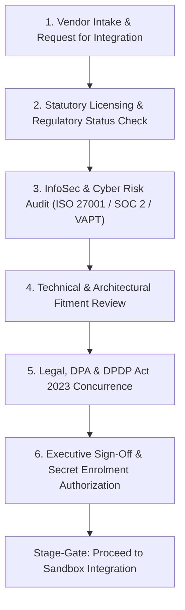
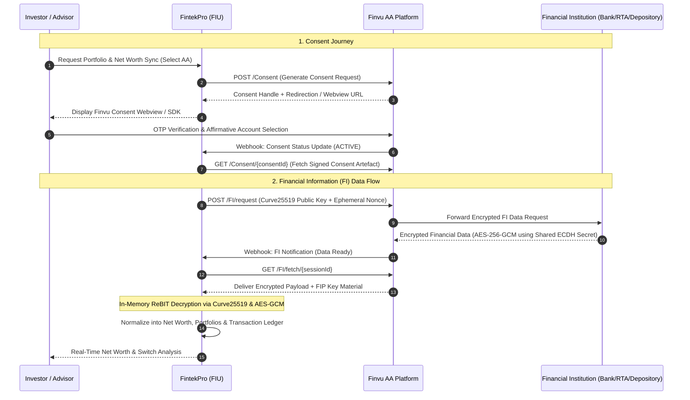

# FintekPro Policy & Standard Operating Procedure (SOP): API Service Provider Enrolment, Integration & Governance

**Document Code**: `FINTEK-POL-SOP-API-ENROL-2026-01`  
**Effective Date**: November 2026  
**Version**: 1.0.0 (Production Release)  
**Governing Authorities**: 
- Securities and Exchange Board of India (SEBI CSCRF - Cybersecurity and Cyber Resilience Framework)
- Reserve Bank of India (RBI Master Direction – Information Technology Governance, Risk, Controls and Assurance Practices, 2023; RBI Master Direction – NBFC - Account Aggregator Directions, 2016; RBI Outsourcing of IT Services Directions, 2023)
- Digital Personal Data Protection Act, 2023 (DPDP Act) & Data Protection Board of India (DPBI)
- Indian Computer Emergency Response Team (CERT-In Cyber Security Directions under Section 70B of IT Act 2000)
- ReBIT (Reserve Bank Information Technology Pvt. Ltd.) Technical Framework for Account Aggregators (v1.1.2 / v2.0)
**Applicability**: Architecture Council, Engineering Teams, Chief Information Security Officer (CISO), Compliance & Legal Officers, Operations Desks, RIA / RA Advisory Desks  

---

## 1. Executive Summary & Purpose

FintekPro connects with regulated and licensed institutional Application Programming Interface (API) service providers to execute its core financial operations, including market data ingestion, trade routing, account aggregation, identity verification, payment processing, and credit analysis.

This document establishes the **statutory Policy** and **Standard Operating Procedure (SOP)** for evaluating, vetting, enrolling, integrating, operating, and de-enrolling external API Service Providers. It ensures that every third-party API integration:
1. Adheres to zero-trust architecture, strict encryption, and data residency in India.
2. Complies with SEBI CSCRF, RBI IT Outsourcing norms, CERT-In logging guidelines, and DPDP Act 2023 requirements.
3. Implements fault-tolerant, idempotent, explainable, and multi-vendor resilient software patterns conforming to **FintekPro Global Coding Rules (GCR v1.0)**.
4. Includes dedicated technical protocols for onboarding **Finvu (Cookiejar Technologies Pvt. Ltd.)** as an RBI-licensed Account Aggregator (AA).

---

## 2. Statutory Provider Classification & Risk Tiering

Every API Service Provider must be categorized into one of three statutory risk tiers prior to commercial engagement or technical integration:

| Risk Tier | Category & Services | Statutory Regulators | Security & Audit Requirements | Default Failover Strategy |
| :--- | :--- | :--- | :--- | :--- |
| **Tier 1: High Impact (Core Financial & Aggregation)** | Account Aggregators (Finvu, Setu AA, OneMoney), Partner Brokers/OMS (Upstox, Alpaca, Angel One), RTAs (KFintech IRIS, CAMS), Depositories (NSDL, CDSL) | RBI, SEBI, US SEC/FINRA | SOC 2 Type II, ISO 27001, Annual Third-Party VAPT, Indian Data Localization, End-to-End Cryptography | Mandatory Secondary Provider Hot-Standby / Graceful Circuit Breaker |
| **Tier 2: Transactional & Identity** | Payment Gateways (Cashfree, Razorpay), CKYC / KRA / Aadhaar e-Sign (AuthBridge, Digio, Leegality), Credit Bureaus (CRIF High Mark, CIBIL) | RBI, UIDAI, CERSAI | ISO 27001, PCI-DSS Level 1 (for card/UPI), UIDAI AUA/KUA Compliance, PII Masking Firewall | Automatic Retry with Exponential Backoff + Alternate Gateway Routing |
| **Tier 3: Informational & Ancillary** | Commodity Feeds (NCDEX), Municipal/Corporate Bond Catalogs, Tax Rules, WhatsApp/SMS Gateways (Twilio) | CERT-In, TRAI | TLS 1.3, Static IP Egress Whitelisting, Rate-Limit Circuit Breakers | Local Cache Serving (Stale-While-Revalidate) + Queue-Buffered Async Processing |

---

## 3. Pre-Enrolment Vendor Due Diligence & Statutory Vetting

Before technical credentials or contract execution, the **Vendor Onboarding Committee** (comprising CTO, CISO, and Head of Compliance) must complete the following six-point vetting process:



### 3.1 Statutory Licensing & Legal Verification
- The provider must provide valid regulatory licenses from RBI (e.g. NBFC-AA Certificate of Registration for Finvu), SEBI (Stock Broker / Depository Participant / RA registration), or respective apex statutory bodies.
- Unregistered intermediaries or non-compliant proxies are disqualified immediately.

### 3.2 Information Security & Compliance Audit
1. **Certifications**: Mandatory submission of active ISO/IEC 27001:2022 and SOC 2 Type II reports issued within the preceding 12 months.
2. **Vulnerability Assessment & Penetration Testing (VAPT)**: Provider must present an executive summary of an independent CERT-In empanelled auditor VAPT report with zero open Critical or High severity findings.
3. **Data Localization Mandate (RBI & DPDP 2023)**: All primary database records, customer financial statements, transaction metadata, logs, and cryptographic keys must be hosted exclusively in data centers located within the territory of India (e.g. Google Cloud `asia-south1` or `asia-south2`).
4. **Data Protection Agreement (DPA)**: A signed DPA binding the provider as a Data Processor under DPDP Act 2023, strictly prohibiting:
   - Data mining, aggregation, or third-party syndication.
   - Use of customer financial information for model training of public or commercial AI/LLMs.
   - Retention of decrypted Financial Information beyond statutory processing windows.

---

## 4. Architectural & Engineering Integration Standards (FintekPro GCR v1.0)

Every API integration must strictly observe the layered architecture and engineering guardrails defined in FintekPro Global Coding Rules.

```
┌────────────────────────────────────────────────────────┐
│  Presentation / Webhook Routes: server/routes/         │
│  (Stateless, Input Validation, Rate Limits, No Logic)  │
└───────────────────────────┬────────────────────────────┘
                            │
┌───────────────────────────▼────────────────────────────┐
│  Application Services: server/services/{provider}/     │
│  (Business Orchestration, Idempotency, Fallbacks)      │
└───────────────────────────┬────────────────────────────┘
                            │
┌───────────────────────────▼────────────────────────────┐
│  Core Domain & Cryptography: server/core/ & utils/     │
│  (Pure Functions, ReBIT Curve25519/AES-GCM, Schemas)  │
└───────────────────────────┬────────────────────────────┘
                            │
┌───────────────────────────▼────────────────────────────┐
│  Data Layer & Ledger: server/data/ & repositories/     │
│  (Drizzle ORM, Immutable Audit Trails, No Raw SQL)     │
└────────────────────────────────────────────────────────┘
```

### 4.1 Strict Layered Decoupling
- **No Controller Business Logic**: Route files (`server/routes/*`) must ONLY validate request payloads, verify signatures, enforce rate limits, and delegate directly to dedicated service classes.
- **Dedicated Service Isolation**: All provider-specific code must reside in a dedicated namespace under `server/services/<provider-name>/` (e.g., `server/services/finvu/`).
- **No Direct Database Mutations**: Controllers and services must interact with storage solely through Drizzle ORM models with audit metadata (`created_at`, `updated_at`, `source`).

### 4.2 Idempotency & Safe Retries
- Every mutating request (consent initiation, trade placement, payment request, data session generation) MUST include an idempotency key generated via:
  ```typescript
  const idempotencyKey = `${PROVIDER_PREFIX}_${entityId}_${action}_${timestamp}`;
  ```
- Maximum retry limit: **3 attempts** using exponential backoff with jitter (`backoff_ms = Math.min(1000 * Math.pow(2, attempt) + Math.random() * 200, 10000)`).
- Safe failure mode: If the provider fails, the system must transition gracefully to degraded mode or secondary provider, never crashing the parent thread.

### 4.3 Structured Observability Standard
Every inbound and outbound API interaction must emit a structured JSON log complying with the FintekPro standard:
```json
{
  "event": "PROVIDER_API_INTERACTION",
  "provider": "finvu",
  "direction": "outbound",
  "endpoint": "/Consent",
  "http_status": 200,
  "latency_ms": 145,
  "status": "success",
  "idempotency_key": "FINVU_CONSENT_10928_1732360000",
  "timestamp": "2026-11-23T09:30:00.145Z"
}
```

### 4.4 Mandatory PII Masking Firewall
- **PAN**: Mask characters 6 through 8 (`ABCDE****F`).
- **Aadhaar**: Never store full 12 digits; retain only last 4 digits (`XXXXXXXX1234`) with explicit Virtual ID or tokenization.
- **Bank Account / Demat**: Retain only last 4 digits in non-encrypted logs (`******5678`).
- **Cryptographic Keys, Private Keys, Passwords, Session Tokens**: Permanently omitted from logs.

---

## 5. Zero-Trust Cryptographic Enrolment & Secret Lifecycle

In compliance with SEBI CSCRF and CERT-In directions:

### 5.1 GCP Secret Manager Provisioning
1. **Strictly Prohibited**: Plaintext API keys, secrets, client certificates, or private keys inside `.env` files, source repositories, or client code.
2. **Secret Secret Naming Standard**: All secrets reside in Google Cloud Secret Manager under project `fintekpro` with uniform naming:
   - `<PROVIDER>_CLIENT_ID`
   - `<PROVIDER>_CLIENT_SECRET`
   - `<PROVIDER>_PRIVATE_KEY` / `<PROVIDER>_PUBLIC_KEY`
   - `<PROVIDER>_WEBHOOK_SECRET`
   - `<PROVIDER>_BASE_URL`
3. **Runtime Mounting**: Secrets are mounted into Cloud Run container memory as environment variables or read dynamically via Secret Manager client using the runtime service account `fintekpro-app@fintekpro.iam.gserviceaccount.com`.

### 5.2 Key Rotation & Emergency Revocation
1. **90-Day Rotation Schedule**: All API keys, basic auth secrets, and webhook tokens must be rotated every 90 days following the corporate security calendar.
2. **Emergency Revocation ($\le 15$ Minutes)**:
   - Security Officer initiates revocation on the provider portal.
   - New credentials pushed to GCP Secret Manager:
     ```bash
     gcloud secrets versions add <SECRET_NAME> --data-file=- <<< "<NEW_VALUE>"
     ```
   - Cloud Run container automatically loads the updated `:latest` version.

### 5.3 Static Egress IP & Mutual TLS (mTLS)
- All production calls to regulated financial APIs must originate from whitelisted Cloud Run Serverless VPC Access Connector static egress IPs.
- Where mandated (e.g. RBI AA ReBIT specifications or direct bank hosts), bidirectional Mutual TLS (mTLS) with X.509 certificates signed by an accredited CA must be established.

---

## 6. Sandbox-to-Production Stage-Gate Checklist

Before any newly enrolled API Service Provider is granted live production traffic, it must pass all six statutory gates:

| Gate | Verification Check | Responsible Role | Pass Criteria |
| :--- | :--- | :--- | :--- |
| **Gate 1: Contractual** | Signed Master Services Agreement (MSA), SLA, and DPDP Data Processing Agreement (DPA) | Legal & Compliance | All statutory clauses active; liability & data localization verified |
| **Gate 2: Cryptographic Handshake** | Mutual TLS, Curve25519 / RSA key generation, public key exchange, and test signature validation | Lead Security Engineer | 100% cryptographic handshake verification in sandbox |
| **Gate 3: Functional & Error Testing** | Full end-to-end user journey tested using synthetic data across nominal and edge cases (HTTP 400, 401, 403, 429, 500, 503, timeout) | Lead QA / SDET | Zero unhandled exceptions; circuit breaker trips cleanly; exponential backoff verified |
| **Gate 4: Performance & Load Verification** | Synthetic load test measuring p95 and p99 latency against contracted SLA limits | Systems Architect | p95 latency $\le 1000\text{ms}$; throughput verified up to $2\times$ projected peak load |
| **Gate 5: Security & Pen-Testing** | Static code analysis (SAST), dependency scan, secret leak verification, and API endpoint penetration testing | CISO / AppSec Desk | Zero Critical / High vulnerabilities in SAST / DAST scans |
| **Gate 6: Canary Rollout & Final Sign-Off** | Phased traffic cutover (5% internal staff $\rightarrow$ 25% beta users $\rightarrow$ 100% general availability) with real-time error budget tracking | Principal Officer & CTO | 24-hour error rate $< 0.05\%$; formal sign-off in Governance Registry |

---

## 7. Ongoing Operational Governance, SLA Monitoring & Incident Response

### 7.1 Service Level Agreement (SLA) Matrix
- **Provider Uptime Commitment**: Minimum **$99.9\%$** monthly availability.
- **Latency Baseline**:
  - Synchronous Market Quotes / Health Pings: $\le 200\text{ms}$
  - Asynchronous Consent / Data Session Ingestion: $\le 1500\text{ms}$
- **Error Budget**: If provider HTTP 5xx responses or timeouts exceed **$0.5\%$** over a rolling 1-hour window, the circuit breaker opens automatically and alerts fire.

### 7.2 CERT-In 6-Hour Incident Notification SOP
Under the CERT-In Cyber Security Directions 2022 (Section 70B of IT Act 2000):
1. Any cybersecurity incident involving an API service provider (e.g., credential leak, unauthorized access, data breach, denial of service) must be reported to CERT-In (`incident@cert-in.org.in`) within **6 hours** of detection.
2. The Incident Response Team must immediately invoke the kill switch to isolate the compromised provider.
3. NTP Time Synchronization: System clocks must maintain continuous synchronization with the National Physical Laboratory (NPL) or NIC NTP pool (`time.nic.in` / `time.google.com`), keeping drift strictly $\le \pm 50\text{ms}$.

### 7.3 Annual Re-Certification & Vendor Audit
Every enrolled API Service Provider undergoes an annual audit:
- Re-verification of ISO 27001 and SOC 2 Type II validity.
- Audit of cumulative uptime, latency breaches, and SLA penalties.
- Review of statutory compliance certificates (DPDP Act, RBI/SEBI directives).

---

## 8. Finvu Account Aggregator (AA) Enrolment & Implementation Blueprint

This section provides the end-to-end technical installation and onboarding blueprint for **Finvu (Cookiejar Technologies Pvt. Ltd. - RBI Licensed NBFC-AA)**.



### 8.1 Finvu Institutional Onboarding & Registry Registration
1. **FIU Membership**: FintekPro registers as a Financial Information User (FIU) with the Sahamati Central Registry and obtains its unique `FIU_ENTITY_ID` (`fintekpro-fiu`).
2. **Finvu Partner Portal Setup**: FintekPro establishes its institutional account on the Finvu Developer Portal:
   - Provide SEBI RIA / RA / Stock Broker license credentials.
   - Register the production webhook URL: `https://app.fintekpro.com/api/finvu/webhook`.
   - Submit the static egress IPs for network whitelisting.

### 8.2 End-to-End Cryptography (ReBIT Technical Standards)
In compliance with the ReBIT AA specifications, financial data is encrypted end-to-end by the Financial Information Provider (FIP) and can **only** be decrypted by FintekPro (FIU). Finvu acts as a blind data transit pipe and cannot view the underlying financial statements.

1. **Curve25519 Key Generation**:
   - For every data session request, FintekPro generates an ephemeral Curve25519 keypair:
     - `ephemeralPrivateKey` (kept strictly in server memory, never persisted).
     - `ephemeralPublicKey` (transmitted in the `/FI/request` payload alongside a cryptographically secure random nonce).
2. **Shared Secret Derivation (Diffie-Hellman / ECDH)**:
   - Upon receiving the encrypted data payload from Finvu containing the FIP's public key material and nonce:
     $$\text{SharedKey} = \text{ECDH}(\text{FIU\_PrivateKey}, \text{FIP\_PublicKey})$$
   - Key Derivation Function (HKDF) derives the AES encryption key using the combined nonces as salt:
     $$\text{DerivedKey} = \text{HKDF-SHA256}(\text{SharedKey}, \text{Nonce}_{\text{FIU}} \parallel \text{Nonce}_{\text{FIP}})$$
3. **AES-256-GCM Decryption**:
   - The encrypted payload is decrypted in-memory using AES-256-GCM with authentication tag validation.
   - Cleartext financial records are validated against ReBIT JSON schemas before ingestion.

### 8.3 Core Engineering Modules for Finvu Installation

```
server/
├── services/
│   └── finvu/
│       ├── finvu-client.ts          # Base HTTP client with mTLS, JWS signing & retry logic
│       ├── finvu-crypto.ts          # Curve25519 ECDH key generation, HKDF & AES-256-GCM decryptor
│       ├── finvu-consent-service.ts # Consent creation, status tracking, handle polling & revocation
│       ├── finvu-fi-service.ts      # FI data request, fetch session, decryption & ingestion pipeline
│       └── finvu-webhook-handler.ts # Inbound webhook validation, signature verification & dispatcher
├── routes/
│   └── finvu-routes.ts              # Stateless API endpoints: /api/finvu/consent, /api/finvu/webhook
└── data/
    └── schema/
        └── finvu-schema.ts          # Drizzle ORM schema for consents, sessions & financial profiles
```

### 8.4 Drizzle ORM Schema Specification (`finvu-schema.ts`)
```typescript
import { pgTable, text, timestamp, jsonb, boolean, integer } from "drizzle-orm/pg-core";
import { users } from "./users";

// AA Consent Artefacts
export const aaConsents = pgTable("aa_consents", {
  id: text("id").primaryKey(), // Internal UUID
  userId: integer("user_id").notNull().references(() => users.id),
  consentHandle: text("consent_handle").notNull().unique(),
  consentId: text("consent_id"), // Finvu issued consent ID
  provider: text("provider").notNull().default("finvu"), // "finvu" | "setu"
  status: text("status").notNull().default("PENDING"), // PENDING, ACTIVE, REJECTED, REVOKED, EXPIRED
  consentMode: text("consent_mode").notNull().default("STORE"), // STORE | VIEW
  fetchType: text("fetch_type").notNull().default("PERIODIC"), // ONETIME | PERIODIC
  fiTypes: text("fi_types").array().notNull(), // ["DEPOSIT", "MUTUAL_FUNDS", "EQUITIES"]
  dateRangeFrom: timestamp("date_range_from").notNull(),
  dateRangeTo: timestamp("date_range_to").notNull(),
  consentExpiry: timestamp("consent_expiry").notNull(),
  consentArtefact: jsonb("consent_artefact"), // Signed ReBIT consent JSON
  createdAt: timestamp("created_at").notNull().defaultNow(),
  updatedAt: timestamp("updated_at").notNull().defaultNow(),
});

// AA Financial Information Data Sessions
export const aaFiSessions = pgTable("aa_fi_sessions", {
  id: text("id").primaryKey(), // Session ID
  consentId: text("consent_id").notNull().references(() => aaConsents.id),
  userId: integer("user_id").notNull().references(() => users.id),
  sessionId: text("session_id"), // Finvu FI session ID
  status: text("status").notNull().default("REQUESTED"), // REQUESTED, READY, COMPLETED, FAILED
  publicKey: text("public_key").notNull(), // Curve25519 public key sent to AA
  privateKeyEncrypted: text("private_key_encrypted").notNull(), // Ephemeral key encrypted with server master key
  nonce: text("nonce").notNull(),
  recordsFetched: integer("records_fetched").default(0),
  completedAt: timestamp("completed_at"),
  createdAt: timestamp("created_at").notNull().defaultNow(),
});

// Aggregated Financial Profiles (Normalized Bank Accounts, Deposits, Mutual Funds)
export const aaFinancialProfiles = pgTable("aa_financial_profiles", {
  id: text("id").primaryKey(),
  userId: integer("user_id").notNull().references(() => users.id),
  fipId: text("fip_id").notNull(), // e.g. "HDFC-FIP", "CAMS-FIP"
  accountType: text("account_type").notNull(), // SAVINGS, CURRENT, MUTUAL_FUNDS, TERM_DEPOSIT
  maskedAccountNumber: text("masked_account_number").notNull(),
  linkRefNumber: text("link_ref_number").notNull(),
  currentBalance: text("current_balance"), // Stored as string to preserve precision
  currency: text("currency").notNull().default("INR"),
  rawSummary: jsonb("raw_summary"),
  lastSyncedAt: timestamp("last_synced_at").notNull().defaultNow(),
  createdAt: timestamp("created_at").notNull().defaultNow(),
  updatedAt: timestamp("updated_at").notNull().defaultNow(),
});
```

### 8.5 Required GCP Secret Manager Configurations
```bash
# Provision Finvu credentials in GCP Secret Manager (Project: fintekpro)
gcloud secrets create FINVU_CLIENT_ID --replication-policy="automatic"
gcloud secrets create FINVU_CLIENT_SECRET --replication-policy="automatic"
gcloud secrets create FINVU_APP_ID --replication-policy="automatic"
gcloud secrets create FINVU_PRIVATE_KEY --replication-policy="automatic"
gcloud secrets create FINVU_PUBLIC_CERTIFICATE --replication-policy="automatic"
gcloud secrets create FINVU_WEBHOOK_SECRET --replication-policy="automatic"
gcloud secrets create FINVU_BASE_URL --replication-policy="automatic"
```

---

## 9. Contractual De-Enrolment & Exit Procedure

If an API Service Provider relationship is terminated or decommissioned:
1. **Immediate Revocation**: Deactivate API keys, certificates, and webhook tokens in Secret Manager within **30 minutes** of termination notice.
2. **Data Erasure & Sanitization**: Ensure complete erasure of any temporary data held on provider systems in accordance with DPDP Act 2023 Section 8(7), demanding a formal **Certificate of Data Destruction**.
3. **Seamless Failover Activation**: If the provider is Tier 1 (e.g. Account Aggregator), redirect client traffic to the designated secondary provider (e.g., secondary AA gateway) with zero downtime.
4. **Audit Trail Archival**: Retain historical transaction logs, consent logs, and audit records for **5 years** in encrypted cold storage (Cloud Storage Archive Class) to satisfy SEBI / PMLA statutory retention rules.

---

*Document Certified by*: FintekPro Architecture Council, CISO Desk & Head of Regulatory Compliance  
*Approved Date*: November 2026  
*Review Cadence*: Semi-Annual  
