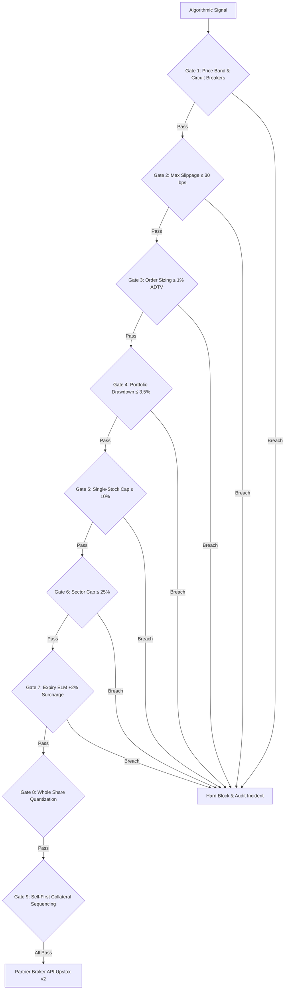

# Policy & Standard Operating Procedure (SOP): Client-Facing Algorithmic Trading
## FintekPro Portal — Extension of Algorithmic Trading to Platform Users

**Document Code**: `FINTEK-POL-CLI-ALGO-2026-01`  
**Standard Version**: POL-CLI-ALGO-1.1.0  
**Effective Date**: November 2026  
**Operating Entity**: FintekPro Portal / Multi-Tenant SaaS Platform  
**Target Beneficiaries**: Retail Investors, Affluent Clients, SEBI-Registered Investment Advisers (RIAs), and SEBI-Registered Portfolio Managers (PMS)  
**Account Classification**: `CLI` (Client Segregated Brokerage & Demat Accounts)  
**Governing Authorities**: Securities and Exchange Board of India (SEBI), National Stock Exchange of India (NSE), Bombay Stock Exchange (BSE), and CERT-In  
**Statutory Frameworks**:
1. SEBI (Investment Advisers) Regulations, 2013 (Regulation 15, 17, 19, 22 — Non-Discretionary Fiduciary Mandate & Segregation of Advisory/Distribution)
2. SEBI (Portfolio Managers) Regulations, 2020 (Regulation 22, 23 — Discretionary Systematic Mandate $\ge$ ₹50 Lakhs)
3. SEBI Circular SEBI/HO/MIRSD/MIRSD-PoD-1/P/CIR/2024/114 (Prohibition on Association with Persons Making Return/Performance Claims)
4. SEBI Master Circular on Algorithmic Trading & Stock Broker APIs (Direct-to-Consumer / Retail Algorithmic Framework)
5. SEBI Anti-Pooling Circular SEBI/HO/MIRSD/DOP/CIR/P/2021/637 (Client Asset Segregation)
6. FintekPro Global Coding Rules (GCR v1.0) & FASP-AI v3.1-ALGO Engine

---

## 1. Statutory Scope & Statement of Purpose

This Policy and Standard Operating Procedure defines the statutory boundaries, client authorization requirements, risk management architecture, and compliance workflows governing the **extension of algorithmic trading, automated rebalancing, and quantitative execution facilities to users of the FintekPro Portal**.

The FintekPro platform operates as a high-integrity technology intermediary and decision support infrastructure. All algorithmic facilities extended to clients are strictly segmented based on client classification and statutory authorization.

---

## 2. Core Legal & Regulatory Invariants

### 2.1 Complete Anti-Pooling & Segregated Demat Execution
In strict compliance with SEBI circulars on client fund segregation:
- **No Client Fund/Security Custody**: FintekPro **never holds, pools, deposits, or routes client funds or securities** through LLP or platform accounts.
- **Direct Broker Routing**: Every algorithmic trade executes directly in the client's own segregated trading and demat account with an exchange-cleared partner broker (e.g. Upstox API v2) via client-authenticated OAuth sessions.

### 2.2 Fiduciary Non-Delegation Principle
- Per SEBI AI/ML and Algorithmic Trading guidelines, the registered intermediary (RIA, Portfolio Manager, or Research Analyst) retains **100% legal, fiduciary, and financial responsibility** for all algorithmic advice and execution.
- Responsibility cannot be waived, disclaimed, or shifted to algorithms, machine learning models, or third-party API providers.

### 2.3 Strict Segregation of Advisory & Distribution (SEBI IA Reg 22)
- Where algorithmic rebalancing advice is rendered to an investor under an Investment Advisory agreement, **neither FintekPro nor the partner RIA shall receive any brokerage commission, trail rebate, or volume-based incentive** from the executing partner broker.
- Client execution is configured on pure direct/zero-brokerage-sharing API endpoints.

---

## 3. Dual-Track Execution Architecture

FintekPro enforces two mutually exclusive algorithmic execution tracks based on client net worth and statutory agreement:

```
┌─────────────────────────────────────────────────────────────────────────────────────────────┐
│                          FintekPro Client Algorithmic Mandate Matrix                        │
└─────────────────────────────────────────────────────────────────────────────────────────────┘
  Track           Statutory Scope        Execution Model               Authorization Gate
  ──────────────  ─────────────────────  ────────────────────────────  ────────────────────────
  Track A:        Retail & Affluent      Non-Discretionary             1-Click Biometric / TOTP
  Retail / RIA    (< ₹50 Lakhs)          Client-Confirmed Rebalance    Mandatory (15-min TTL)
  ──────────────  ─────────────────────  ────────────────────────────  ────────────────────────
  Track B:        HNI / UHNI PMS & AIF   Discretionary Systematic      15-Minute Background
  PMS / Discret.  (≥ ₹50 Lakhs / ₹1 Cr)  Automated Batch Sweeps        Automated RMS Sweep
```

### 3.1 Track A: Retail & RIA Accounts (< ₹50 Lakhs) — Non-Discretionary Smart Mandate
1. **Statutory Requirement**: SEBI (Investment Advisers) Regulations, 2013 mandate that RIAs cannot execute trades on a discretionary basis on behalf of retail investors.
2. **Operational Workflow**:
   - The algorithmic engine continuously monitors model portfolio tracking error, covariance drift, and macro regimes.
   - When drift warrants rebalancing, the engine constructs an immutable **Pre-Trade RMS Pack**.
   - The client receives an instantaneous Push Notification / WhatsApp Dossier with an explainability breakdown (rebalance rationale, proposed trims/adds, estimated taxes, and STT).
   - **Mandatory Authorization Gate**: No order is dispatched until the client completes explicit **1-Click Biometric Confirmation (FaceID/Fingerprint)** or **TOTP / "Slide to Execute"** on their mobile/web device.
3. **Strict Authorization TTL (Time-To-Live)**:
   - Client authorization carries a **strict 15-minute Time-To-Live (TTL)** or expires at the close of that trading session (15:30 IST), whichever is earlier.
   - If market liquidity prevents order fulfillment within the TTL, unfilled legs are cancelled. **No multi-day or rolling authorization is permissible**; fresh client consent must be obtained for subsequent execution sessions.

### 3.2 Track B: Discretionary Portfolio Management Services (PMS $\ge$ ₹50 Lakhs)
1. **Statutory Requirement**: SEBI (Portfolio Managers) Regulations, 2020 permit discretionary automated rebalancing only for clients who have executed a formal Portfolio Management Agreement (PMA) with a verified minimum commitment of **₹50 Lakhs**.
2. **Operational Workflow**:
   - Portfolios are evaluated on a **15-minute background sweep cycle** by the system scheduler.
   - When drift exceeds statutory thresholds (**> 3.00% for Debt, > 5.00% for Equity**), rebalancing orders are automatically generated and dispatched via the partner broker gateway.
   - The designated Portfolio Manager and Compliance Officer maintain real-time supervisory dashboards with the capability to pause or override sweeps at any instant.

---

## 4. Broker OAuth Token Lifespan & Daily Authentication

In accordance with SEBI/Exchange Broker API Security Directives:
1. **Zero Permanent Password/Token Storage**: FintekPro never stores unencrypted client broker passwords, PINs, or perpetual API credentials.
2. **Mandatory Daily Token Expiration**: All client OAuth tokens (e.g. Upstox API v2 access tokens) automatically expire at the end of each trading session (15:30 IST).
3. **Morning 2FA Re-Authentication**: Clients desiring active algorithmic rebalancing sweeps must re-authorize their broker session each trading day via mandatory two-factor authentication (TOTP/Biometric). No automated trade can fire on an unauthenticated or expired token.

---

## 5. Client Suitability & Mandatory Risk Profiling

1. **Prerequisite Risk Profile Assessment**:
   - No user may enable algorithmic trading without completing an approved SEBI-compliant **Investor Risk Profile (IRP)** within the prior 12 months.
2. **Risk Category Mapping**:
   - **Conservative**: Restricted strictly to Arbitrage, Sovereign Green/Gold Bonds, and Liquid ETF rebalancing. Derivative strategies are hard-locked.
   - **Moderate**: Permitted Long-Only Canonical Model Portfolios (Large-cap / Multi-cap) with whole share quantization.
   - **Aggressive**: Permitted Multi-Leg Hedged Option Strategies (Bull Call Spreads, Bear Put Spreads, Iron Condors). Naked short option strategies are **strictly prohibited across all risk tiers**.

---

## 6. The 9-Gate Client Pre-Trade Risk Management System (RMS)

Every order dispatched through the FintekPro portal on behalf of any client must clear 9 automated pre-trade risk gates:



1. **Price Bands & Circuit Breakers**: Blocks trades if a constituent is within 0.5% of Upper or Lower Circuit.
2. **Dynamic Slippage & Adaptive Limit Orders**: Capped at **30 bps (0.30%)**. Zero naked market orders.
3. **Liquidity Ceilings**: Order size $\le 1.0\%$ of 30-day ADTV; larger orders are sliced via TWAP/VWAP.
4. **Portfolio Drawdown Circuit Breaker**: Auto-halts trading if portfolio intraday drawdown hits **3.50%**.
5. **Single-Stock Cap**: Constituent weight cannot exceed **10.00%** post-rebalance.
6. **Sector Concentration Cap**: Single sector exposure cannot exceed **25.00%**.
7. **Derivative Margin & ELM Surcharge**: Enforces +2% Extreme Loss Margin (ELM) surcharge on expiry days; hard-blocks naked options.
8. **Integer Share Quantization**: Indian exchange fractional share avoidance; sizes are quantized down to integer units, routing fractional residuals to liquid cash drag.
9. **Collateral Sequencing**: Phase 1 **SELL/TRIM** legs execute first to release collateral before Phase 2 **BUY/ADD** legs execute, preventing margin shortfall penalties.

---

## 7. Market-Wide Circuit Breakers (MWCB) Protocol

Under SEBI Master Circulars on nationwide Index-Based Circuit Breakers:
1. **Automated Exchange Status Listener**: The platform continuously listens to exchange market status broadcasts (`NORMAL`, `PRE_OPEN`, `HALTED`).
2. **Instant Freeze on 10%, 15%, 20% Index Halts**:
   - If Nifty 50 or Sensex triggers a nationwide circuit breaker halt, the system immediately cancels all active, unfilled limit orders across all client accounts in $< 500\text{ ms}$.
   - All background rebalancing sweeps are paused until the exchange officially resumes normal trading.

---

## 8. Client Voluntary Kill-Switch & Regulatory Cooling-Off Lock

1. **In-App Client Kill Switch**:
   - Available on all client touchpoints via 1-tap "Pause Algo Trading".
2. **Voluntary Segment Kill-Switch (SEBI Benchmark)**:
   - Clients may voluntary halt derivative and algorithmic trading via `POST /api/derivatives/kill-switch`.
   - **12-Hour Immutable Cooling-Off Period**: Activation triggers a mandatory 12-hour freeze during which incoming trade submissions are rejected with `USER_KILL_SWITCH_ACTIVE`. The cooling-off period cannot be overridden by customer support or portal agents until 12 hours have elapsed.

---

## 9. Algorithmic Error Trade Resolution & Indemnity Policy

Under SEBI inspection standards, **clients cannot bear financial losses arising from platform software defects, algorithmic glitches, or API communication anomalies**:
1. **Corporate Error Account**: FintekPro maintains a dedicated **Corporate Settlement & Error Account** with the partner clearing broker.
2. **Erroneous Trade Resolution**:
   - If a technical glitch results in an unintended, unauthorized, or duplicate execution in a client's account, the position is immediately transferred or squared off against the Corporate Error Account.
   - **Client Hold Harmless Guarantee**: Any financial loss arising from such errors is borne 100% by the platform; any inadvertent profit is credited to the statutory Investor Protection Fund (IPF) as mandated by SEBI.

---

## 10. Compliance with SEBI October 2024 Circular on Unregulated Platforms

In strict adherence to SEBI Circular `SEBI/HO/MIRSD/MIRSD-PoD-1/P/CIR/2024/114`:
1. **Ban on Association with Unregulated Entities**: FintekPro does not ingest signals, integrate APIs, or share platform infrastructure with any third-party "algo vendors", social media trading channels, or unregistered finfluencers.
2. **Zero Return Claims & Ban on Gamification**:
   - No leaderboard, win-rate percentage, or deterministic profit projections may be displayed to retail users.
   - Simulated backtests cannot be presented as anticipated performance.
3. **Mandatory Statutory Risk Warning**:
   > *"Algorithmic execution is a technology facility subject to latency, market volatility, and exchange connectivity risks. No return or profit guarantee is provided. Past performance does not assure future results."*

---

## 11. Immutable Audit Trail & Regulatory Reporting (WORM Retention)

- Every algorithmic lifecycle event (signal generation, suitability check, client OTP verification, broker payload, and execution fill) is logged with atomic millisecond timestamps ($\pm 50\text{ ms}$) synchronized with National Physical Laboratory (NPL) / NIC NTP servers.
- Logs are stored in immutable WORM tables (`model_portfolio_transactions`, `portfolio_ai_decisions`, `order_lifecycle_events`) and retained for **7 years** pursuant to SEBI regulations and CERT-In cyber incident directions.
