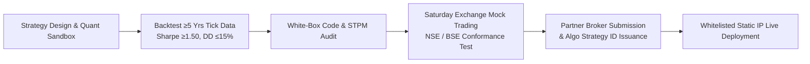

# Policy & Standard Operating Procedure (SOP): Proprietary Algorithmic Trading (Self-Account)
## FintekPro Financial Services LLP — Proprietary Trading Desk

**Document Code**: `FINTEK-POL-PRO-ALGO-2026-01`  
**Standard Version**: POL-PRO-ALGO-1.1.0  
**Effective Date**: November 2026  
**Operating Entity**: FintekPro Financial Services LLP ("LLP" / "Proprietary Desk")  
**Account Classification**: `PRO` (Proprietary Account)  
**Governing Authorities**: Securities and Exchange Board of India (SEBI), National Stock Exchange of India (NSE), Bombay Stock Exchange (BSE), and CERT-In  
**Statutory Frameworks**:
1. SEBI Circular CIR/MRD/DP/09/2012 (Framework for Algorithmic Trading in Indian Securities Market)
2. SEBI Master Circular on Algorithmic Trading & Stock Broker Proprietary Trading Facilities
3. SEBI (Prohibition of Insider Trading - PIT) Regulations, 2015 (Regulations 3(5), 3(6) & Structured Digital Database)
4. SEBI (Prohibition of Fraudulent and Unfair Trade Practices - PFUTP) Regulations, 2003 (Self-Trade / Wash-Trade Prevention)
5. Exchange Order-to-Trade Ratio (OTR) Penalty Framework (NSE/BSE)
6. CERT-In Cyber Security Directions & NPL/NIC Time Synchronization Standard

---

## 1. Statutory Scope & Purpose

This Policy and Standard Operating Procedure governs the design, pre-trade risk controls, deployment, and statutory reporting of all **automated, semi-automated, quantitative, and algorithmic trading operations executed on the self-account (balance sheet capital) of FintekPro Financial Services LLP**.

Proprietary algorithmic trading is carried out exclusively through designated `PRO` trading accounts maintained with registered clearing members and partner brokers (e.g. Upstox Pro API v2 / Institutional Broking Desks).

---

## 2. Information Barrier, Anti-Front-Running & Insider Trading Controls (Chinese Wall)

### 2.1 Complete Architectural Separation
Under SEBI PFUTP Regulations and SEBI IA/PMS Regulations, FintekPro Financial Services LLP maintains an impenetrable **Information Barrier ("Chinese Wall")** between the Proprietary Desk and the client-facing FintekPro Advisory Portal:

```
┌────────────────────────────────────────────────────────────────────────────────────────┐
│                        FintekPro Architectural Chinese Wall Matrix                     │
└────────────────────────────────────────────────────────────────────────────────────────┘
       PROPRIETARY DESK (LLP Balance Sheet)          CLIENT ADVISORY PORTAL (Portal Users)
  ─────────────────────────────────────────────  ─────────────────────────────────────────────
  Entity: FintekPro Financial Services LLP       Entity: FintekPro Multi-Tenant SaaS / RIA / PMS
  Account: `PRO` Designated Broker Account        Account: Segregated Client Demat (`CLI`)
  Capital: Own Balance Sheet Capital Only        Capital: 100% Client-Owned Funds (No Pooling)
  Data: Exchange Market Feeds (Tick / Level 2)   Data: User Risk Profiles, Advisory Portfolios
  Database: Isolated PRO Database Schema         Database: Client Multi-Tenant Schema
  Infrastructure: Dedicated PRO Server/VPC       Infrastructure: Public Portal App Cloud Run VPC
  ─────────────────────────────────────────────  ─────────────────────────────────────────────
```

### 2.2 Strict Prohibition of Front-Running and Order Ingestion
1. **Zero Access to Client Order Flow**: Proprietary algorithms are strictly forbidden from accessing, reading, subscribing to, or ingesting:
   - Client model portfolio rebalancing queues.
   - Client pending order dispatches or advisory recommendations.
   - Client trade blotters or order execution responses.
2. **Restricted Security Watchlist & Grey List**:
   - If an RIA, Research Analyst, or quantitative engine on the FintekPro portal issues a material rebalance, research report, or "Pick of the Day" signal, the underlying security is automatically added to the LLP Proprietary **Restricted Security Watchlist** for a mandatory freeze window of $\ge 24\text{ hours}$.
   - The PRO desk is hard-blocked from initiating any pre-emptive directional position that could front-run client transactions.

### 2.3 Structured Digital Database (SDD) & PIT Regs Compliance
In adherence to Regulation 3(5) & 3(6) of SEBI (Prohibition of Insider Trading) Regulations, 2015:
- An automated, immutable **Structured Digital Database (SDD)** records all instances where Unpublished Price Sensitive Information (UPSI) is shared or handled internally.
- Any symbol logged into the SDD automatically activates a **Proprietary Trading Window Closure** for that symbol.
- Designated Persons and Partners of the LLP must obtain pre-clearance from the Compliance Officer before manually trading any security on the Restricted List.

---

## 3. Proprietary Pre-Trade Risk Management System (RMS)

All proprietary algorithms executing on behalf of FintekPro Financial Services LLP must pass 7 automated pre-trade risk controls before dispatch to the exchange:

### 3.1 Self-Trade Prevention Mechanism (STPM) — Anti-Wash Trade Gate
Under SEBI PFUTP Regulations and Exchange Circulars on synchronized trading:
1. **Pre-Trade Match Check**: Before any proprietary order is routed to the broker API, the STPM engine inspects all active, unfilled orders placed by the LLP across all strategies for the same symbol.
2. **Cancellation / Rejection Action**: If the new order is a BUY (or SELL) that would cross or match with an active resting SELL (or BUY) order from the LLP at the same or intersecting price, the STPM daemon automatically cancels the resting passive order prior to dispatching the new aggressive leg, or rejects the new leg outright.
3. Under no circumstances may an algorithmic order result in an internal crossing where buyer PAN equals seller PAN.

### 3.2 Capital Allocation, Value-at-Risk (VaR) & MTM Loss Ceilings
1. **Balance Sheet Cap**: Total capital committed to active algorithmic strategies cannot exceed the Board/Designated Partner-approved capital ceiling:
   $$\text{Active PRO Exposure} \le \text{Allocated Proprietary Capital Reserve}$$
2. **Value-at-Risk (VaR) Limit**: Daily 99% 1-day parametric VaR across all open proprietary strategies must remain within **2.0% of allocated proprietary net worth**.
3. **Daily Loss Limit (Intraday MTM)**:
   - **Soft Warning (2.0% MTM Loss)**: Alerts Compliance and Designated Partners; strategy halts new aggressive position-building.
   - **Hard Freeze (2.5% MTM Loss)**: All new order submissions across all proprietary strategies are frozen immediately.
   - **Mandatory Liquidation (4.0% MTM Loss)**: The automated risk daemon triggers an immediate, non-discretionary square-off of all open intraday positions and suspends trading for the remainder of the session.

### 3.3 Order-to-Trade Ratio (OTR) Management
To avoid punitive exchange charges under NSE/BSE circulars:
- Every proprietary algo strategy must maintain an **Order-to-Trade Ratio (OTR) $\le 50:1$** within any 15-minute rolling window.
- If the strategy's OTR exceeds $40:1$, an internal rate-limiter daemon throttles order modification and cancellation rates to maintain compliance beneath exchange penalty slabs.

### 3.4 Strict Price Band & Fat-Finger Prevention
- **Price Band Guard**: No order may be dispatched at a price deviating more than **1.0%** from the Last Traded Price (LTP).
- **Hard Single-Order Rupee Cap**: Maximum single-order value is hard-capped at **₹15,00,000** for equity cash and **₹25,00,000** for index derivative contracts, unless overridden with dual-partner cryptographic authorization.

---

## 4. Algorithm Lifecycle, Mock Trading & Exchange Approval

Before any algorithmic strategy is deployed live on the LLP's `PRO` account:



1. **Backtesting & Simulation Rigor**:
   - Minimum **5 years of out-of-sample historical tick data** across multiple market regimes (bull, bear, sideways, high-volatility).
   - Maximum allowable backtested drawdown: $\le 15\%$.
   - Sharpe Ratio $\ge 1.50$ (net of all exchange transaction fees, STT, stamp duty, and estimated 30 bps slippage).
2. **Strategy Code White-Box Audit**:
   - Source code must be reviewed by the Lead Quantitative Strategist and verified for deterministic execution, mathematical integrity (no synthetic formula bypasses), and memory leak prevention.
3. **Mandatory Saturday Exchange Mock Trading Conformance**:
   - In accordance with SEBI Circular CIR/MRD/DP/09/2012, no strategy may be deployed live until it has successfully participated in at least **one full Saturday Mock Trading Session** organized by NSE/BSE.
   - The strategy must demonstrate zero unhandled exceptions, correct rate-limiting, error recovery, and proper response to synthetic exchange circuit halts.
4. **Exchange Algorithmic Registration (Algo ID) & Static IP Binding**:
   - Every algorithm must be documented with its technical flowchart, logic specification, and mock test logs, and registered with the clearing broker / exchange to receive an authorized **Exchange Strategy / Algo ID**.
   - All live algorithmic dispatches must originate strictly from **exchange-registered, whitelisted static IP addresses** hosted in secure Indian data center facilities.

---

## 5. Proprietary Multi-Level Emergency Kill-Switch

FintekPro Financial Services LLP maintains a multi-level kill-switch hierarchy:

```
┌────────────────────────────────────────────────────────────────────────────────────────┐
│                        Proprietary Algo Kill-Switch Hierarchy                          │
└────────────────────────────────────────────────────────────────────────────────────────┘
  Level 1: Strategy-Level Auto-Halt (MTM Loss > 2.0% or 3 consecutive API timeouts)
    └── Level 2: Risk Officer Manual Override (Dedicated Desk Dashboard Button)
          └── Level 3: Broker-Level Hard API Token Revocation & Direct Terminal Halt
```

1. **Automated Algorithmic Disconnect**:
   - Strategy halts immediately upon detecting network packet loss $> 500\text{ ms}$, market feed desynchronization, or heartbeat timeout.
2. **Designated Partner Emergency Halt**:
   - Available via internal admin controls and secure CLI webhook. Calling `/api/pro-trading/kill-switch` cancels all unexecuted limit orders across all symbols in $< 300\text{ ms}$.
3. **Direct Broker Terminal Override**:
   - The LLP keeps a live, authenticated NEST/NOW/Upstox Pro broker terminal active at the trading desk, allowing manual one-key square-off if API gateways fail.

---

## 6. Audit Trail, Logging & Statutory System Audits

1. **Millisecond NPL/NIC Timestamping**:
   - Every algorithmic tick, internal signal generation, order request, modification, cancellation, and execution fill is stamped with UTC/IST time accurate to $\pm 10\text{ ms}$ synchronized with National Physical Laboratory (NPL) / National Informatics Centre (NIC) NTP time sources.
2. **7-Year WORM Retention**:
   - Trade logs, parameter configuration snapshots, and execution logs must be stored in Write-Once-Read-Many (WORM) compliant storage for **7 years** pursuant to SEBI Regulation 16 and CERT-In directions.
3. **Annual CISA/DISA System Audit**:
   - An independent audit of all proprietary algorithmic code, RMS servers, STPM mechanisms, and security logs is performed annually by a CERT-In / CISA-certified auditor, and submitted to the stock exchanges as required by regulatory circulars.
