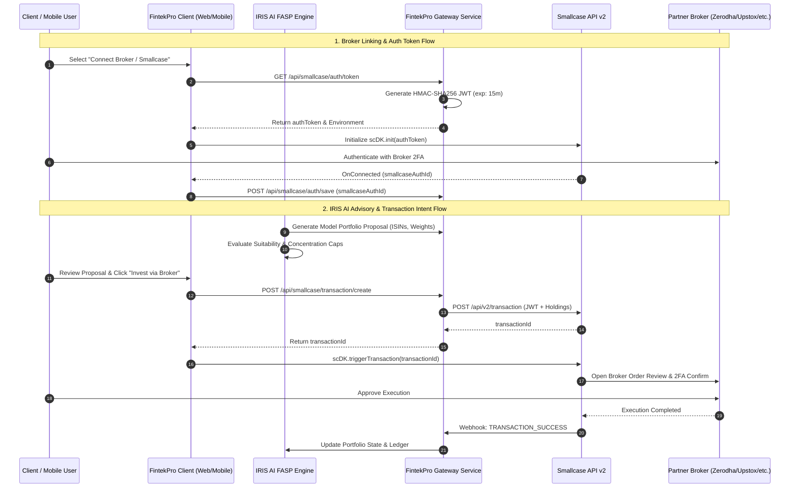

# FintekPro Policy & Standard Operating Procedure: Smallcase Gateway & Publisher Platform Governance (POL-SOP-SC-2026-01)

**Document Code**: `POL-SOP-SC-2026-01`  
**Governing Standard**: FintekPro FASP-AI v1.0 & GCR v1.0  
**Effective Date**: November 2026  
**Formulated & Monitored By**: **IRIS AI Compliance & Advisory Copilot** (FintekPro Advisory Support Platform / FASP-AI v1.0)  
**Governing Authorities**: 
- Securities and Exchange Board of India (SEBI) — IA Regulations 2013, RA Regulations 2014, CSCRF (Cybersecurity and Cyber Resilience Framework), Circular on AI/ML in Securities Markets
- Reserve Bank of India (RBI) — Digital Lending Guidelines & Demat Loan Against Securities (LAS) Regulations
- Ministry of Electronics and Information Technology (MeitY) — Digital Personal Data Protection (DPDP) Act 2023
- Indian Computer Emergency Response Team (CERT-In) — Cyber Security Directions 2022

**Target Desks**: Smallcase Gateway Desk, IRIS RTA Desk, RIA Advisory Desk, Research Analyst (RA) Desk, Engineering & DevOps Desk

---

## 1. Executive Summary & Statutory Scope

This document sets forth the comprehensive technical evaluation of **Smallcase Technologies Private Limited** API infrastructure and formalizes the **Statutory Policy and Standard Operating Procedure (SOP)** governing its integration into the **FintekPro** multi-asset wealth platform.

Formulated under the supervision of **IRIS AI**—FintekPro’s institutional advisory intelligence and regulatory gatekeeper—this policy operationalizes:
1. **Smallcase Gateway**: Non-custodial multi-broker equity/ETF transaction routing, Demat holdings aggregation, and Loan Against Securities (LAS) pledge flows across 16+ Indian brokerage houses.
2. **Smallcase Publisher**: Model portfolio creation, quantitative research distribution, subscription fee management, and systematic rebalance publishing for SEBI-registered RIAs and RAs.
3. **FASP-AI v1.0 Fiduciary Boundaries**: Strict enforcement of non-autonomous order generation, mandatory human advisor review, and multi-factor client consent.

---

## 2. Smallcase API Capabilities Matrix

Smallcase provides an institutional B2B infrastructure suite dividing into **Smallcase Gateway** (Transaction & Aggregation) and **Smallcase Publisher** (Advisory & Curation):

```
┌─────────────────────────────────────────────────────────────────────────────────────────────────┐
│                                   SMALLCASE PLATFORM SUITE                                      │
├────────────────────────────────────────────────┬────────────────────────────────────────────────┤
│             1. SMALLCASE GATEWAY               │             2. SMALLCASE PUBLISHER             │
│   (Embedded Execution, Holdings, Demat LAS)   │        (Research, Baskets, Subscriptions)       │
├────────────────────────────────────────────────┼────────────────────────────────────────────────┤
│ • Multi-Broker Connect (16+ Brokers)           │ • Model Portfolio Creation & Weighting         │
│ • Custom Basket Transactions (SECURITIES)      │ • Backtesting Engine vs Nifty 50/500           │
│ • Single Stock / ETF Order Routing             │ • Systematic Rebalancing Engine                │
│ • Demat Holdings Import & Consolidated PnL    │ • Automated Factsheet & Risk Profiling         │
│ • Demat Loan Against Securities (LAS / LAMF)   │ • Subscription Fee Billing & Invoicing (SEBI)  │
│ • Systematic Investment Plans (SIP) on Baskets │ • Client Communication & Disclosure Archival   │
│ • Real-time Webhook & Postback Events          │ • Regulatory Audit Trail & Performance Reports │
└────────────────────────────────────────────────┴────────────────────────────────────────────────┘
```

### 2.1 Detailed Gateway Capabilities

| Capability Module | Protocol / Endpoint | Functional Scope & Supported Brokers |
| :--- | :--- | :--- |
| **Authentication & Session** | `GET /api/v2/auth/token` | Generates short-lived (15 min) HMAC-SHA256 JWT tokens. Supports **Connected Users** (`sub = smallcaseAuthId`) and **Guest Users** (anonymous lead onboarding). |
| **Broker Ecosystem** | Gateway SDK Overlay | Direct integration with 16+ brokers: Zerodha Kite, Upstox, Angel One, Groww, ICICI Direct, HDFC Sky, Kotak Securities, 5paisa, Axis Direct, Motilal Oswal, Dhan, Paytm Money, Alice Blue, IIFL Securities, Trustline. |
| **Transaction Engine** | `POST /api/v2/transaction` | Server-initiated transaction intent (`intent: "TRANSACTION"`). Generates `transactionId` executed via client SDK. Supports market, limit, AMO orders, and multi-leg baskets. |
| **Holdings Import** | `POST /api/v2/holdings/import` | Non-custodial pull of user demat holdings (ISIN, quantity, average price, broker ID). Enables unified portfolio analytics alongside IRIS Mutual Fund CAS. |
| **Smallcase LAS / Lending** | `POST /api/v2/lending/pledge` | Digital Demat collateral pledge with partner NBFCs (e.g. Smallcase Capital) under RBI Master Directions (max 50% LTV for equity, 75% for liquid ETFs). |
| **Systematic Investment** | `POST /api/v2/sip/create` | Programmatic SIP mandate scheduling for stock baskets, notifying users on SIP trigger dates for one-click broker execution. |
| **Webhooks & Postbacks** | HTTPS POST with HMAC sign | Real-time event notifications: `TRANSACTION_SUCCESS`, `TRANSACTION_FAILED`, `HOLDINGS_IMPORTED`, `PLEDGE_CONFIRMED`, `REBALANCE_COMPLETED`. |

### 2.2 Detailed Publisher Capabilities

| Capability Module | Regulatory Alignment | Functional Scope |
| :--- | :--- | :--- |
| **Model Basket Creation** | SEBI RA/IA Guidelines | Define equity & ETF universes, constituent weights (Market-cap, Equal, Quantitative custom), liquidity filters, and rebalance cadences (monthly, quarterly, ad-hoc). |
| **Historical Backtesting** | SEBI Performance Benchmark | Simulates backtested performance against Nifty 50, Nifty 500, and sector indices with dividend adjustments, slippage modeling, and turnover ratio metrics. |
| **Rebalance Engine** | Fiduciary Duty to Clients | RIA initiates portfolio update; Smallcase Publisher generates differential buy/sell legs and notifies subscribed investors for 1-click execution. |
| **Regulatory Archival** | SEBI 7-Year Retention Rule | Immutable archival of research reports, rationale dossiers, factsheets, rebalancing notices, and client advisory consent records. |
| **Fee Collection Gate** | SEBI IA Fee Cap Circular | Automated collection of fixed/AUA advisory fees with GST-compliant invoicing, preventing fee collection beyond statutory limits. |

### 2.3 Smallcase Global & Offshore Investing Capabilities (GIFT City IFSCA & RBI LRS)

With Smallcase expanding its architecture to **Global / Offshore Investing**, Indian investors can now access curated US-listed equities and global ETFs:

| Offshore Capability Module | Regulatory Architecture | Functional Scope & Execution Pathway |
| :--- | :--- | :--- |
| **Global Thematic Baskets** | IFSCA / SEBI Advisory | Curated portfolios in US equities (AI Infrastructure, Mega-Cap Tech, Energy Transition, Global All-Weather Macro) with systematic risk ratings. |
| **Fractional Share Execution** | IFSCA Global Access Provider | Low minimum investment thresholds (starting at **$50 USD**), enabling fractional share acquisition (e.g., 0.15 shares of high-value US tech stocks). |
| **Cross-Border Remittance Gate** | RBI FEMA LRS Framework | Integrates with Authorized Dealer (AD Category I) banks for automated **Form A2** declarations citing Purpose Code **`S0001`** (Indian portfolio investment abroad). |
| **Dual-Account Segregation** | DPDP & Custody Rules | Distinct segregation between domestic Demat accounts (NSDL/CDSL) and overseas USD custody accounts held at IFSCA-registered / US FINRA/SIPC partner clearing brokers. |
| **Tax & Withholding Layer** | US IRS / Indian IT Act | Automated digital **W-8BEN** tax status validation (25% dividend withholding under US-India DTAA) and Section 206C(1G) TCS tracking. |

---

## 3. Statutory & Fiduciary Compliance Policy

In strict adherence to **FintekPro Global Coding Rules (GCR v1.0)**, **FASP-AI v1.0**, and **SEBI Regulations**:

### 3.1 Non-Autonomous Execution & Zero-Discretion Mandate
1. **Decision Support Only**: IRIS AI and FintekPro quantitative models serve strictly as an advisor decision support system. Under no circumstances shall IRIS AI or Smallcase Gateway autonomously submit, execute, or modify trade orders.
2. **Explicit Client Confirmation**: Every basket order, rebalance, and LAS pledge requires affirmative client confirmation inside the Smallcase Gateway SDK modal, authenticated via the client's own broker credentials (2FA/TOTP/Biometric).
3. **No Discretionary Power of Attorney (PoA)**: Neither FintekPro nor Smallcase holds PoA on client demat accounts. The investor retains sovereign custody at their depository participant (NSDL/CDSL).

### 3.2 Suitability, Risk Profiling & Concentration Limits
1. **IRIS AI Suitability Verification**: Prior to generating a Smallcase transaction intent, IRIS AI computes the client’s risk score ($S \in [1, 100]$) and validates that the basket’s risk tier matches the client's profile.
2. **Diversification & Exposure Caps**:
   - Single equity allocation $\le 15\%$ of total portfolio equity value.
   - Single sector exposure $\le 25\%$ (unless specifically categorized as a thematic/sectoral basket with explicit risk warnings).
   - Illiquid securities filter: Stocks with average daily turnover $< ₹1 \text{ Crore}$ are excluded by default.

### 3.3 Zero-Trust Security & Data Localization (DPDP Act 2023)
1. **Credential Isolation**:
   - `SMALLCASE_GATEWAY_NAME` and `SMALLCASE_SECRET` must reside exclusively in Google Cloud Secret Manager.
   - The Gateway Secret is strictly used on the backend (`server/routes/smallcase-routes.ts`) for HMAC-SHA256 JWT signing. It is never exposed in browser bundles or mobile SDKs.
2. **PII Masking & Data Minimization**:
   - Client PAN, Demat Account numbers, and Broker IDs are masked in all logs (`XXXXXX1234A`).
   - Transaction payloads pass only security ISINs, quantities, and transaction types.

### 3.4 Cross-Border Regulatory & Tax Governance (FEMA LRS & IFSCA)
1. **FEMA Liberalised Remittance Scheme (LRS) Ceiling**:
   - In strict compliance with RBI FEMA Master Directions, overseas investments via Smallcase Global are subject to the **$250,000 USD annual ceiling** per resident individual per financial year.
   - Purpose Code **`S0001`** (Indian portfolio investment abroad in equity shares and bonds) must be cited on all remittance declarations.
2. **Zero-Speculation / Cash-Delivery Mandate**:
   - Under RBI FEMA regulations, remitting funds abroad for margin trading, forex speculation, or offshore Contracts for Difference (CFDs) is strictly **illegal**.
   - Smallcase Global transactions are restricted strictly to **cash delivery and fractional spot equity/ETF acquisition**.
3. **Tax Collected at Source (TCS) Tracking under Section 206C(1G)**:
   - For cumulative overseas remittances exceeding ₹7,00,000 in a financial year, a mandatory **20% TCS** applies.
   - IRIS AI calculates and surfaces indicative TCS liability during order preview before client confirmation.
4. **US IRS Withholding & Double Tax Avoidance (DTAA)**:
   - Automated electronic **Form W-8BEN** validation is required for US-listed asset holding to cap dividend withholding at 25% under the India-US DTAA.
   - Capital gains on overseas assets are taxed in India under Section 112 (Long-term: holding period $\ge 24$ months at 12.5% without indexation; Short-term: slab rates).

---

## 4. IRIS AI Standard Operating Procedures (SOP)



### SOP 1: Client Onboarding & Multi-Broker Linkage
1. **Initiation**: The investor selects "Link Existing Broker" in FintekPro.
2. **Token Minting**: `server/routes/smallcase-routes.ts` generates a guest JWT token signed with `SMALLCASE_SECRET`.
3. **Gateway SDK Overlay**: The client SDK displays the smallcase broker selection modal.
4. **Broker Authentication**: The user logs in to their broker using their own broker credentials and OTP/TOTP.
5. **Auth ID Storage**: Smallcase returns a unique `smallcaseAuthId`. FintekPro encrypts and saves this identifier to `users.default_broker_id` via Drizzle ORM. Subsequent requests use connected user JWTs containing the `sub` claim.

### SOP 2: RIA Model Portfolio Publishing & Rebalancing
1. **Portfolio Formulation**: The SEBI-registered RIA / Research Analyst creates a stock basket using IRIS AI Research Workbench.
2. **Backtesting & Factsheet**: IRIS AI runs quantitative backtests against benchmark indices, generating volatility, Sharpe ratio, max drawdown, and turnover analytics.
3. **Publisher Upload**: The model portfolio is uploaded to Smallcase Publisher with regulatory risk disclosures.
4. **Rebalance Trigger**: When fundamental or macroeconomic shifts necessitate rebalancing:
   - The RIA triggers a rebalance event in the dashboard.
   - Smallcase Publisher broadcasts differential trade notices (buy X shares of A, sell Y shares of B) to subscribed clients.
   - IRIS AI logs the rebalance rationales in the statutory compliance archive.

### SOP 3: Transaction Intent Creation & Pre-Trade Validation
1. **Pre-Trade Compliance Gate**:
   - `transactionComplianceGate.ts` validates that the user's KYC status is verified.
   - IRIS AI verifies the client’s risk tolerance matches the basket risk rating.
2. **Server-Side Intent Generation**:
   - FintekPro server invokes `POST https://gateway.smallcase.com/api/v2/transaction` with the signed JWT.
   - Transaction payload specifies `intent: "TRANSACTION"`, securities legs (`isin`, `quantity`, `action: "BUY"|"SELL"`), and portfolio title.
3. **Client SDK Trigger**:
   - Smallcase API returns a `transactionId`.
   - The frontend passes `transactionId` to `scDK.triggerTransaction()`.
   - The user inspects the order summary, available margin, and confirms via broker 2FA.

### SOP 4: Loan Against Securities (Smallcase Demat LAS)
1. **Collateral Evaluation**:
   - Investor requests liquidity via FintekPro LAS Desk.
   - `smallcaseLasService.checkEligibility(pan, smallcaseAuthId)` fetches eligible demat equities and ETFs across linked brokers.
2. **Haircut & LTV Application**:
   - Equities: Haircut $\ge 50\%$ (Max LTV $50\%$).
   - Liquid ETFs: Haircut $\ge 25\%$ (Max LTV $75\%$).
   - Explainability layer computes:
     $$\text{Max Loan Amount} = \sum_{i=1}^{N} \left( \text{Market Value}_i \times (1 - \text{Haircut}_i) \right)$$
3. **Depository Lien Marking**:
   - `smallcaseLasService.createLendingTransaction()` initiates a `LENDING` transaction intent.
   - The investor e-signs the loan agreement and authorizes an electronic pledge in NSDL/CDSL.
4. **Disbursal**: Upon depository pledge confirmation via webhook, the partner NBFC (Smallcase Capital) disburses funds directly to the investor's verified bank account.

### SOP 5: Webhook Processing, Post-Trade Reconciliation & CAS Sync
1. **Webhook Validation**: All incoming requests to `/api/webhooks/smallcase` must pass cryptographic HMAC signature verification using the gateway webhook secret.
2. **State Updates**:
   - `TRANSACTION_SUCCESS`: FintekPro updates internal order status to `FILLED` and schedules a portfolio refresh.
   - `TRANSACTION_FAILED`: Error code, broker reason, and retry options are logged and surfaced to the user.
3. **Consolidated Portfolio Sync**:
   - The nightly 02:30 AM IST cron (`cron-iris-sync.ts`) reconciles Demat equity holdings from Smallcase alongside Mutual Fund CAS records from KFintech/CAMS IRIS.
   - Discrepancies exceeding $0.01\%$ trigger automated reconciliation alerts to the Operations Desk.

### SOP 6: Incident Management, Circuit Breakers & Fallback Protocols

| Metric / Scenario | Threshold | Automated Circuit Breaker Action | Escalation SLA |
| :--- | :--- | :--- | :--- |
| **API Error Rate** | $\ge 15\%$ failures over 60s | Circuit Breaker trips to `OPEN`. Orders switch to manual review or alternate execution route. | 15 Minutes (NOC Alert) |
| **P99 API Latency** | $> 3,000 \text{ ms}$ | Gateway queries switch to cached holdings; new transaction creation throttled. | 30 Minutes |
| **Broker Outage** | Specific broker failure in SDK | Gateway UI automatically notifies user and offers alternate linked broker or Upstox direct routing. | 1 Hour |
| **Depository Pledge Jam** | Depository timeout $> 4$ hrs | LAS application flagged as `PENDING_DEPOSITORY_CONFIRMATION`; automated retry queue activated. | 2 Hours |

### SOP 7: Global / Offshore Smallcase Execution & FEMA LRS Pre-Flight Gate
1. **Selection & Advisory Review**:
   - Investor selects a curated offshore basket (e.g. "Global AI & Tech Titans", min $100 USD) via `/api/smallcase/offshore/baskets`.
   - IRIS AI verifies investor suitability score ($S \ge 70$ for high-risk offshore equities).
2. **LRS Quota & Compliance Verification**:
   - `transactionComplianceGate.ts` (Gate 5) evaluates the investor's cumulative LRS remittances for the financial year against the statutory $250,000 USD limit.
   - If estimated remittance exceeds remaining quota, the transaction is hard-blocked with remediation instructions.
3. **FEMA Purpose Code & TCS Acknowledgement**:
   - The investor reviews and affirmatively signs the **FEMA LRS Declaration** citing Purpose Code **`S0001`**.
   - Indicative Section 206C(1G) TCS liability (20% above ₹7 Lakh) is displayed alongside estimated USD/INR FX conversion rates.
4. **Gateway Transaction Intent Creation**:
   - `POST /api/smallcase/transaction/create` transmits `market: "GLOBAL_OFFSHORE"`, `currency: "USD"`, and fractional leg quantities (`0.25`, `1.50`).
   - Server returns `transactionId` with FEMA compliance metadata.
5. **Gateway SDK Execution**:
   - Client opens `scDK.triggerTransaction(transactionId)`.
   - The investor confirms execution via their IFSCA/global broker credentials and 2FA.

### SOP 8: Offshore Rebalancing, Currency Drift & Fractional Share Custody
1. **Rebalance Notification**:
   - When a global basket is rebalanced by the RIA, differential order legs are computed in USD.
   - Fractional shares are adjusted seamlessly (no full share rounding required).
2. **FX Buffer & Slippage Management**:
   - Multi-currency orders incorporate a **1.0% FX volatility buffer** to prevent order rejections due to intraday USD/INR currency fluctuation.
3. **Tax & Dividend Withholding Tracking**:
   - Dividends received from US-domiciled equities are automatically logged with 25% US withholding tax under the India-US DTAA.
   - Capital gains are categorized under Section 112 for annual tax filing (holding period $\ge 24$ months for LTCG at 12.5% without indexation).

---

## 5. Audit Logging & Regulatory Disclaimers

### 5.1 Structured Log Standard
Every Smallcase interaction must emit structured JSON logs adhering to GCR v1.0:
```json
{
  "event": "SMALLCASE_TRANSACTION_CREATED",
  "user_id": "usr_94820184",
  "transaction_id": "tx_sc_782910384",
  "intent": "TRANSACTION",
  "holdings_count": 8,
  "model_version": "sc-gateway-v2.0",
  "iris_suitability_score": 84,
  "risk_profile": "MODERATE_AGGRESSIVE",
  "latency_ms": 182,
  "status": "success",
  "timestamp": "2026-11-25T00:27:00.000Z"
}
```

### 5.2 Mandatory Statutory Disclaimers
All client interfaces displaying Smallcase baskets, publisher models, or lending quotes must prominently display:
1. **SEBI Registration Disclaimer**: *"Investment in securities market are subject to market risks. Read all the related documents carefully before investing. FintekPro / IRIS AI provides decision support and analytical tools; final investment execution is performed directly by the client through SEBI-registered brokers."*
2. **No Guaranteed Returns**: *"Past performance of smallcases or model portfolios is not indicative of future returns. Neither FintekPro nor the Research Analyst guarantees any returns or capital protection."*
3. **Borrowing Risk Warning (LAS)**: *"Loan Against Securities involves market volatility risk. In the event of a significant decline in the market value of pledged securities, the lender reserves the statutory right to request margin calls or liquidate pledged securities as per SEBI/RBI regulations."*

---

*Policy Document Certified By*: **IRIS AI Regulatory Governance Engine & FintekPro Compliance Council**  
*Audit Trail Verification Code*: `IRIS-FASP-SC-VERIFIED-2026-Q4`  
*Next Mandatory Review Date*: May 2027
