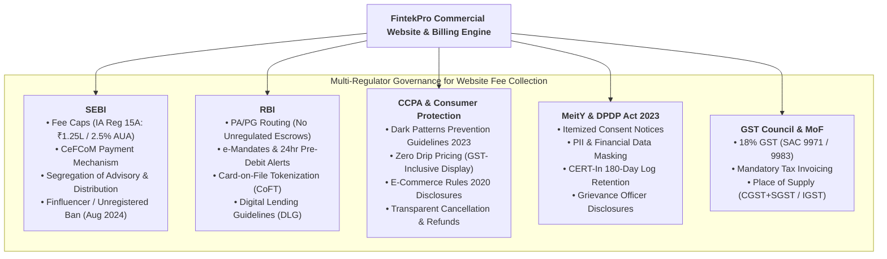
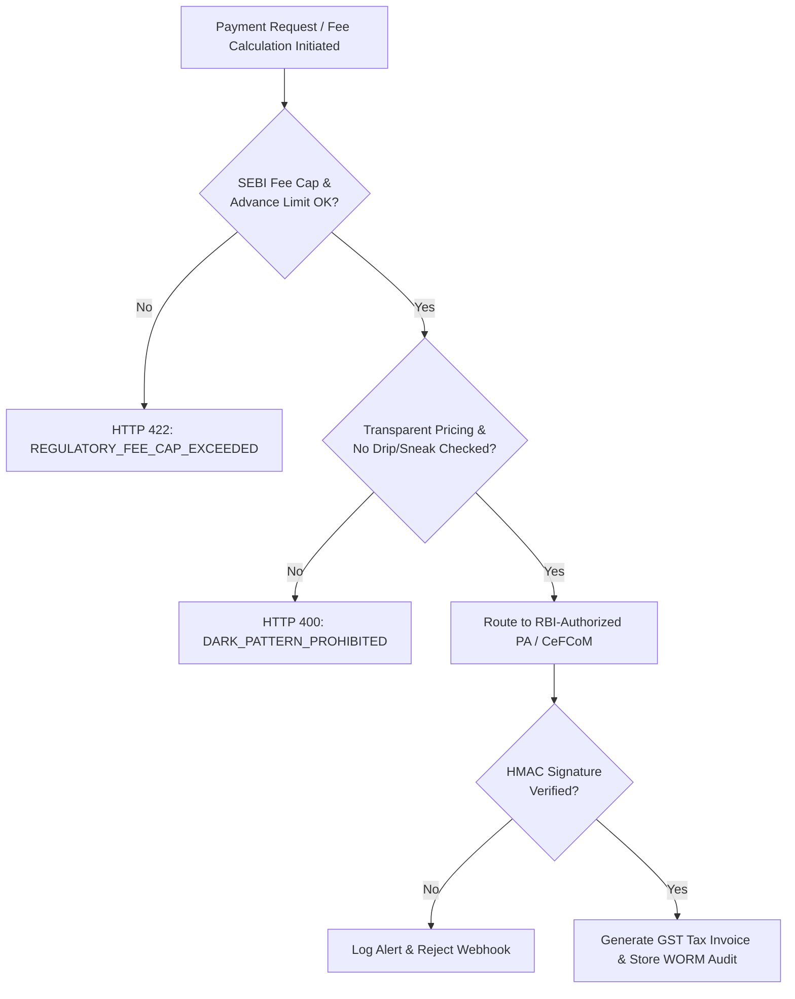

# FintekPro Policy & SOP: Commercial Website Operations, Multi-Regulator Fee Collection & Billing Governance

**Document ID**: FINTEK-POL-SOP-COMM-FEES-2026-01  
**Standard Version**: WFC-1.0.0  
**Effective Date**: November 2026  
**Governing Authority**: FintekPro Legal, Regulatory & Compliance Council  
**Statutory Jurisdiction**: SEBI, RBI, CCPA / Ministry of Consumer Affairs, MeitY / DPDP Act 2023, Ministry of Finance (GST Council), CERT-In, IRDAI, PFRDA  
**Enforcement Mandate**: **100% Perpetual Adherence — Strictly Zero Exception**

---

## 1. Executive Summary & Policy Mandate

FintekPro operates commercial websites, client-facing web portals, advisor consoles, and APIs that facilitate financial software subscriptions, analytics tools, and access to SEBI-regulated advisory and transaction capabilities.

This Policy and Standard Operating Procedure (SOP) governs all commercial fee collection, user billing, checkout workflows, subscription lifecycles, and public business website disclosures across FintekPro. 

**Zero-Exception Mandate**:
Any deviation, circumvention, hidden surcharge, unapproved fee model, unmasked financial identifier, or non-compliant affiliate referral is a **Class-1 Regulatory Violation** requiring immediate service isolation, executive reporting, and rectification within 6 hours.

---

## 2. Multi-Regulator Statutory Framework

### 2.1 SEBI (Securities and Exchange Board of India)
1. **Advisory Fee Caps (SEBI IA Regulations 2013, Regulation 15A & Master Circulars)**:
   - **Fixed Fee Cap**: Maximum ₹1,25,000 per annum per client family across all schemes.
   - **AUA-based Cap**: Maximum 2.5% of Assets Under Advice (AUA) per annum per client family.
   - **Advance Collection Limit**: Maximum 2 quarters (6 months) in advance. Advance fee collection beyond 6 months is strictly prohibited.
2. **Centralized Fee Collection Mechanism (CeFCoM - SEBI Circular Sept 13, 2024)**:
   - Registered Investment Advisers (RIAs) and Research Analysts (RAs) must offer clients the option to pay advisory and research fees through the CeFCoM platform co-administered by BSE Administration & Supervision Ltd (BASL) and MF Utilities (MFU).
   - Traceable banking channels only: Net Banking, UPI / UPI Autopay, Debit/Credit Cards via authorized gateways, and eNACH. Cash payments are illegal.
3. **Segregation of Advisory and Execution (Regulation 22)**:
   - Advisory clients paying advisory fees cannot be charged distribution commissions or brokerages on the same asset. The platform strictly enforces Direct Plans for advisory clients.
4. **Finfluencer & Unregistered Intermediary Ban (SEBI Amendments August 2024)**:
   - The platform, its regulated partners, and business websites are **strictly prohibited** from paying referral fees, sharing revenue, or commercially associating with unregistered individuals/entities who provide stock tips, financial advice, or performance/return claims.

### 2.2 RBI (Reserve Bank of India)
1. **Payment Aggregator / Payment Gateway (PA/PG) Directions**:
   - All client fee collections must route strictly through RBI-authorized Payment Aggregators (Razorpay, Cashfree, BillDesk, etc.).
   - FintekPro must never maintain unlicensed pool, escrow, or transit bank accounts collecting public funds.
2. **e-Mandates & Recurring Billing Guidelines (Section 25 PSSA Act)**:
   - **Additional Factor of Authentication (AFA)**: Mandatory during recurring subscription registration.
   - **Pre-Debit Notification**: Automated SMS and email alerts must be dispatched to the client at least **24 hours prior** to every recurring subscription charge.
   - **Client Cancellation Autonomy**: The client must be provided an instant, self-service dashboard to view, pause, or revoke recurring mandates without requiring manual support tickets.
3. **Card-on-File Tokenization (CoFT)**:
   - Websites, databases, and logs are **strictly forbidden** from storing actual card numbers (16-digit PAN), cardholder names, CVVs, or expiration dates. Only RBI-compliant network tokens and masked cards (`Ending in 1234`) may be held.

### 2.3 CCPA & Ministry of Consumer Affairs (Dark Patterns Prevention 2023)
1. **Zero Drip Pricing**:
   - Prices displayed on pricing pages, feature tables, and landing pages must be transparent. The final payable price (including base rate and 18% GST) must be clearly stated prior to initiating checkout. Adding surprise convenience fees or handling charges at the payment stage is illegal.
2. **Zero Forced Continuity & Sneaking**:
   - Auto-renewals must require explicit, unbundled client opt-in. Pre-checked checkboxes for automatic renewals, insurance add-ons, or priority support tiers are strictly banned.
3. **Consumer Protection (E-Commerce) Rules, 2020 Compliance**:
   - The website footer and checkout pages must prominently display:
     - Legal entity name, Corporate Identity Number (CIN), registered office address, and contact email/phone.
     - Name, email, and designation of the **Grievance Redressal Officer**.
     - Explicit links to Terms of Service, Privacy Policy, and Refund & Cancellation Policy.

### 2.4 MeitY & DPDP Act 2023 / CERT-In Directions
1. **Digital Personal Data Protection Act 2023**:
   - Itemized, bilingual Consent Notice stating data categories collected (identity, financial identifiers, billing history) and exact processing purpose.
   - Right to withdraw consent and right to data erasure upon subscription termination.
2. **CERT-In Cyber Security Directions (April 2022)**:
   - All payment transactions, gateway callbacks, authentication events, and invoice generations must be securely logged with NTP-synchronized IST timestamps and retained for **180 days** within Indian sovereign territory.

### 2.5 Ministry of Finance & GST Guidelines
1. **Applicable GST Rate**: 18% standard GST under SAC 9971 (Financial and related services) or SAC 9983 (Information technology software / SaaS services).
2. **Mandatory Tax Invoicing**: Every successful transaction must automatically generate a digitally signed GST invoice with:
   - FintekPro legal entity name, address, and GSTIN.
   - Client name, state code, and client GSTIN (for B2B/corporate clients).
   - Clear breakdown of Taxable Value, CGST (9%), SGST (9%), or IGST (18%), and Total Amount.

---

## 3. Product & Commercial Fee Classification Matrix

| Category Code | Product / Service Type | Governing Regulatory Regimes | Permissible Fee Structure | Payment Channel Standard |
| :--- | :--- | :--- | :--- | :--- |
| **CAT-SAAS** | FintekPro Terminal SaaS / Wealth Analytics / CA Desk | Contract Act, Consumer Protection 2019, GST SAC 9983 | Monthly / Annual recurring subscription; Tiered user seats | RBI-authorized PA, UPI Autopay with 24-hr pre-debit alert |
| **CAT-RIA** | Investment Advisory Services (Fee-Only) | SEBI IA Reg 2013, CeFCoM Circular 2024, BASL | Capped at ₹1.25L/yr fixed or 2.5% AUA; max 6-mo advance | CeFCoM portal or direct traceable bank transfer / authorized PA |
| **CAT-RA** | Research Analyst Reports / Stock Thematic Dossiers | SEBI RA Reg 2014, CeFCoM Circular 2024 | Flat subscription or per-report fee; No performance sharing | CeFCoM or authorized PA; No profit-share fees permitted |
| **CAT-EOP** | Direct Mutual Fund Execution Services | SEBI EOP Regulations 2023, AMFI | Capped transaction/subscription fee under EOP guidelines | Exchange / MFU / AMC approved payment aggregator routes |
| **CAT-DIST** | Regular Mutual Funds / Insurance / Corporate Bonds | SEBI Mutual Fund Regs, IRDAI, PFRDA | **Zero client fee**; Distribution fee earned solely from AMC/Issuer | Direct client payment strictly routed to AMC/Issuer escrow |

---

## 4. Standard Operating Procedures (SOPs)

### SOP-FEES-01: Pricing Page & Checkout Display Governance (CCPA & Anti-Dark-Pattern)
1. **Objective**: Guarantee 100% price transparency and eliminate deceptive design patterns.
2. **Standard Requirements**:
   - Every pricing tier on `fintekpro.com/pricing` must show:
     - Base Plan Fee.
     - Explicit GST note: *"All prices are exclusive/inclusive of 18% GST (Tax breakup shown upfront)"*.
   - Checkout summary modal must display an itemized breakdown:
     - `Subtotal: ₹X,XXX`
     - `GST (18%): ₹XXX`
     - `Total Payable: ₹Y,YYY`
   - **No Hidden Gateway Markups**: Platform convenience fees or gateway payment processing fees cannot be sneaked in on the final screen.
   - **No Pre-Ticked Checkboxes**: Checkboxes for auto-renewal, marketing emails, or add-on modules must start unselected (`checked={false}`).

### SOP-FEES-02: SEBI Advisory Fee Cap & Advance Billing Gate
1. **Objective**: Prevent statutory fee cap breaches under SEBI IA Regulation 15A.
2. **Automated Enforcement**:
   - Before any advisory invoice is created, [`fee-calculator-service.ts`](file:///Users/sangrammohanty/Documents/GitHub/FintekPro/server/services/fee-calculator-service.ts) and [`client-fee-mode-service.ts`](file:///Users/sangrammohanty/Documents/GitHub/FintekPro/server/services/client-fee-mode-service.ts) must execute an automated compliance pre-check:
     - Verify cumulative annual fees billed to the client's family PAN pool $\le ₹1,25,000$ (fixed mode) or $\le 2.5\%$ of audited AUA.
     - Verify billing period does not exceed 180 days (2 quarters) in advance.
   - Any transaction exceeding the statutory ceiling is aborted with HTTP 422 `REGULATORY_FEE_CAP_EXCEEDED`.
3. **CeFCoM Offer Mandate**:
   - On the advisory fee payment screen, a prominent option must be presented: *"Pay via SEBI Centralized Fee Collection Mechanism (CeFCoM)"*, complete with BASL registration details.

### SOP-FEES-03: RBI Recurring Subscription & e-Mandate Lifecycle
1. **Objective**: Maintain complete compliance with RBI recurring payment directives.
2. **Workflow**:
   - **Step 1 (Mandate Creation)**: Client authorizes the recurring mandate using an AFA method (OTP or biometric authentication).
   - **Step 2 (24-Hour Pre-Debit Notification)**:
     - At $T - 24$ hours before the billing cycle trigger, `subscription-service.ts` dispatches an automated notification via SMS and registered email.
     - Notification payload: Client Name, Plan Name, Amount to be Debited (`₹Y,YYY` including GST), Mandate ID, and an Instant Cancellation Link.
   - **Step 3 (One-Click Mandate Revocation)**:
     - The client's Account Settings (`/settings/billing`) must offer a one-click *"Cancel Subscription / Revoke Mandate"* button that immediately calls the Payment Gateway API to revoke the token.
   - **Step 4 (Zero Plain Card Storage)**:
     - All card details entered during checkout pass directly to the PCI-DSS compliant iframe/SDK of the RBI-authorized PA. FintekPro servers never touch or log raw PAN/CVV.

### SOP-FEES-04: Automated GST Invoicing & Financial Accounting
1. **Objective**: Ensure seamless tax compliance and audit readiness with CBDT/GST authorities.
2. **Procedure**:
   - Upon receiving a verified payment webhook from the payment aggregator:
     - System validates the webhook cryptographic HMAC signature.
     - Identifies Place of Supply based on the client's billing state:
       - If client state matches FintekPro operational state: `CGST (9%) + SGST (9%)`.
       - If client state differs: `IGST (18%)`.
     - Generates a PDF Tax Invoice with sequential numbering (e.g., `FP/2026-27/INV-XXXXX`).
     - Stores invoice in WORM-compliant storage and emails a copy to the client within 15 minutes.

### SOP-FEES-05: Refund, Cancellation & Grievance Redressal
1. **Objective**: Guarantee fair consumer protection and adhere to the 15-day IT Intermediary resolution SLA.
2. **Procedure**:
   - **SaaS Subscriptions**: Clients may cancel recurring subscriptions at any time. Prorated refunds for unused billing periods must be processed within 5 to 7 business days to the original payment source.
   - **Advisory Services**: If an advisory contract is terminated prematurely, advance fees for the unexpired period must be refunded to the client's verified bank account in accordance with SEBI IA circulars.
   - **Grievance Escalation SLA**:
     - Level 1: Support Desk (`support@fintekpro.com`) — Acknowledged within 24 hours.
     - Level 2: Grievance Officer (`grievance@fintekpro.com`) — Resolved within 15 calendar days.
     - Level 3: Regulatory escalation portals (SEBI SCORES / RBI CMS / National Consumer Helpline) clearly linked in the website footer.

### SOP-FEES-06: Finfluencer, Unregistered Partner & Affiliate Screening
1. **Objective**: Enforce the August 2024 SEBI ban on commercial ties with unregistered financial influencers.
2. **Standard Requirements**:
   - FintekPro shall **NOT** operate any affiliate referral program that pays commissions per client trade or per lead to individuals offering stock recommendations, options tips, or performance promises on social media (YouTube, Telegram, Instagram, X).
   - All commercial B2B partners, white-label operators, and introducers must undergo mandatory compliance vetting:
     - Verification of SEBI registration (RIA/RA/Broker/MFD) or legal business registration.
     - Signed undertaking that the partner will not make return guarantees or dispense unauthorized trading advice.
     - Automatic contract termination upon regulatory enforcement notice.

### SOP-FEES-07: Mandatory Website Legal Disclosures & Footer Standards
Every commercial FintekPro website, marketing landing page, and web application portal must maintain an immutable, prominent footer containing:
1. **Corporate Identification**:
   - FintekPro Financial Services LLP / Private Limited
   - Corporate Identity Number (CIN) / LLPIN
   - Registered Office & Corporate Office Address
2. **Regulatory Registrations & Disclaimers**:
   - SEBI Registration Type & Number (e.g., *SEBI Reg. Investment Adviser: INAXXXXXXXXX*)
   - AMFI Registration Number (ARN-XXXXX) (if applicable for distribution arm)
   - Mandatory Risk Disclaimer: *"Investment in securities market are subject to market risks. Read all scheme related documents carefully."*
3. **Redressal & Consumer Links**:
   - Link to SEBI SCORES portal (`scores.sebi.gov.in`) and SMART ODR platform (`smartodr.in`).
   - Link to Privacy Policy, Terms & Conditions, Pricing & Refund Policy.
   - Grievance Officer details: Name, Email, Phone, and Resolution Timelines.

---

## 5. Automated Verification & Breach Escalation Matrix

### Escalation Protocol:
- **Level 1 (Warning / Code Lint)**: Attempt to commit checkout UI with pre-ticked checkboxes or hidden fees $\rightarrow$ Blocked by CI/CD pipeline and code review.
- **Level 2 (Runtime Interception)**: Unregistered affiliate fee payout or fee cap breach attempt $\rightarrow$ Blocked by middleware, structured audit log emitted.
- **Level 3 (Regulatory Breach Event)**: Failure to dispatch 24-hr pre-debit notice or unauthorized pooling account $\rightarrow$ Immediate escalation to Compliance Officer; remediation within 6 hours.

---

*Approved by FintekPro Legal, Regulatory & Compliance Council*  
*100% Adherence Mandate • Strict Zero-Tolerance Implementation*
