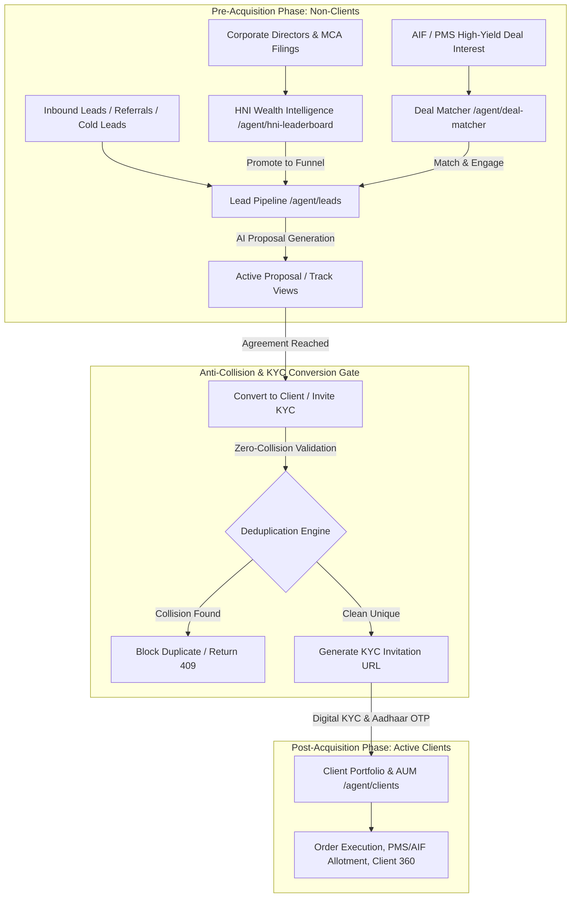

# FintekPro Policy: Unified Client Acquisition, Native CRM & Third-Party CRM Delinking (POL-CRM v1.0)

**Document Code**: POL-CRM-2026-01  
**Effective Date**: November 2026  
**Governing Authorities**: SEBI (Securities and Exchange Board of India), DPDP Act 2023 (Digital Personal Data Protection Act), CERT-In, FintekPro Global Coding Rules (GCR v1.0 + FASP-AI v1.0)  
**Applicability**: All FintekPro Institutional Partners, Wealth Managers, Relationship Managers, Field Agents, Sub-distributors, and System Architects  
**Authoritative System of Record**: FintekPro Native CRM Engine (`lead_registry`, `agent_leads`, `prospect_leads`, `prospect_clients`, `prospect_proposals`, `lead_activities`)  

---

## 1. Executive Summary & Strategic Directive

Historically, client acquisition and lead pipelines within FintekPro evaluated hybrid synchronisation mechanisms with third-party external CRM suites (specifically Zoho CRM). 

As of November 2026, **FintekPro has formally delinked, deprecated, and retired all external Zoho CRM dependencies**. 

### Core Drivers for Delinking:
1. **Data Sovereignty & DPDP Act 2023 Compliance**: Customer and non-client prospect financial data (including PAN, liquid net worth, annual corporate surplus, equity holdings, and investment intents) must remain within FintekPro's sovereign, encrypted, zero-trust cloud perimeter (`asia-south1`, GCP Cloud SQL with CMEK and strict IAM boundaries). Exporting or syncing prospect PII to external SaaS vendors introduces unnecessary third-party exposure and audit risk under SEBI CSCRF guidelines.
2. **Unified Single Pane of Glass**: Maintaining disjointed lead systems (`agent_leads`, `prospect_clients`, and external Zoho leads) created workflow fragmentation, double-entry, and user confusion.
3. **Financial-Grade Native Architecture**: FintekPro's in-house Native CRM provides sub-10ms query latency, direct integration with our AI Proposal Studio, automated MCA/BSE corporate director wealth intelligence, automated AIF/PMS Deal Matcher, and direct 1-click KYC onboarding invitation generation—capabilities unattainable via generic third-party CRMs.

**Effective immediately, FintekPro Native CRM is the sole, authoritative, and non-negotiable System of Record (SoR) for all client acquisition, prospect management, and onboarding pipelines.**

---

## 2. Pre-Acquisition vs. Client Lifecycle Boundary

To eliminate operational ambiguity across our partner network, the platform strictly segregates non-clients from onboarding/onboarded clients:



### Module Responsibilities:
- **Lead Pipeline (`/agent/leads`)**: The primary command cockpit for managing all non-client relationships. Incorporates Kanban stages (`new`, `contacted`, `proposal_sent`, `negotiation`, `converted`, `lost`), quick filters (`All Leads`, `👑 HNI / Promoters`, `📄 Proposals Active`, `🔥 Hot Leads`), auto-dialer queues, bulk CSV ingestion, and instant WhatsApp/Copy onboarding invitations.
- **HNI Wealth Intelligence (`/agent/hni-leaderboard`)**: An analytical intelligence module powered by AI wealth scoring that evaluates corporate directors, listed shareholdings, liquidity events, and corporate surplus for targeted outreach.
- **Deal Matcher (`/partner/deal-matcher` / `/agent/deal-matcher`)**: An algorithmic engine matching high-ticket PMS/AIF opportunities with qualified prospects based on net worth thresholds and risk profiling.
- **Clients (`/agent/clients`)**: Reserved exclusively for users who have completed KYC verification or have an active investor account on FintekPro.

---

## 3. Anti-Collision & Deduplication Mandate

Under **FintekPro Global Coding Rules**, duplicate client or prospect records degrade advisory integrity and cause partner attribution conflicts. 

### Mandatory 3-Tier Verification Engine (`LeadDeduplicationService`):
Every manual lead entry, HNI prospect creation, and bulk CSV upload must undergo atomic verification across three distinct entities:
1. `users` (Active Onboarded Clients)
2. `agent_leads` (Inbound & Outreach Leads)
3. `prospect_clients` (Corporate & HNI Wealth Prospects)

### Deduplication Attributes:
| Attribute | Normalisation Rule | Match Strictness | Action on Collision |
| :--- | :--- | :--- | :--- |
| **Phone Number** | Strip country codes (`+91`, `91`), whitespace, hyphens; extract canonical 10 digits (`^\d{10}$`). | Strict Equality | **HTTP 409 Conflict**: Returns existing entity type, owner, and collision reason. |
| **Email Address** | Trim whitespace, lowercase conversion, RFC 5322 validation. | Strict Equality | **HTTP 409 Conflict**: Halts creation with explanatory error. |
| **Permanent Account Number (PAN)** | Uppercase conversion, regex verification (`^[A-Z]{5}[0-9]{4}[A-Z]{1}$`). | Strict Equality | **HTTP 409 Conflict**: Halts creation; prompts partner to verify existing portfolio. |

---

## 4. Third-Party CRM (Zoho) Retirement & Decommissioning Plan

### Navigation & UI Cleanup:
- **Navigation Menu (`client/src/components/layout/agent-layout.tsx`)**: Removed "Partner CRM" (`/agent/crm`). Renamed "HNI Prospects" to "HNI Wealth Intelligence" to eliminate conceptual overlap with the unified Lead Pipeline.
- **Quick Action Command Palette**: Replaced "Partner CRM Leads" with "Lead Pipeline" pointing to `/agent/leads`.
- **Legacy Route Redirection (`client/src/routes/agent.routes.tsx`)**:
  - `/agent/crm` $\rightarrow$ Redirects (HTTP 302/Wouter `<Redirect>`) to `/agent/leads`
  - `/partner/crm` $\rightarrow$ Redirects to `/agent/leads`
  - `/agent/zoho-crm` $\rightarrow$ Redirects to `/agent/leads`

### Backend & Service Deactivation:
- Outbound synchronisation jobs and webhooks targeting Zoho CRM endpoints have been disconnected.
- Environment variables relating to Zoho CRM sync (`ZOHO_SYNC_ENABLED`, `ZOHO_CLIENT_ID`, `ZOHO_CLIENT_SECRET`) are marked as deprecated and non-operational for lead management.
- All lead enrichment, tracking, and proposal generation are handled natively within FintekPro.

---

## 5. Audit Trail & Compliance Verification

In accordance with SEBI CSCRF guidelines:
- Every lead creation, status transition, and conversion event emits a structured audit log:
  ```json
  {
    "event": "LEAD_STATUS_UPDATED",
    "lead_id": "lead_uuid",
    "agent_id": "agent_uuid",
    "from_stage": "proposal_sent",
    "to_stage": "converted",
    "timestamp": "2026-11-19T15:58:00.000Z",
    "engine_version": "v1.2.0"
  }
  ```
- No PII is logged in unmasked plain text; PAN and Aadhaar are masked according to UIDAI and SEBI norms.
- All lead activities remain immutable in `lead_activities` for a minimum statutory period of 5 years.

---

## 6. Native Marketing Studio & Omnichannel Acquisition Governance

To empower partners with automated acquisition capabilities without relying on external campaign software:

1. **Integrated Marketing Studio**: Elevated into the primary partner navigation (`/agent/bulk-communication`, `/agent/marketing`, `/agent/campaigns`) and linked directly from the Lead Pipeline cockpit.
2. **Unified Audience Segmentation**: The marketing engine natively aggregates both **Non-Client Leads** (from `agent_leads` / `prospect_clients`) and **Existing Clients** (from `users` / `clients`), allowing targeted outreach by tier (`💎 UHNI`, `👑 HNI`, `Affluent`), persona (corporate directors), and funnel stage (`new`, `contacted`, `proposal_sent`).
3. **Closed-Loop Touchpoint Logging**: Every outbound campaign (WhatsApp broadcast, transactional email, SMS blast) automatically records an activity record in `lead_activities`, ensuring complete interaction visibility on the partner Kanban board.
4. **SEBI Advertising Code Compliance**: All promotional templates must include statutory risk disclaimers, avoid deterministic profit guarantees, and support explicit DPDP opt-out mechanisms.
