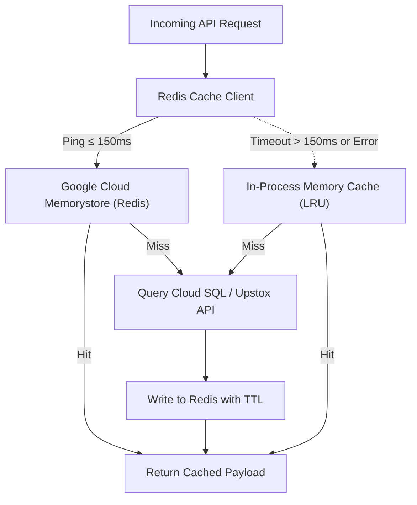

# FintekPro Redis Activation & Scalable Infrastructure Policy

**Document Reference**: FP-INFRA-POL-2026-01  
**Classification**: FintekPro Internal Infrastructure & Engineering Operations  
**Effective Date**: October 2026  
**Governing Standard**: FintekPro Global Coding Rules (GCR v1.0) & FASP-AI v3.0  
**Target Concurrency Trigger**: **1,000 Active Users** (or 250 Concurrent Real-Time Sessions)  

---

## 1. Executive Summary & Purpose

FintekPro currently operates with in-process memory caching (`Map` / LRU) in Google Cloud Run. While highly efficient for single-container footprints, auto-scaling across multiple Cloud Run instances at scale causes cache bifurcation:
1. Redundant upstream calls to Upstox API v2, AMFI mfapi.in, and Vertex AI.
2. Risk of hitting exchange/broker rate limits during market-open surges.
3. Idempotency and pre-trade risk counters isolated within individual containers rather than shared globally.

This policy defines the quantitative triggers, architecture specification, failover safeguards, and execution steps for activating **Google Cloud Memorystore for Redis** upon reaching **1,000 active users**, alongside companion infrastructure enhancements (PgBouncer connection pooling, TimescaleDB continuous aggregates, and explicit Cloud Run health probes).

---

## 2. Quantitative Activation Triggers

Activation of Google Cloud Memorystore for Redis MUST commence immediately upon reaching any ONE of the following operational thresholds:

| Trigger Metric | Threshold | Measurement Method | Operational Urgency |
| :--- | :--- | :--- | :--- |
| **Daily Active Users (DAU)** | **$\ge$ 1,000 registered users active in 24h** | BigQuery audit logs / User session analytics | High (Begin provisioning) |
| **Concurrent Sessions** | **$\ge$ 250 active WebSocket / SSE connections** | Cloud Run active instance metrics | Critical (Immediate activation) |
| **Cloud Run Instance Auto-scale** | **$\ge$ 3 active concurrent instances sustained for > 1 hour** | Cloud Run metrics (`container/instance_count`) | High |
| **Market Data Ingestion Rate** | **$\ge$ 5,000 price requests / minute** | Upstox & IndianAPI gateway monitor | Critical |
| **Database Connection Contention** | **Active Cloud SQL connections $\ge$ 70% of max capacity** | Cloud SQL metrics (`database/postgresql/num_backends`) | High |

---

## 3. Redis Infrastructure Specification (GCP Memorystore)

### 3.1 Provisioning Blueprint
- **Service**: Google Cloud Memorystore for Redis
- **Region**: `asia-south1` (Mumbai), colocated with Cloud Run (`fintekpro-app`) and Cloud SQL (`fintekpro-db`)
- **VPC Connector**: Serverless VPC Access connector (`fintekpro-vpc-connector`, CIDR `/28`)
- **Initial Tier (1,000 – 5,000 users)**:
  - **Tier**: Basic Tier (M1 instance, 1 GB to 2 GB memory)
  - **Redis Engine Version**: 7.2 (with Redis ACL support)
  - **Max Memory Eviction Policy**: `allkeys-lru`
  - **In-Transit Encryption**: TLS enabled
- **Scale Tier (> 5,000 users / Institutional PMS & AIF Expansion)**:
  - **Tier**: Standard Tier (High Availability with automatic multi-zone failover and 99.9% SLA)
  - **Read Replicas**: 2 read-replicas for distributed read load

### 3.2 Key Namespaces, TTLs & Eviction Architecture

| Namespace Key Pattern | Purpose | TTL | Eviction Priority |
| :--- | :--- | :--- | :--- |
| `quote:nse:{symbol}` | Real-time equity quote (LTP, OHLC, bid/ask) | 3 seconds | Volatile (LRU safe) |
| `quote:options:{expiry}:{strike}` | Live Options chain & Greeks | 2 seconds | Volatile |
| `market:index:{name}` | NIFTY 50 / SENSEX / Sectoral benchmarks | 5 seconds | Volatile |
| `amfi:nav:{schemeCode}` | Trailing AMFI Mutual Fund NAV | 24 hours | Persistent |
| `ai:advisory:{portfolioId}` | Grounded FASP-AI portfolio insight & rationales | 12 hours | Refresh on rebalance |
| `quant:backtest:{hash}` | Vectorized backtest return series | 6 hours | Deterministic |
| `idempotency:{key}` | Safe write retry protection for orders/KYC | 15 minutes | Mandatory (Do not evict early) |
| `ratelimit:{userId}:{endpoint}` | Sliding window rate limiting counters | 60 seconds | Volatile |

---

## 4. Zero-Downtime Fallback Architecture (Graceful Degradation)

In accordance with FintekPro Global Coding Rules (GCR v1.0 § Self-Healing):
- **Primary Cache**: Memorystore Redis cluster via Serverless VPC connector.
- **Failover / Disconnection Timeout**: Maximum connection timeout of **150ms**.
- **Local Fallback**: If Redis fails, times out, or enters maintenance, the application MUST automatically fall back to the in-memory LRU cache (`memory-cache.ts`).
- **Never Crash full API**: All Redis wrapper functions (`redisClient.get()`, `redisClient.set()`) MUST catch connection errors, log a structured warning (`{ event: "REDIS_FALLBACK_TO_MEMORY", latency_ms, status: "degraded" }`), and fulfill the request using local memory.



---

## 5. Implementation Roadmap for Companion Infrastructure Upgrades

Alongside Redis activation, the following three infrastructure upgrades will be deployed to complete the enterprise architecture:

### 5.1 PgBouncer Connection Pooling (Cloud SQL)
- **Problem Solved**: Cloud Run containers scale dynamically from 1 to $N$. Under traffic spikes, new containers spawn simultaneous direct connections to PostgreSQL, exceeding `max_connections`.
- **Implementation**:
  - Deploy PgBouncer in transaction-pooling mode between Cloud Run and Cloud SQL.
  - Pin server connection pool to 100 backend connections.
  - Client connections scale to 2,000+ virtual connections without exhausting database memory.

### 5.2 TimescaleDB Continuous Aggregates for Historical NAV
- **Problem Solved**: Dynamic SQL aggregation over multi-year `mf_nav_history` and `historical_nav_data` tables takes 350–500ms on complex multi-asset portfolios.
- **Implementation**:
  - Convert `mf_nav_history` to a TimescaleDB hypertable partitioned by `nav_date`.
  - Materialize continuous aggregates (`monthly_nav_summary`) refreshed automatically via background policy.
  - Reduces portfolio backtest and rolling returns query latency to $< 15\text{ms}$.

### 5.3 Explicit Cloud Run Startup & Liveness Probes
- **Implementation**:
  - Register `/api/health` with `--liveness-probe-initial-delay=30` and `--liveness-probe-period=10` on Cloud Run service `fintekpro-app`.
  - Ensures container readiness before routing production traffic, eliminating 502/503 errors during deployments.

---

## 6. Execution Command Sequence for Infra Activation

When the 1,000-user trigger is reached, DevOps/Platform engineering executes the following verified sequence:

```bash
# 1. Create Serverless VPC Access connector
gcloud compute networks vpc-access connectors create fintekpro-vpc-connector \
    --region=asia-south1 \
    --network=default \
    --range=10.8.0.0/28

# 2. Provision Google Cloud Memorystore for Redis (Basic Tier M1, 2GB)
gcloud redis instances create fintekpro-redis \
    --size=2 \
    --region=asia-south1 \
    --zone=asia-south1-a \
    --redis-version=redis_7_2 \
    --network=default \
    --connect-mode=PRIVATE_SERVICE_ACCESS

# 3. Obtain Redis Host IP and store in Google Secret Manager
REDIS_IP=$(gcloud redis instances describe fintekpro-redis --region=asia-south1 --format='value(host)')
echo -n "redis://${REDIS_IP}:6379" | gcloud secrets versions add REDIS_URL --data-file=-

# 4. Attach VPC connector and REDIS_URL secret to Cloud Run service
gcloud run services update fintekpro-app \
    --region=asia-south1 \
    --vpc-connector=fintekpro-vpc-connector \
    --set-secrets="REDIS_URL=REDIS_URL:latest"

# 5. Verify live Redis connection and health
curl -s "https://fintekpro-app-7f3fb64pqq-el.a.run.app/api/health" | jq .
```

---

## 7. Approval & Governance

- **Drafted By**: FintekPro Platform Engineering & Quant Systems  
- **Regulatory Verification**: SEBI RIA & MFD Operational Segregation Audit  
- **Review Cycle**: Quarterly or upon reaching 500, 1,000, and 5,000 user milestones  
