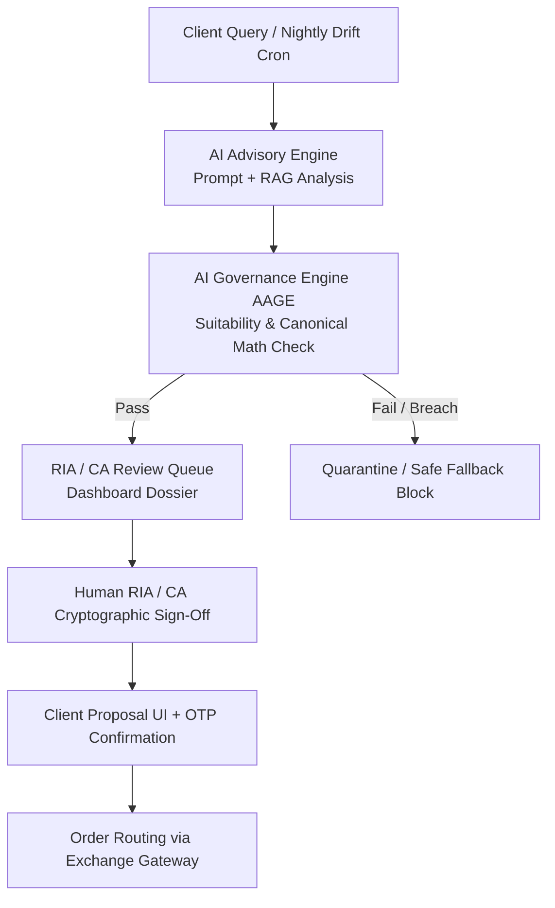

# Standard Operating Procedure (SOP): AI Advisory Governance & Model Risk Management

**Document Code**: `FINTEK-SOP-AI-GOV-2026-01`  
**Standard Version**: SOP-AI-1.0.0  
**Effective Date**: November 2026  
**Governing Authorities**: SEBI (AI/ML Framework for Market Intermediaries, IA Regs 2013, RA Regs 2014) & RBI (Model Risk Management Framework)  
**Applicability**: Engineering, AI Platform Desk, Investment Committee, Compliance Officers, Registered RIAs & RAs  

---

## 1. Statutory Mandate & Purpose

This Standard Operating Procedure establishes the operational controls, testing cadences, and supervisory boundaries required when utilizing Artificial Intelligence (AI), Machine Learning (ML), and Large Language Models (LLMs) to generate financial advice, portfolio allocations, risk scores, and tax planning strategies on the FintekPro portal.

Per SEBI's Master Circular on AI/ML tools, **registered entities retain 100% legal, fiduciary, and regulatory liability** for all advice rendered. Liability cannot be delegated, transferred, or excused by attributing errors to an algorithm.

---

## 2. AI Model Inventory & Regulatory Tiering

The Platform Engineering team must maintain an immutable, version-controlled **AI Model Registry** in the production database. Every AI engine, prompt template, and quantitative algorithm must be categorized into one of three statutory risk tiers:

### Tier 1: High Risk — Customer-Facing Advisory & Rebalancing
- **Scope**: Algorithms generating asset allocation proposals, stock/fund picks, tax-loss harvesting plans, or drift-triggered rebalances (e.g. `URCAE`, `APRE`, `GoldenPricingEngine`, `PortfolioRiskGuard`).
- **Supervisory Controls**:
  - Independent backtesting against $\ge 10$ years of market regime data.
  - Mandatory quarterly bias, stress testing, and explainability audit by the Investment Committee.
  - Zero autonomous order transmission; requires client OTP or RIA digital authorization.

### Tier 2: Medium Risk — Analytical & Synthesis Models
- **Scope**: Summaries, market commentary, corporate earnings digests, and educational playbooks (`KnowledgeHubService`, `MacroCommentaryEngine`).
- **Supervisory Controls**:
  - Automated factual verification against primary exchange filings (BSE/NSE) and licensed market data feeds.
  - Visible AI generation watermarking and risk disclosures.

### Tier 3: Low Risk — Operational & Administrative
- **Scope**: Document OCR, KYC data parsing, internal schema validations.
- **Supervisory Controls**:
  - Pre-commit code linting, automated schema regression testing.

---

## 3. Legal Non-Delegation & Fiduciary Sign-Off Protocol



1. **Advisory Dossier Generation**: The AI generates a structured advisory proposal containing:
   - Target securities with ISINs and weights.
   - Suitability justification tied to client psychometric score.
   - Downside volatility scenario modeling.
2. **Human RIA / CA Review**: Before the advisory dossier reaches the client as an actionable investment proposal:
   - The registered advisor must inspect the explainability layer.
   - The advisor must affix an authenticated digital credential (e-Sign or tokenized approval).
3. **Client Final Confirmation**: The investor must confirm execution via an explicit two-factor authentication (2FA) OTP.

---

## 4. Zero Synthetic / Cooked-Up Formulas Protocol

1. **Pre-Execution Math Audit**:
   - The AI Governance Engine (`AAGE`) intercepts all quantitative metrics (Sharpe, Sortino, VaR, duration, yield, DCF fair value, option Greeks).
   - If an algorithm attempts to substitute an ad-hoc linear approximation, heuristic multiplier, or synthetic formula to mask missing input variables, `AAGE` **blocks the output immediately** with code `CANONICAL_FORMULA_BREACH`.
2. **Canonical Origin Requirement**:
   - All formulas must explicitly reference their canonical financial economics source (e.g. Black-Scholes-Merton, Markowitz MPT, Treynor-Black, standard XIRR/CAGR) or statutory regulatory circular (SEBI, RBI, Income Tax Act 1961).
   - Missing data must yield a structured failure:
     ```json
     {
       "success": false,
       "error": {
         "error_code": "CANONICAL_DATA_UNAVAILABLE",
         "message": "Required market variables missing; synthetic approximation prohibited under FintekPro GCR §3.4"
       }
     }
     ```

---

## 5. Algorithmic Marketing & Performance Claims Code

In strict compliance with SEBI Advertising Codes for Investment Advisers and Research Analysts:

1. **Ban on Retail Backtest Marketing**:
   - Simulated backtests, theoretical algorithmic win-rates, and cherry-picked paper portfolios **must never be advertised or displayed** on public landing pages or retail marketing campaigns.
2. **Net-of-Fee Performance Reporting**:
   - All published model portfolio returns must be displayed **net of all advisory fees, statutory taxes (STT, Stamp Duty, GST), and exchange turnover fees**.
3. **Mandatory Benchmark Co-Display**:
   - Model returns must always appear side-by-side with official SEBI total return indices (e.g. Nifty 50 TRI, Nifty 500 TRI, CRISIL Composite Bond Index) across identical time horizons (1Y, 3Y, 5Y, Since Inception).
4. **Mandatory Statutory Caution**:
   - Every algorithmic performance chart must feature the statutory disclosure:
     *"Past performance is not indicative of future results. Algorithmic models are subject to market risks and regime shifts."*

---

## 6. Model Drift & Out-of-Distribution ($3.5\sigma$) Monitoring

1. **Daily Drift Evaluation**:
   - Quantitative models are backtested daily against new market close prices to compute **Mean Absolute Percentage Error (MAPE)** and **Tracking Error**.
   - If 30-day rolling tracking error exceeds $2.5\%$, the model is flagged for parameter recalibration.
2. **The $3.5\sigma$ Out-of-Distribution (OOD) Fallback**:
   - If market volatility exceeds $3.5\sigma$ of the 3-year rolling standard deviation (e.g., flash crash or geopolitical black swan):
     - The AI engine automatically downgrades advisory intensity.
     - Automated rebalancing proposals are suspended.
     - The portal shifts to the **Safety Fallback Mandate** (preserving capital in Sovereign T-Bills / Overnight cash).

---

## 7. Global AI Kill-Switch SOP

1. **Authority to Trigger**:
   - Managing Director, Head of Compliance, Principal Officer, or Chief Technology Officer.
2. **Trigger Conditions**:
   - Upstream licensed market data corruption $> 3.5\%$.
   - Detection of unmasked PII leakage in model payloads.
   - Critical regulatory directive or investigation notice from SEBI/RBI.
   - Algorithmic drift causing erroneous transaction recommendations.
3. **Execution Procedure**:
   - Execute admin override via the secure governance console or backend command:
     ```bash
     curl -X POST https://api.fintekpro.com/api/admin/governance/kill-switch \
       -H "X-Compliance-Override: $(cat /etc/fintekpro/compliance.token)" \
       -d '{"action": "GLOBAL_KILL_SWITCH", "reason": "Data feed corruption detected"}'
     ```
   - **System Response ($< 100\text{ ms}$)**:
     - Disables all customer-facing AI advisory interfaces.
     - Freezes all pending rebalance proposals.
     - Reverts portal to read-only historical and deterministic human-managed advisory.
     - Dispatches automated incident notifications to the Compliance Officer and CERT-In.

---

*FintekPro Regulatory & AI Technology Governance Council*  
*Standard Operating Procedure — AI Governance & Model Risk*

