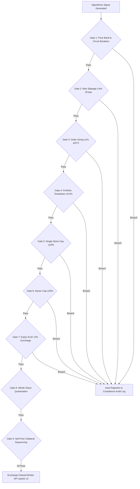

# Standard Operating Procedure (SOP): Algorithmic Trading & Pre-Trade Risk Management System (RMS)

**Document Code**: `FINTEK-SOP-ALGO-RMS-2026-01`  
**Standard Version**: SOP-ALGO-1.0.0  
**Effective Date**: November 2026  
**Governing Authorities**: Securities and Exchange Board of India (SEBI), National Stock Exchange of India (NSE), Bombay Stock Exchange (BSE), Reserve Bank of India (RBI), and CERT-In  
**Statutory Frameworks**:
1. SEBI Circular CIR/MRD/DP/09/2012 (Framework for Algorithmic Trading in Indian Securities Market)
2. SEBI Master Circular on Algorithmic Trading & Stock Broker APIs
3. SEBI (Investment Advisers) Regulations, 2013 (Regulation 15, 17, 19, 22)
4. SEBI (Portfolio Managers) Regulations, 2020 (Regulation 22, 23(2))
5. FintekPro Global Coding Rules (GCR v1.0) & FASP-AI v3.1-ALGO

---

## 1. Executive Summary & Statutory Mandate

This Standard Operating Procedure governs the design, deployment, operational execution, and regulatory compliance of all **algorithmic trading, systematic rebalancing, and quantitative execution routines** deployed on the FintekPro platform.

Algorithmic trading on FintekPro operates under the **FASP-AI-v3.1-ALGO** engine architecture ([`server/services/model-portfolio-algo-service.ts`](file:///Users/sangrammohanty/Documents/GitHub/FintekPro/server/services/model-portfolio-algo-service.ts)) and is restricted strictly to canonical model portfolios and systematically hedged derivative overlays.

### Core Legal Invariant: Non-Delegation of Fiduciary Responsibility
Under SEBI AI/ML and Algorithmic Trading circulars:
- **No Algorithm Immunity**: Registered entities (RIAs, RAs, Portfolio Managers) retain 100% legal, regulatory, and financial responsibility for algorithmic outputs. Faults cannot be attributed to third-party models or algorithmic anomalies.
- **Client Demat Isolation**: In compliance with SEBI anti-pooling circulars, **FintekPro never pools client funds or securities**. All trades execute strictly within the client's own segregated demat account at an exchange-cleared partner broker (e.g. Upstox API v2).

---

## 2. Dual-Track Execution Architecture

FintekPro enforces two mutually exclusive algorithmic execution tracks depending on client classification and statutory authorization:

```
┌─────────────────────────────────────────────────────────────────────────────────────────────┐
│                          FintekPro Algorithmic Trading Mandate Matrix                       │
└─────────────────────────────────────────────────────────────────────────────────────────────┘
  Track           Statutory Scope        Execution Model               Authorization Gate
  ──────────────  ─────────────────────  ────────────────────────────  ────────────────────────
  Track A:        Retail & Affluent      Non-Discretionary             1-Click Biometric / OTP
  Retail / RIA    (< ₹50 Lakhs)          Client-Confirmed Rebalance    Mandatory per batch
  ──────────────  ─────────────────────  ────────────────────────────  ────────────────────────
  Track B:        HNI / UHNI PMS & AIF   Discretionary Systematic      15-Minute Background
  PMS / Discret.  (≥ ₹50 Lakhs / ₹1 Cr)  Automated Batch Sweeps        Automated RMS Sweep
```

### Track A: Retail & RIA Accounts (< ₹50 Lakhs) — Non-Discretionary Smart Mandate
- Per SEBI (Investment Advisers) Regulations, 2013, RIAs operate strictly on a **non-discretionary fiduciary mandate**.
- The algorithm continuously tracks market regimes, covariance drift, and constituent health.
- When rebalancing is warranted, the engine generates an immutable **Pre-Trade RMS Pack**.
- The client receives an instant push/WhatsApp prompt detailing proposed trims, adds, estimated slippage, and STT/charges.
- **Execution Rule**: No order is transmitted to the broker without the client's explicit **1-Click Biometric (FaceID/Fingerprint) or TOTP confirmation**.

### Track B: Discretionary Portfolio Management Services (PMS $\ge$ ₹50 Lakhs)
- Applicable strictly to clients who have executed a formal Portfolio Management Agreement (PMA) meeting the **₹50 Lakh statutory floor** under SEBI (Portfolio Managers) Regulations, 2020.
- When `algoTradingEnabled = true` and `executionChannel = "ALGO_AUTO"`:
  - The platform's 15-minute background scheduler ([`server/startup/background-schedulers.ts`](file:///Users/sangrammohanty/Documents/GitHub/FintekPro/server/startup/background-schedulers.ts)) sweeps active model portfolios.
  - Automatically executes rebalancing when constituent drift exceeds statutory thresholds (**3.00% for Debt, 5.00% for Equity**).
  - The Principal Officer / Portfolio Manager maintains real-time supervisory visibility on the Admin Oversight Console.

---

## 3. The 9-Gate Pre-Trade Risk Management System (RMS)

All orders generated by `modelPortfolioAlgoService` must pass through 9 mandatory pre-trade validation gates before transmission:



### Gate 1: Price Band & Circuit Breaker Verification
- Queries real-time quotes via [`upstox-market-data-service.ts`](file:///Users/sangrammohanty/Documents/GitHub/FintekPro/server/services/upstox-market-data-service.ts).
- If any constituent has hit or is within 0.5% of its Upper Circuit (UC) or Lower Circuit (LC) band, all buy/sell orders in that constituent are blocked immediately.

### Gate 2: Dynamic Slippage Tolerance & Adaptive Limit Orders
- **Zero Naked Market Orders**: All algorithmic orders are submitted as **adaptive limit orders** with tick-level adjustments matching NSE 5 paise increments.
- Default slippage tolerance is capped at **30 bps (0.30%)**. If the market spread exceeds 0.30%, the order is held or re-sliced.

### Gate 3: Liquidity Impact & ADTV Ceilings
- To prevent market abuse, front-running, and self-slippage:
  $$\text{Order Quantity} \le 1.0\% \times \text{Average Daily Traded Volume (ADTV)}_{30\text{-day}}$$
- Orders exceeding 1.0% ADTV must be algorithmically sliced across multiple time windows (TWAP / VWAP).

### Gate 4: Portfolio Drawdown Circuit Breaker
- Continuously verified by `checkDrawdownCircuitBreaker()`:
  - If a model portfolio experiences an intraday drawdown exceeding **3.50%**, algo trading is automatically frozen (`circuitBreakerTripped: true`).
  - Resumption requires manual review and compliance sign-off.

### Gate 5: Single-Stock Concentration Limit
- No equity constituent may exceed **10.00% of total portfolio value** post-rebalance. Any algorithmic rebalance that would breach this threshold is automatically truncated.

### Gate 6: Sector Exposure Limit
- No single industry sector may exceed **25.00% of total portfolio value** to protect against sectoral macro shocks.

### Gate 7: Derivative & Expiry Day Margin ELM Surcharge
- For derivative trading overlays ([`ai-policy/sop_derivative_trading_audit_standards.md`](file:///Users/sangrammohanty/Documents/GitHub/FintekPro/ai-policy/sop_derivative_trading_audit_standards.md)):
  - Enforces mandatory +2% Extreme Loss Margin (ELM) surcharge on weekly index option expiry days.
  - Hard-blocks naked short option positions; all short options must be hedged within a registered multi-leg spread (Bull Call, Bear Put, Iron Condor).

### Gate 8: Whole Integer Share Quantization
- Implemented via [`model-portfolio-share-sizing.ts`](file:///Users/sangrammohanty/Documents/GitHub/FintekPro/server/services/model-portfolio-share-sizing.ts):
  - Because Indian exchanges do not support fractional equity shares, exact rupee allocations are quantized down to integer units (`Math.floor(rupees / price)`).
  - Residual funds are accumulated in designated liquid cash drag buckets without allocation distortion.

### Gate 9: Collateral-Optimized Order Sequencing
- Rebalancing execution legs must execute in strict chronological sequence:
  1. **Phase 1: SELL / TRIM legs execute first** to release margin and demat collateral.
  2. **Phase 2: BUY / ADD legs execute second** using verified released settlement credits, preventing margin shortfalls and broker penalty charges.

---

## 4. Emergency Kill-Switch Architecture

In compliance with SEBI operational risk mandates, FintekPro provides a **Three-Tier Multi-Level Kill Switch**:

```
┌─────────────────────────────────────────────────────────────────────────────────────────────┐
│                           FintekPro Multi-Tier Kill Switch Matrix                           │
└─────────────────────────────────────────────────────────────────────────────────────────────┘
  Tier       Level                Actor                     Action
  ─────────  ───────────────────  ────────────────────────  ──────────────────────────────────
  Tier 1     Client-Level         Individual Investor       1-Tap "Pause Algo" in mobile app
  Tier 2     Portfolio-Level      Advisor / Principal Off.  POST /:id/algo-trading/disable
  Tier 3     Platform-Wide        Compliance Officer / CT   failSystemState (GLOBAL_AI_KILL_SWITCH)
```

1. **Client In-App Kill Switch**: The client can pause automated trading on their portfolio at any time via the FintekPro mobile app.
2. **Portfolio Override Kill Switch**: Accessible to partner RIAs and Portfolio Managers via `POST /api/model-portfolios/:id/algo-trading/disable`.
3. **Platform Global Kill Switch**: The Compliance Officer can engage the global kill-switch via the Admin UI, which instantly freezes all algo sweeps and API dispatches across all tenant instances.
4. **Client-Facing Voluntary Segment Kill-Switch (Upstox Benchmark)**:
   - Retail and institutional clients can voluntarily halt their own derivative and F&O trading via `POST /api/derivatives/kill-switch`.
   - Adhering to SEBI voluntary trading halt circulars, activation enforces an immutable **12-hour cooling-off lock period**. During this period, all order validation (`/api/derivatives/order/validate`) and execution (`/api/derivatives/order/execute`) endpoints reject incoming trades with `USER_KILL_SWITCH_ACTIVE`.

---

## 5. Algorithmic Marketing & Advertising Code

Under SEBI circulars on performance claims and financial marketing:
1. **Ban on Backtest Advertising**:
   - Marketing, displaying, or advertising simulated backtests, theoretical algorithmic win-rates, or cherry-picked paper portfolios to retail investors is **strictly prohibited**.
2. **Mandatory Performance Benchmarking**:
   - All algorithmic performance charts must display returns side-by-side with official SEBI total return indices (e.g. Nifty 50 TRI, Nifty 500 TRI) on a net-of-fees basis.
3. **Mandatory Statutory Warning**:
   - Every algorithmic interface must display:
     > *"Past performance is not indicative of future returns. Algorithmic execution is subject to latency delays, system outages, and market volatility risks. No return or profit guarantee is provided."*

---

## 6. Immutable Audit Trail & Regulatory Reporting (WORM Retention)

Per **SEBI Regulation 16** and **CERT-In Cyber Security Directions**:
- Every algorithmic event is permanently logged with atomic NPL/NIC millisecond timestamps ($\pm 50\text{ ms}$):
  - **`model_portfolio_transactions`**: Stores transaction sequence (`MPT-YYYYMMDD-XXXX`), order legs, target vs executed prices, and slippage.
  - **`portfolio_ai_decisions`**: Stores exact algorithm version (`FASP-AI-v3.1-ALGO`), drift metrics, and regime states.
  - **`order_lifecycle_events`**: Stores broker exchange order IDs and fill states.
- All records are retained in PostgreSQL immutable WORM (Write-Once-Read-Many) storage for **7 years** for statutory inspection.

---

## 7. Multi-Leg Options Strategy Baskets & Greeks Engine (Upstox Pro Benchmark)

To align with institutional standards and the Upstox Pro trading architecture:
1. **Real-time Greeks Engine**:
   - Every option strike computes Black-Scholes Greeks: Delta ($\Delta$), Gamma ($\Gamma$), Theta ($\Theta$), Vega ($\nu$), Rho ($\rho$), Implied Volatility (IV %), and Probability of Profit (POP).
2. **1-Click Pre-Hedged Strategy Baskets**:
   - Standardized strategy templates (*Bull Call Spread*, *Bear Put Spread*, *Long Straddle*, *Short Strangle*, *Iron Condor*).
   - Enforces institutional BUY-first leg execution sequence to lock in exchange hedge margin relief benefits before short legs are routed.
3. **Pre-Trade "Slide to Execute" Guardrail**:
   - Accidental executions on web and touch interfaces are eliminated via the touch/drag `SlideToConfirmOrderModal.tsx`, satisfying FASP-AI v1.0 explicit client confirmation requirements.

