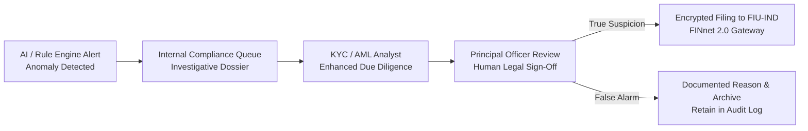

# Standard Operating Procedure (SOP): Anti-Money Laundering (PMLA) & Sanctions Screening

**Document Code**: `FINTEK-SOP-AML-PMLA-2026-04`  
**Standard Version**: SOP-AML-1.1.0  
**Effective Date**: November 2026  
**Governing Authorities**: Financial Intelligence Unit - India (FIU-IND), Prevention of Money Laundering Act, 2002 (PMLA), Ministry of Finance PMLA (Maintenance of Records) Amendment Rules, and FATF Recommendations  
**Applicability**: Compliance Department, Principal Officer, Designated Director, KYC Operations, Engineering  

---

## 1. Statutory Mandate & Scope

As an institutional wealth management platform routing capital through SEBI-registered intermediaries, custodians, and payment networks, FintekPro is obligated under **PMLA Section 12**, the **PMLA (Maintenance of Records) Amendment Rules**, and **FIU-IND Master Directives** to maintain robust systems for detecting money laundering, terrorist financing, and illicit fund flows.

This Standard Operating Procedure establishes the mandatory protocols for:
1. Client Due Diligence (CDD) and Revised Beneficial Ownership (BO) verification.
2. Daily Sanctions, PEP, and UAPA watchlist screening.
3. Automated transaction anomaly detection and structuring alerts.
4. Escalation protocols and human Principal Officer sign-off for FIU-IND regulatory reporting (STR / CTR).

---

## 2. Revised Beneficial Ownership (BO) Thresholds (PMLA 2023 Amendment)

In accordance with the Ministry of Finance amendments to the PMLA Rules, the platform enforces reduced statutory thresholds to identify natural persons controlling non-individual accounts:

```
┌────────────────────────────────────────────────────────────────────────────────────────┐
│                        Statutory Beneficial Ownership (BO) Matrix                      │
└────────────────────────────────────────────────────────────────────────────────────────┘
  Entity Legal Form         Statutory BO Threshold (Ownership / Profit / Voting Rights)
  ────────────────────────  ─────────────────────────────────────────────────────────────
  Company / Corporate Body  ≥ 10% of shares, capital, or profits (reduced from 25%)
  Partnership Firm / LLP    ≥ 10% of capital or profits of partnership (reduced from 15%)
  Unincorporated / AOP      ≥ 15% of property, capital, or profits
  Trust / Foundation        All Trustees, Settlors, Protectors, and Beneficiaries ≥ 10%
```

### 2.1 Non-Profit Organization (NPO) Verification
- For any entity operating as an NPO or charitable trust, the platform must verify its mandatory registration on the **DARPAN portal of NITI Aayog**.
- Details of NPO registration must be retained in the platform compliance ledger for **5 years after the business relationship ends**.

---

## 3. Daily Sanctions & PEP Screening Protocol

Every active investor, corporate director, and authorized signatory on the platform must be subjected to automated daily batch screening via [`aml-service.ts`](file:///Users/sangrammohanty/Documents/GitHub/FintekPro/server/aml-service.ts):

### 3.1 Watchlists Screened Daily
1. **Ministry of Home Affairs (MHA) UAPA List**: Individuals and entities designated under the Unlawful Activities (Prevention) Act, 1967.
2. **United Nations Security Council (UNSC) Consolidated List**: Global terrorist entities and sanctioned individuals under UNSC Resolutions 1267, 1988, and 1718.
3. **Financial Action Task Force (FATF) High-Risk Jurisdictions**: Call for action (Blacklist) and increased monitoring (Greylist) geographies.
4. **Politically Exposed Persons (PEP) Database**: Current or former heads of state, senior politicians, judicial officials, and senior military commanders, including immediate family members and close associates.

### 3.2 Match Handling & False Positive Resolution
- **Fuzzy Matching Algorithm**: Screen matches using Jaro-Winkler distance and Levenshtein metrics with an **85% confidence threshold**.
- **Potential Match (`MATCH_POTENTIAL`)**:
  - Automatically suspends trading and withdrawals immediately.
  - Generates an urgent compliance task for the KYC Analyst.
  - If verified as a **True Positive**:
    - Account is permanently frozen.
    - Transaction is quarantined.
    - The Principal Officer files an immediate **Suspicious Transaction Report (STR)** with FIU-IND within 24 hours.

---

## 4. Automated Anomaly Detection & AML Rules Engine

The real-time monitoring engine flags transactions exhibiting classic money laundering topologies:

| Rule Code | AML Trigger Condition | Risk Level | System Action |
| :--- | :--- | :---: | :--- |
| `AML_001` | **Structuring / Smurfing**: Multiple deposits just below ₹2,00,000 threshold within 48 hours | `HIGH` | Flag for investigation |
| `AML_002` | **Rapid Velocity / Pass-Through**: Instant redemption or transfer within $< 24$ hours of deposit without economic rationale | `HIGH` | Hold withdrawal leg; require source of funds |
| `AML_003` | **Third-Party Account Funding**: Inward fund transfer originating from a bank account not linked to the verified PAN | `CRITICAL` | Block transaction; return funds to source bank |
| `AML_004` | **Sudden Volume Spike**: Transaction size $> 5\times$ historical 12-month average profile | `MEDIUM` | Require updated income declaration / ITR |
| `AML_005` | **Cash Threshold Breach**: Cumulative cash deposits exceeding statutory limit of ₹50,000 per financial year | `CRITICAL` | Reject deposit; trigger CTR log |

---

## 5. Human Principal Officer Sign-Off & FIU-IND Reporting



1. **No Autonomous Regulatory Filings**:
   - The AI algorithm or automated rule engine **must NEVER autonomously submit regulatory filings** to FIU-IND.
   - All automated detections are classified as *Internal Flags* requiring human investigation.
2. **Principal Officer Review**:
   - The designated Principal Officer (registered with FIU-IND under PMLA Rules) reviews the client dossier, transaction trail, and source-of-wealth documentation.
   - Filing of Suspicious Transaction Reports (STRs) or Cash Transaction Reports (CTRs) must be executed strictly through the **FINnet 2.0 Gateway** under the digital signature of the Principal Officer.
3. **Statutory Non-Disclosure ("Tipping Off" Prohibition)**:
   - Under PMLA Section 14, platform staff and agents are strictly forbidden from notifying or tipping off the client that an inquiry or STR has been lodged.
