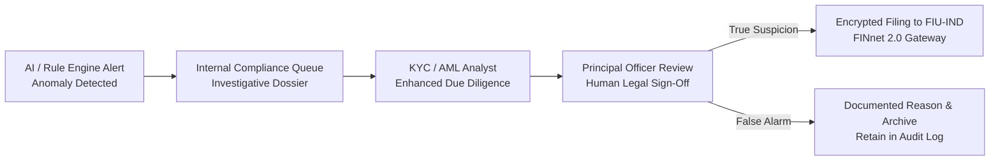

# Standard Operating Procedure (SOP): Anti-Money Laundering (PMLA) & Sanctions Screening

**Document Code**: `FINTEK-SOP-AML-PMLA-2026-04`  
**Standard Version**: SOP-AML-1.0.0  
**Effective Date**: November 2026  
**Governing Authorities**: Financial Intelligence Unit - India (FIU-IND), Prevention of Money Laundering Act, 2002 (PMLA), and FATF Recommendations  
**Applicability**: Compliance Department, Principal Officer, KYC Operations, Engineering  

---

## 1. Statutory Mandate & Scope

As an institutional wealth management platform routing capital through SEBI-registered intermediaries, custodians, and payment networks, FintekPro is obligated under **PMLA Section 12** and **FIU-IND Reporting Rules** to maintain robust systems for detecting money laundering, terrorist financing, and illicit cross-border fund flows.

This Standard Operating Procedure governs the automated transaction monitoring engines, daily sanctions screening, and regulatory filing escalation workflows.

---

## 2. Daily Sanctions & PEP Screening Protocol

Every active investor, corporate director, and authorized signatory on the platform must be subjected to automated daily batch screening via [`aml-service.ts`](file:///Users/sangrammohanty/Documents/GitHub/FintekPro/server/aml-service.ts):

### 2.1 Watchlists Screened Daily
1. **Ministry of Home Affairs (MHA) UAPA List**: Individuals and entities designated under the Unlawful Activities (Prevention) Act, 1967.
2. **United Nations Security Council (UNSC) Consolidated List**: Global terrorist entities and sanctioned individuals.
3. **Financial Action Task Force (FATF) High-Risk Jurisdictions**: Blacklisted / Greylisted geographies.
4. **Politically Exposed Persons (PEP) Database**: Current or former heads of state, senior politicians, judicial officials, and senior military commanders, including immediate family members and close associates.

### 2.2 Match Handling & False Positive Resolution
- **Fuzzy Matching Algorithm**: Screen matches using Jaro-Winkler distance and Levenshtein metrics with an **85% confidence threshold**.
- **Potential Match (`MATCH_POTENTIAL`)**:
  - Automatically suspends trading and withdrawals immediately.
  - Generates an urgent compliance task for the KYC Analyst.
  - If verified as a **True Positive**:
    - Account is permanently frozen.
    - Transaction is quarantined.
    - The Principal Officer files an immediate **Suspicious Transaction Report (STR)** with FIU-IND within 24 hours.

---

## 3. Automated Anomaly Detection & AML Rules Engine

The real-time monitoring engine flags transactions exhibiting classic money laundering topologies:

| Rule Code | AML Trigger Condition | Risk Level | System Action |
| :--- | :--- | :---: | :--- |
| `AML_001` | **Structuring / Smurfing**: Multiple deposits just below ₹2,00,000 threshold within 48 hours | `HIGH` | Flag for investigation |
| `AML_002` | **Rapid Velocity / Pass-Through**: Instant redemption or transfer within $< 24$ hours of deposit without economic rationale | `HIGH` | Hold withdrawal leg; require source of funds |
| `AML_003` | **Third-Party Account Funding**: Inward fund transfer originating from a bank account not linked to the verified PAN | `CRITICAL` | Block transaction; return funds to source bank |
| `AML_004` | **Sudden Volume Spike**: Transaction size $> 5\times$ historical 12-month average profile | `MEDIUM` | Require updated income declaration / ITR |
| `AML_005` | **Cash Threshold Breach**: Cumulative cash deposits exceeding statutory limit of ₹50,000 per financial year | `CRITICAL` | Reject deposit; trigger CTR log |

---

## 4. Human Principal Officer Sign-Off & FIU-IND Reporting

1. **No Autonomous Regulatory Filings**:
   - The AI algorithm or automated rule engine **must NEVER autonomously submit regulatory filings** to FIU-IND.
   - All automated detections are classified as *Internal Flags* requiring human investigation.
2. **Principal Officer Review**:
   - The designated Principal Officer (registered with FIU-IND under PMLA Rules) reviews the client dossier, transaction trail, and source-of-wealth documentation.
3. **Filing Timelines (Statutory Mandate)**:
   - **Suspicious Transaction Report (STR)**: Must be submitted via the **FINnet 2.0 Portal** within **7 business days** of the Principal Officer forming suspicion.
   - **Cash Transaction Report (CTR)**: Generated monthly for all cash transactions exceeding statutory thresholds and submitted by the 15th of the following month.
4. **Strict "Tipping Off" Prohibition (PMLA Section 12)**:
   - Platform staff and advisors are strictly prohibited from informing the client that an STR has been filed or that their transactions are under investigation.

---

## 5. 7-Year Immutable Record Retention (PMLA Section 12)

1. **Retention Scope**:
   - All client identity records, CKYC verification tokens, bank statements, transaction logs, and internal AML notes must be retained for at least **7 years after the business relationship has ended**.
2. **Cryptographic Integrity**:
   - Records are sealed using **SHA-256 HMAC signatures** and archived in append-only storage, guaranteeing tamper-proof audit trails for enforcement agencies.

---

*FintekPro AML & Financial Crime Compliance Desk*  
*Standard Operating Procedure — PMLA & FIU-IND*

