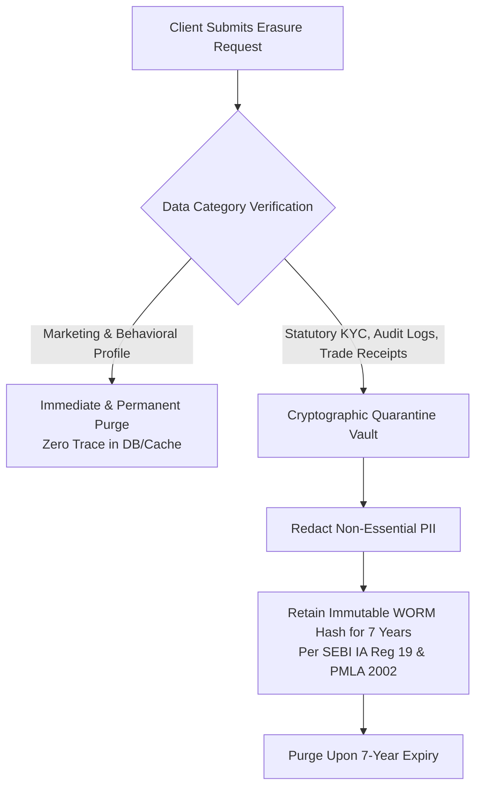

# Standard Operating Procedure (SOP): DPDP Data Privacy & LLM Sanitization Firewall

**Document Code**: `FINTEK-SOP-DPDP-LLM-2026-02`  
**Standard Version**: SOP-DPDP-1.0.0  
**Effective Date**: November 2026  
**Governing Authorities**: Digital Personal Data Protection Act, 2023 (DPDP Act), Data Protection Board of India (DPBI), and Ministry of Electronics and Information Technology (MeitY)  
**Applicability**: Software Engineering, Security Operations, Data Protection Officer (DPO), Customer Support, AI Engineering  

---

## 1. Statutory Mandate & Purpose

Under the **Digital Personal Data Protection Act, 2023 (DPDP Act)**, FintekPro operates as a **Data Fiduciary** handling sensitive financial, biometric, and identity information of Indian citizens (Data Principals).

Because FintekPro leverages commercial foundation models (Google Gemini, Groq, Cerebras, Anthropic) for advisory, portfolio synthesis, and query resolution, this SOP establishes the non-negotiable **LLM Pre-Prompt Sanitization Firewall**, customer consent workflows, and protocols to protect client privacy under Indian law.

---

## 2. Granular Consent Management (DPDP Section 6)

1. **Affirmative Itemized Consent**:
   - The platform must capture unambiguous, informed, and itemized consent before utilizing client portfolio, banking, or tax records for algorithmic processing.
   - Bundled or pre-ticked consent checkboxes are strictly prohibited.
2. **Purpose-Limited AI Processing**:
   - Client transaction histories may only be processed for the explicit purpose agreed upon (e.g. *"Generate personalized mutual fund rebalancing proposal"*).
   - Client financial data **must never be used to train, fine-tune, or calibrate public AI foundation models**.
3. **Withdrawal of Consent**:
   - Clients must have an intuitive portal toggle to withdraw consent for AI processing at any time. Upon withdrawal, automated model recommendations are disabled immediately.

---

## 3. The LLM Pre-Prompt Sanitization Firewall

Every external call to a Large Language Model API (Google Gemini, Groq, Anthropic, etc.) must transit through the central middleware [`ai-service.ts`](file:///Users/sangrammohanty/Documents/GitHub/FintekPro/server/services/ai-service.ts) and the **Pre-Prompt Sanitizer**:

```
Client Prompt / Financial Context
             │
             ▼
┌──────────────────────────────────────────────┐
│       PRE-PROMPT SANITIZATION FIREWALL       │
│  • Strip full Aadhaar (12 digits)            │
│  • Mask PAN to format: ABCDE****F            │
│  • Tokenize Bank / Demat Account numbers     │
│  • Pseudonymize Client Name & Address        │
│  • Round granular account balances to bands  │
└──────────────────────┬───────────────────────┘
                       │
                       ▼ Sanitized / Tokenized Payload
┌──────────────────────────────────────────────┐
│     EXTERNAL LLM API (Gemini / Groq / etc.)  │
│     *Enforced Zero Data Retention (ZDR)*     │
└──────────────────────┬───────────────────────┘
                       │
                       ▼ Raw LLM Response
┌──────────────────────────────────────────────┐
│         POST-INFERENCE DETOKENIZER           │
│  • Restore local display entities            │
│  • Enforce canonical math & explainability   │
│  • Attach MeitY AI Watermark Badge           │
└──────────────────────┬───────────────────────┘
                       │
                       ▼
            Client / Advisor Screen
```

### 3.1 Sanitization Rules Matrix
| Data Attribute | Incoming Format | Sanitized Format Sent to LLM | Action |
| :--- | :--- | :--- | :--- |
| **Aadhaar Number** | `1234 5678 9012` | `[REDACTED_AADHAAR]` | Completely stripped |
| **PAN Card** | `ABCDE1234F` | `ABCDE****F` | Last 4 characters masked |
| **Bank Account** | `918237491823` | `[BANK_ACCT_END_1823]` | Replaced with token |
| **Demat BO ID** | `1208160012345678` | `[DEMAT_END_5678]` | Replaced with token |
| **Investor Name** | `Sangram Mohanty` | `Investor_Client_Alpha` | Pseudonymized |
| **Portfolio Value** | `₹48,27,914.32` | `₹48 Lakhs (HNI Tier)` | Binned to brackets |

### 3.2 Zero Data Retention (ZDR) Verification
- All enterprise API agreements with foundation model providers must guarantee **Zero Data Retention (ZDR)**. Prompts and completions cannot be logged, cached, or reviewed by third-party vendor human evaluators.

---

## 4. Contestability & Right to Human Advisor Review (DPDP Section 12)

1. **Statutory Right to Challenge**:
   - Any client who receives an automated risk classification, loan eligibility rating, or model portfolio proposal has the statutory right to contest the decision.
2. **One-Click Human Review Trigger**:
   - The UI must surface a visible button: `Request Certified Human Review`.
   - Clicking this routes the complete advisory dossier to a certified SEBI-registered RIA or Chartered Accountant within the internal compliance dashboard.
   - The human advisor must deliver an independent review report within **48 business hours**.

---

## 5. Reconciling DPDP Erasure with SEBI & PMLA Statutory Retention

A fundamental regulatory tension exists between **DPDP Section 12 (Right to Erasure)** and **SEBI / PMLA Statutory Record Retention (7 Years)**. FintekPro enforces the following statutory hierarchy:



1. **Eligible for Immediate Erasure**:
   - Marketing email lists, behavioral browsing cookies, unsubmitted draft proposals, and app engagement telemetry are purged within **72 hours**.
2. **Subject to Mandatory Statutory Retention**:
   - KYC identity verification packs, signed RIA advisory agreements, risk profile logs, order execution receipts, and audit trail hashes **must be retained for 7 years** per SEBI (Investment Advisers) Regulations, 2013 (Reg 19) and PMLA 2002.
   - Such data is severed from live search indices and moved to a cold, encrypted, append-only WORM compliance vault accessible only upon court or regulatory subpoena.

---

## 6. MeitY AI Advisory & Watermarking Standards

1. **Visual Watermarking Badge**:
   - Every client-facing screen, exported PDF, or email containing AI-generated advisory narratives must feature the mandatory MeitY badge:
     ```
     🤖 AI-Assisted Advisory • Decision Support System Only • Subject to Certified Human Review
     ```
2. **Cryptographic Metadata Header**:
   - Exported PDFs and API responses must embed an immutable header:
     ```json
     {
       "x_fintek_ai_governance": {
         "generated_by": "FintekPro AI Core",
         "model_engine": "gemini-2.5-flash@2026",
         "prompt_template_version": "portfolio_review@1.2",
         "fasp_compliance_status": "VERIFIED_CANONICAL",
         "timestamp": "2026-11-05T09:30:00Z"
       }
     }
     ```

---

*FintekPro Data Protection Officer & Platform Security Operations*  
*Standard Operating Procedure — DPDP & LLM Privacy*

