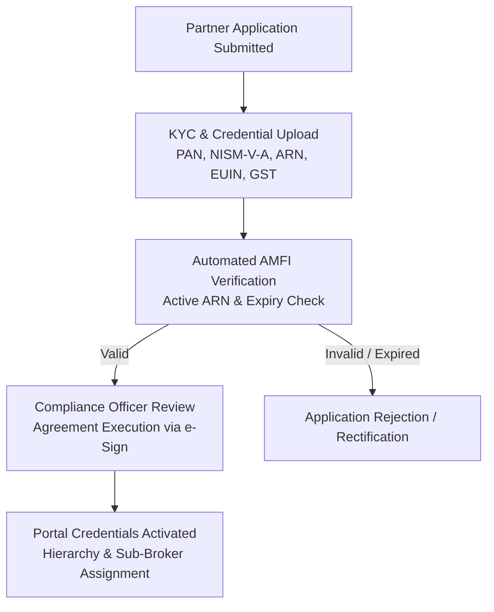

# Standard Operating Procedure (SOP): Financial Product Distribution Desk

**Document Code**: `FINTEK-SOP-DIST-DESK-2026-01`  
**Standard Version**: SOP-DIST-1.0.0  
**Effective Date**: November 2026  
**Governing Authorities**: SEBI (Mutual Funds Regs, IA Reg 22, OBPP Framework), AMFI (Code of Conduct), IRDAI, PFRDA, and RBI  
**Applicability**: Distribution Partners, Sub-Brokers, Sales Operations, Partner Engineering, Finance & Settlement Desk  

---

## 1. Statutory Mandate & Scope

This Standard Operating Procedure establishes the step-by-step operational workflows for onboarding distribution partners, enrolling sub-brokers and agents, verifying statutory credentials, executing product transactions, computing and reconciling commissions, and managing client grievance redressals on the FintekPro Partner Platform.

---

## 2. Partner, Sub-Broker & Agent Onboarding Workflow



### Step 1: Document Collection & Validation
Every Distribution Partner and Sub-Broker must submit:
1. **Identity & Entity Proof**: PAN Card, Certificate of Incorporation / Partnership Deed (for non-individuals), Address proof.
2. **Professional Certification**: Valid NISM-Series-V-A (Mutual Fund Distributors Certification) certificate.
3. **AMFI Registration**: Active ARN card and EUIN registration letters for all marketing staff and relationship managers.
4. **Bank Account Details**: Cancelled cheque or bank statement matching the registered ARN name.
5. **Tax Details**: Active GSTIN (mandatory if annual distribution turnover $> ₹20 \text{ Lakhs}$, or for inter-state service supplies).

### Step 2: Automated AMFI Registry Check
- System calls the AMFI API to verify:
  - ARN status is `ACTIVE` (not suspended, de-registered, or under investigation).
  - Validity expiry date is $\ge 90$ days from application date.
  - EUIN codes are linked to the specific ARN.

### Step 3: Distribution Agreement Execution
- Execution of the legally binding **FintekPro Distribution Intermediary Agreement** outlining commission sharing ratios, clawback obligations, code of conduct, and anti-rebating undertakings via Aadhaar e-Sign.

---

## 3. Statutory Segregation Pre-Trade Gate (SEBI IA Reg 22)

Before any client transaction can be routed as a distribution order:

```typescript
// Enforce SEBI Regulation 22 Client-Level Segregation
async function enforceDistributionSegregationGate(clientId: string, isin: string) {
  const clientProfile = await db.query.users.findFirst({ where: eq(users.id, clientId) });
  
  // Rule 1: Advisory Client Cannot Buy Regular Commission Products
  if (clientProfile.advisoryStatus === "ACTIVE_RIA_CLIENT") {
    throw new ComplianceError(
      "STATUTORY_SEGREGATION_BREACH",
      "Client is enrolled as a SEBI Registered Advisory Client. Purchase of commission-earning Regular Plans or partner distribution products is strictly prohibited under SEBI IA Regulation 22. Route transaction via Direct Plan only."
    );
  }

  // Rule 2: Immediate Family Check
  const familyAdvisoryLink = await checkFamilyAdvisoryStatus(clientProfile.familyId);
  if (familyAdvisoryLink.hasActiveRIAAdvisory) {
    throw new ComplianceError(
      "FAMILY_SEGREGATION_BREACH",
      "Immediate family member is enrolled in fee-based advisory. Distribution products blocked under SEBI IA Reg 22."
    );
  }
}
```

---

## 4. Pre-Trade Commission & TER Disclosure Workflow

Under SEBI Circular 2018/137, when an investor selects a Regular Plan on the portal:

1. **Automated TER Lookup**:
   - Fetch the latest daily Total Expense Ratio for the **Regular Plan** and the corresponding **Direct Plan** from the AMFI feed.
2. **Pre-Trade Modal Screen**:
   - The UI presents a non-dismissible comparison modal:
     ```
     ┌────────────────────────────────────────────────────────────────────────┐
     │                PRE-TRADE STATUTORY EXPENSE DISCLOSURE                  │
     ├────────────────────────────────────────────────────────────────────────┤
     │ Scheme: HDFC Top 100 Fund - Growth Option                              │
     │ Investment Amount: ₹1,00,000                                           │
     │                                                                        │
     │ • Regular Plan TER (Selected):     1.65% p.a.                          │
     │ • Direct Plan TER (Alternative):   0.90% p.a.                          │
     │ • Annual Distribution Cost:        0.75% p.a. (₹750 / year)            │
     │                                                                        │
     │ Estimated Distributor Trail Payout: ~0.65% p.a.                        │
     │                                                                        │
     │ [ Continue with Regular Plan ]            [ Switch to Direct Plan ]    │
     └────────────────────────────────────────────────────────────────────────┘
     ```
3. **Audit Log Generation**:
   - The investor's affirmative selection is logged with timestamp, client ID, IP address, and displayed TER values.

---

## 5. Multi-Product Transaction Routing

### 5.1 Mutual Funds Routing
1. Validate client CKYC and FATCA status.
2. Tag transaction payload with Partner ARN and RM EUIN:
   ```json
   {
     "scheme_code": "100123",
     "plan_type": "REGULAR",
     "arn": "ARN-182394",
     "euin": "E192837",
     "amount": 50000,
     "eop_category": "CAT_2_EXCHANGE"
   }
   ```
3. Route order via BSE StAR MF or NSE NMF II order execution bridge.

### 5.2 Insurance Sourcing (IRDAI Desk)
1. Complete and store digital **Need Analysis Questionnaire**.
2. Confirm client has received the Key Features Document (KFD) and policy wording.
3. Submit proposal to insurer API; log policy number upon issuance.
4. Trigger automated 30-day countdown for **Free-Look Period Tracking**.

### 5.3 Corporate Bonds / NCDs (SEBI OBPP Desk)
1. Verify instrument is listed on NSE/BSE debt market.
2. Display Clean Price, Accrued Interest, Dirty Price, and Yield to Maturity (YTM).
3. Confirm credit rating from CRISIL, ICRA, or CARE.
4. Route settlement via ICCL / NSCCL clearing corporation.

---

## 6. Commission Reconciliation, Invoicing & Payout Protocol

### 6.1 Trail Commission Calculation
- Trail commissions accrue daily based on client closing AUM and the scheme-specific trail rate agreed with the AMC.
- Monthly reverse broker feeds (WBR9 / Brokerage statements) from CAMS, KFintech, and insurers are ingested on the 10th of every month.

### 6.2 Clawback Processing
- If an investor redeems units within the statutory clawback window (12 months from purchase for equity schemes):
  - The AMC debits the clawed-back commission.
  - The system automatically reflects a matching deduction against the sourcing partner's ledger:
    `{ event: "COMMISSION_CLAWBACK", partner_id, folio_number, amount, reason: "EXIT_BEFORE_12M" }`.

### 6.3 Invoicing, GST & TDS Compliance
1. By the 15th of each month, the system generates automated tax invoices:
   - **TDS Deduction**: TDS is deducted at **5% under Section 194H** of the Income Tax Act (for commission payments to residents exceeding ₹15,000 p.a.).
   - **GST Reverse Charge / Forward Charge**: Verify whether partner is GST-registered; apply 18% GST as appropriate.
2. Payouts are disbursed via automated NEFT / RTGS banking rails by the 20th of the month.

---

## 7. Mis-Selling Prevention & Grievance Redressal Protocol

1. **Zero Rebating Enforcement**:
   - Any report or audit evidence of a partner agent offering cash-backs, gift cards, or fee waivers derived from commissions triggers an immediate freeze of the partner's account.
2. **Mis-Selling Escalation Queue**:
   - Customer complaints alleging mis-representation, unauthorized transaction execution, or return promises are routed to the **Nodal Grievance Officer**.
   - The Nodal Officer must investigate and resolve complaints within **14 calendar days**.
3. **SEBI SCORES & SMART ODR Integration**:
   - Unresolved disputes are integrated with the SEBI Complaints Redress System (SCORES) and the SMART Online Dispute Resolution portal.

---

*FintekPro Partner Operations & Distribution Governance Desk*  
*Standard Operating Procedure — Product Distribution Desk*

