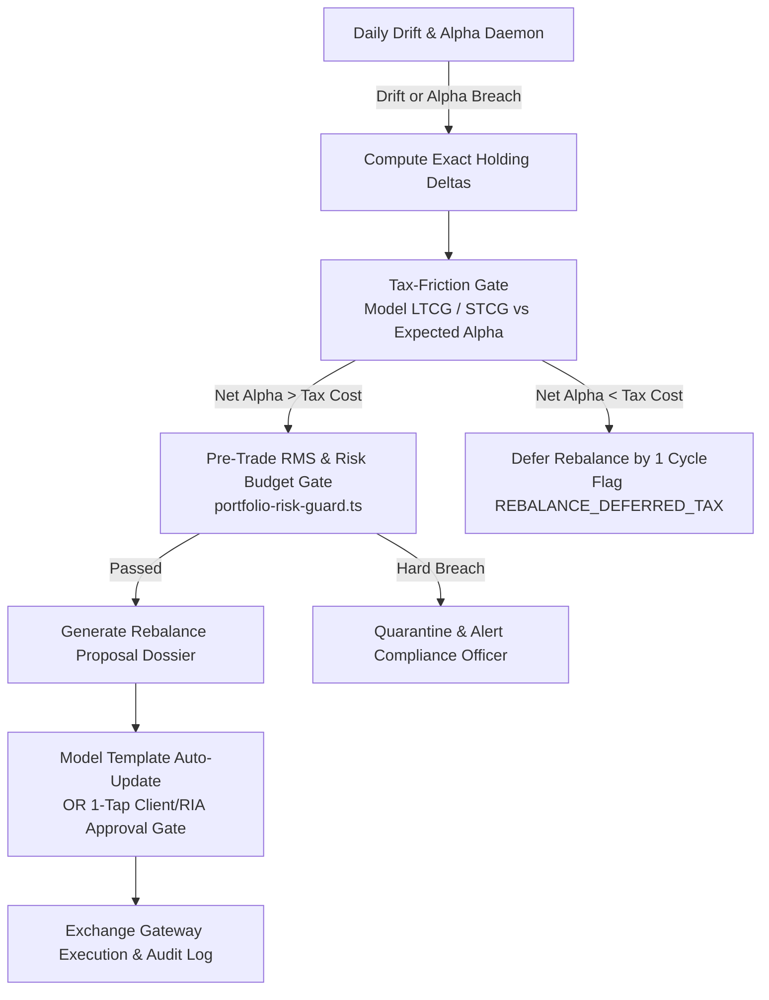

# FintekPro Standard Operating Policy: Universal Model Portfolio Performance & Alpha Monitoring (SOP-MPM v2.0)

**Document Code**: `SOP-MPM-2026-02`  
**Effective Date**: November 2026 (Supercedes SOP-BAL-2026-01)  
**Governing Regulations**: SEBI (Investment Advisers) Regulations, 2013 (Reg 16 & 17); SEBI (Mutual Funds) Regulations, 1996; SEBI (Portfolio Managers) Regulations, 2020; SEBI (Alternative Investment Funds) Regulations, 2012; AMFI Scheme Categorization Circular 2017; SEBI SIF Framework 2024  
**Scope of Coverage**: **UNIVERSAL** — All 40 Canonical Model Portfolios across all asset classes (`equity`, `debt`, `hybrid`, `thematic`, `goal_based`, `commodity`, `hni`, `alternatives`, `derivatives`) and all regulatory tiers (`retail_mf`, `affluent_sif`, `hni_pms`, `uhni_aif`)  
**Enforced By**: [`portfolio-rebalance-scheduler.ts`](../server/services/portfolio-rebalance-scheduler.ts) | [`portfolio-risk-guard.ts`](../server/services/portfolio-risk-guard.ts) | [`model-portfolio-metrics-service.ts`](../server/services/model-portfolio-metrics-service.ts) | [`model-portfolio-quant-service.ts`](../server/services/model-portfolio-quant-service.ts)

---

## 1. Executive Mandate & Universal Monitoring Scope

Model portfolios on FintekPro are deployed across four statutory regulatory tiers, catering to retail, affluent, HNI, and institutional mandates. Monitoring cannot be restricted to balanced portfolios alone; a single unmonitored equity, thematic, or fixed-income sleeve can accumulate severe benchmark tracking error, unhedged drawdowns, or fee leakage.

This Universal Standard Operating Procedure establishes a **continuous algorithmic monitoring, alpha-tracking, and risk-budgeting framework** for all model portfolios:

| Tier | Investment Vehicle | Statutory Minimum | Asset Classes Covered | Primary Mandate |
| :--- | :--- | :---: | :--- | :--- |
| **Retail MF / ETF** | Direct Plans & Direct ETFs | ₹500 (SIP) / ₹5,000 | Equity, Debt, Hybrid, Goal, Thematic | Low-cost, core diversification, zero commission drag |
| **Affluent SIF** | Specified Investment Products | ₹10,00,000 | Multi-Asset, Long-Short, Factor | Downside protection, long-short factor spreads |
| **HNI PMS** | Discretionary PMS | ₹50,00,000 | Concentrated Equities, High-Yield Debt | Pure factor alpha (Quality/Momentum), active rotation |
| **UHNI AIF** | Category II / III AIF | ₹1,00,00,000 | Multi-Strategy, Private Credit, Unlisted | Absolute return, macro hedging, illiquidity premium |

---

## 2. Statutory Asset Allocation Bands & Regulatory Guardrails

All model portfolios must operate strictly within their SEBI-mandated and prospectus-declared asset allocation bands:

| Asset Class / Category | Min Target Asset (%) | Max Target Asset (%) | Cash / Liquid Ceiling (%) | Statutory Reference |
| :--- | :---: | :---: | :---: | :--- |
| **Pure Large-Cap Equity** | 80% Large-Cap Equities | 100% | 10% | SEBI Categorization Circular 2017 |
| **Flexi-Cap / Multi-Cap** | 65% Equities (Multi-Cap: min 25% each in L/M/S) | 100% | 10% | SEBI/HO/IMD/DF3/CIR/P/2020/172 |
| **Mid & Small-Cap Equity** | 65% Mid/Small-Caps | 100% | 8% | SEBI Categorization Circular 2017 |
| **Thematic / Sectoral** | 80% in Mandate Sector | 100% | 5% | SEBI Categorization Circular 2017 |
| **Conservative Hybrid** | 10% – 25% Equity | 75% – 90% Debt | 15% | SEBI/HO/IMD/DF3/CIR/P/2017/114 |
| **Balanced Hybrid** | 40% – 60% Equity | 40% – 60% Debt | 12% | SEBI/HO/IMD/DF3/CIR/P/2017/114 |
| **Aggressive Hybrid** | 65% – 80% Equity | 20% – 35% Debt | 10% | SEBI/HO/IMD/DF3/CIR/P/2017/114 |
| **Dynamic Asset Allocation (BAF)** | 0% – 100% Equity (unconstrained) | 0% – 100% Debt | 15% | Model-driven; net equity disclosed |
| **Multi-Asset Allocation** | Min 3 asset classes, each $\ge 10\%$ | — | 12% | Gold/Commodities min 10% |
| **Pure Debt / G-Sec** | 0% Equity | 100% Debt / G-Secs | 15% | Duration matched to SID |
| **SIF Long-Short Equity** | Net Equity 25% – 75% (Gross $\le 125\%$) | 25% – 75% Debt/Hedge | 15% | SEBI SIF Master Framework 2024 |
| **PMS Concentrated Alpha** | 85% – 100% Direct Equities (15–25 stocks) | 0% – 15% Cash/Debt | 10% | SEBI PMS Regulations 2020 |

> [!IMPORTANT]
> Any inadvertent band breach caused by price divergence must be **rectified within 30 days** in compliance with SEBI operational circulars.

---

## 3. Universal Monitoring Cadence, Thresholds & Triggers

### 3.1 Daily & Weekly Automated Cadence

The quant monitoring daemon evaluates all 40 model portfolios on a scheduled cadence:

| Monitoring Activity | Frequency | Asset Class In Scope | Trigger Condition | Enforcement System |
| :--- | :--- | :--- | :--- | :--- |
| **Asset-Mix Drift Check** | Daily (4:30 PM IST) | All (Multi-Asset & Hybrid) | Live equity/debt/gold % deviates by $> \pm 3.5\text{pp}$ to $\pm 5\text{pp}$ | `portfolio-rebalance-scheduler.ts` |
| **Security Drift Check** | Daily (4:30 PM IST) | All (Pure Equity & Debt) | Single holding weight drifts by $> \text{threshold}$ (Liquid: 2%, Debt: 3%, Eq: 5%, Thematic: 7%) | `model-portfolio-quant-service.ts` |
| **Benchmark Tracking & TWRR** | Weekly (nav-sync) | All 40 Portfolios | Portfolio trailing TWRR lags benchmark by $> 1.5\text{pp}$ on rolling 3M/6M basis | `model-portfolio-metrics-service.ts` |
| **Sharpe / Sortino Floor** | Monthly | All Portfolios | Sharpe ratio drops below mandate floor (Conservative: 0.85, Moderate: 0.65, Aggressive: 0.45) | `portfolio-risk-guard.ts` |
| **Max Drawdown Breach** | Real-Time (Intraday) | All Portfolios | Drawdown from peak breaches mandate limit (Conservative: -6%, Moderate: -14%, Aggressive: -24%) | `portfolio-risk-guard.ts` (Hard Breach) |
| **Alpha Drag & Underperformer Check** | Monthly | All Portfolios | Single constituent trailing alpha $< \text{alphaDragFloor}$ on rolling 6M basis OR bottom quartile peer rank | `portfolio-risk-guard.ts` |
| **Excess Cash Drag Check** | Daily | All Portfolios | Uninvested cash $>$ `maxCashDrag` (Conservative: 15%, Moderate: 10%, Aggressive: 8%, HNI: 5%) | `portfolio-risk-guard.ts` |
| **Correlation Breakdown** | Monthly | Multi-Asset & SIF | Cross-asset correlation (Equity vs Debt or Equity vs Gold) flips to $> +0.50$ | `global-macro-transmission-service.ts` |

### 3.2 Emergency Circuit Breakers

| Market Shock Event | Algorithmic Escalation Protocol |
| :--- | :--- |
| **Nifty 50 Intraday Drop $\ge 7\%$** | `circuit_breaker_tripped = true`; automated rebalance suspended immediately to prevent selling into flash liquidity vacuums. |
| **Implied Volatility (India VIX) $> 35$** | Switch to Risk-Off defensive regime. All momentum-driven buying paused; portfolio volatility budgets tightened by 20%. |
| **RBI Emergency Rate Hike $\ge 50\text{ bps}$** | Trigger debt duration review. Compress portfolio modified duration across fixed-income sleeves. |
| **Credit Rating Downgrade $<$ AA** | Immediate mandatory liquidation proposal generated for affected corporate bond ISIN within 24 hours. |

---

## 4. Benchmark Architecture Across All 40 Portfolios

Every model portfolio must be measured against a designated official total return benchmark stored in `benchmark_name` and `blended_benchmark_return`:

```
                             OFFICIAL BENCHMARK MAP
  ┌─────────────────────────┬─────────────────────────┬─────────────────────────┐
  │      EQUITY BASKETS     │      DEBT BASKETS       │   HYBRID & MULTI-ASSET  │
  │ Nifty 50 / 500 TRI      │ CRISIL Composite Bond   │ CRISIL Hybrid 60:40     │
  │ Nifty Midcap 150 TRI    │ CRISIL Dynamic Gilt     │ CRISIL Multi-Asset 60:40│
  │ Nifty Smallcap 250 TRI  │ CRISIL Liquid Debt      │ CRISIL Hybrid 25:75     │
  └─────────────────────────┴─────────────────────────┴─────────────────────────┘
```

| Portfolio Sub-Category | Official Benchmark | Composition / Methodology |
| :--- | :--- | :--- |
| **Large-Cap Bluechips** | Nifty 50 TRI | 100% Nifty 50 Total Return Index |
| **Flexi-Cap / Core Equity** | Nifty 500 TRI | 100% Broad Market Equity Total Return Index |
| **Mid-Cap Alpha** | Nifty Midcap 150 TRI | 100% Midcap Benchmark Total Return Index |
| **Small-Cap Growth** | Nifty Smallcap 250 TRI | 100% Smallcap Benchmark Total Return Index |
| **Sectoral / Thematic** | Nifty Sector TRI (IT/Bank/Pharma/Infra) | 100% Corresponding Sectoral Total Return Index |
| **Conservative Capital Preserver** | CRISIL Hybrid 25:75 Index | 25% Nifty 50 TRI + 75% CRISIL Composite Bond Index |
| **Moderate Balanced Growth** | CRISIL Hybrid 60:40 Index | 60% Nifty 50 TRI + 40% CRISIL Composite Bond Index |
| **Aggressive Wealth Builder** | CRISIL Hybrid 80:20 Index | 80% Nifty 50 TRI + 20% CRISIL Composite Bond Index |
| **All-Weather Multi-Asset** | CRISIL Multi Asset 60:40 Index | 60% Equity / 20% Debt / 10% Gold / 10% REITs |
| **Pure Sovereign / Corporate Debt** | CRISIL Composite Bond Fund Index | Weighted Sovereign & AAA Corporate Bond composite |
| **Treasury / Liquid** | CRISIL Liquid Debt Index | 100% Overnight / Money Market composite |
| **Affluent SIF / Long-Short** | Nifty 500 Multicap 50:25:25 TRI | Blended equity with short derivative overlay benchmark |
| **HNI Discretionary PMS** | S&P BSE 500 TRI (APMI Standard) | APMI standard equity benchmark for discretionary PMS |
| **UHNI Alternative Multi-Strat** | CRISIL Multi Asset 60:40 Index | Institutional multi-asset composite benchmark |

---

## 5. Tactical Asset Allocation (TAA) & Benchmark Outperformance Protocol

To structurally eliminate benchmark underperformance and generate persistent positive alpha ($\alpha > 0$):

### 5.1 Direct Cost-Elimination Gate (Mandatory Zero-Commission Execution)
- All advisory model portfolios must execute exclusively in **Direct Plans (`ISIN` Direct-Growth)** or **ultra-low-cost Direct ETFs ($\le 0.15\%$ TER)**.
- Regular Plans with distributor commission trails (0.75%–1.50% p.a.) are strictly prohibited in advisory model portfolios. This immediately eliminates a 100–150 bps annual structural drag against gross Total Return Benchmarks.

### 5.2 Valuation-Driven Tactical Asset Allocation (BEER Ratio Overlay)
The engine continuously computes the **Bond-Equity Earnings Yield Ratio (BEER)**:
$$\text{BEER} = \frac{\text{10-Year Indian Sovereign G-Sec Yield}}{\text{Nifty 50 Earnings Yield} \, (E/P = 1 / \text{PE})}$$

- **Equity Froth Regime ($\text{BEER} > 1.30$)**: Incrementally trim satellite equity by 5%–10% within statutory SEBI bands and allocate into Short-Duration Debt or Arbitrage to preserve capital.
- **Fair Value Regime ($0.90 \le \text{BEER} \le 1.30$)**: Maintain target strategic asset allocation.
- **Equity Undervaluation Regime ($\text{BEER} < 0.90$)**: Deploy cash reserves and expand equity weights toward the upper SEBI boundary to capture valuation mean reversion.

### 5.3 Core-Satellite Factor Engine
- **Core Sleeve (50%–70%)**: Low-cost index ETFs + Target Maturity Sovereign Debt. Tracks the baseline benchmark at zero tracking error and minimal fee drag.
- **Satellite Sleeve (30%–50%)**: High-conviction factor-tilted direct equities (Quality + Momentum + High ROCE + Free Cash Flow Yield). Designed to generate an active factor alpha spread of $+200$ to $+400\text{ bps}$ over the market-cap benchmark.

### 5.4 Accelerated Underperformer Ejection (Alpha Drag Stop-Loss)
- Any holding whose rolling 6-month trailing alpha breaches its mandate's `alphaDragFloor` ($-2.5\%$ to $-4.0\%$) **OR** ranks in the bottom quartile of its category for 2 consecutive monthly reviews triggers an **Automated Candidate Replacement Dossier**.
- No underperforming asset is permitted to linger for multiple quarters eroding portfolio capital.

---

## 6. Unified Multi-Leg Rebalancing & Drift Correction Protocol

When drift or underperformance triggers a rebalance (`needs_rebalance = true`):



1. **Tax-Friction Optimization**: The engine calculates the net tax impact (STCG @ 20%, LTCG @ 12.5% post Budget 2024). Rebalancing is approved only if expected forward alpha gains exceed transaction costs and tax friction.
2. **FASP-AI Non-Delegation Gate**: Client accounts are never traded autonomously. Proposals are dispatched to the RIA / CA dashboard or client mobile app for explicit one-tap authorization.
3. **Execution Integrity**: Orders are sized into whole integer shares (no fractional leakage) and routed as limit orders with dynamic tick-level slippage buffers via `upstoxMarketDataService`.

---

## 7. Universal Performance Attribution & Decision Logging Schema

Every model portfolio must emit a monthly **performance attribution and audit event** logged to `portfolio_ai_decisions` and persisted for 7 years (SEBI IA Reg 16):

```json
{
  "event": "MODEL_PORTFOLIO_PERFORMANCE_REVIEW",
  "portfolio_id": "<string>",
  "portfolio_code": "<string>",
  "asset_class": "equity | debt | hybrid | thematic | goal_based",
  "portfolio_tier": "retail_mf | affluent_sif | hni_pms | uhni_aif",
  "review_period": "YYYY-MM",
  "portfolio_twrr_1m": 1.85,
  "portfolio_twrr_1y": 16.42,
  "benchmark_return_1y": 14.10,
  "active_alpha_1y": 2.32,
  "sharpe_ratio": 1.15,
  "sortino_ratio": 1.82,
  "information_ratio": 0.68,
  "max_drawdown_3m": -4.20,
  "current_cash_drag_pct": 4.5,
  "drift_score": 1.8,
  "beer_ratio": 1.08,
  "underperformer_count": 0,
  "rebalance_recommended": false,
  "compliance_status": "COMPLIANT",
  "model_version": "FASP-AI v3.1",
  "engine_version": "FASP-AI-v3.1-ALGO",
  "calculation_timestamp": "2026-11-11T15:00:00.000Z"
}
```

---

## 8. Quantitative Risk Budgets (Universal Calibration)

Enforced in [`portfolio-risk-guard.ts`](../server/services/portfolio-risk-guard.ts) across all model portfolios:

| Risk Mandate | Max Volatility ($\sigma$) | Max Drawdown | Beta Ceiling ($\beta$) | Sharpe Floor | Max Single Holding | Max Sector Weight | Max Cash Drag | Alpha Drag Floor |
| :--- | :---: | :---: | :---: | :---: | :---: | :---: | :---: | :---: |
| **Conservative Capital Preserver** | 8.0% | -6.0% | 0.45 | 0.85 | 30.0% | 50.0% | 15.0% | -2.5% |
| **Moderate Balanced Growth** | 16.0% | -14.0% | 1.05 | 0.65 | 25.0% | 40.0% | 10.0% | -3.0% |
| **All-Weather Multi-Asset** | 12.0% | -10.0% | 0.75 | 0.80 | 25.0% | 40.0% | 12.0% | -2.8% |
| **Aggressive Wealth Builder** | 26.0% | -24.0% | 1.65 | 0.45 | 15.0% | 35.0% | 8.0% | -3.5% |
| **High Alpha Opportunities** | 30.0% | -28.0% | 1.95 | 0.35 | 12.0% | 30.0% | 5.0% | -4.0% |

- **Hard Breach**: Violations of `maxSingleWeight`, `betaCeiling`, or `maxDrawdown` halt auto-apply.
- **Soft Warning**: Exceeding `maxCashDrag` or breaching `alphaDragFloor` logs `{ event: "RISK_SOFT_WARNING" }` and generates an underperformer replacement dossier.

---

## 9. Universal Codebase Enforcement Architecture

| SOP Rule | Enforcing Code Service | Execution Cadence |
| :--- | :--- | :--- |
| **Universal Portfolio Monitoring** | `monitorAllModelPortfolios()` in [`portfolio-rebalance-scheduler.ts`](../server/services/portfolio-rebalance-scheduler.ts) | Daily at 4:30 PM IST (post-market close) |
| **Pre-Trade Risk & Alpha Guard** | [`portfolio-risk-guard.ts`](../server/services/portfolio-risk-guard.ts) | Real-time on every rebalance or holding proposal |
| **Quant Alpha & Drift Scoring** | [`model-portfolio-quant-service.ts`](../server/services/model-portfolio-quant-service.ts) | Real-time & scheduled sweep |
| **TWRR & Blended Benchmark Engine** | [`model-portfolio-metrics-service.ts`](../server/services/model-portfolio-metrics-service.ts) | Daily / Weekly NAV ingestion batch |
| **Integer Sizing & Slippage Guard** | [`model-portfolio-share-sizing.ts`](../server/services/model-portfolio-share-sizing.ts) | Pre-order routing |
| **Audit Ledger Persistence** | `sebi_audit_logs` & `portfolio_ai_decisions` | Immutable WORM persistence (7-year retention) |

### 9.1 The Universal `monitorAllModelPortfolios()` Function Specification
The scheduled cron invokes:
```typescript
/**
 * monitorAllModelPortfolios()
 * SOP-MPM v2.0 — Universal automated monitoring for all 40 canonical portfolios.
 *
 * Checks:
 *   1. Asset-class and security-level weight drift.
 *   2. TWRR vs Official TRI Benchmark deviation.
 *   3. Underperformer trailing alpha breaches (< alphaDragFloor).
 *   4. Excessive cash drag (> maxCashDrag).
 *   5. Drawdown circuit breaker trips.
 *
 * Schedule: Daily at 4:30 PM IST post-market close.
 * Outputs:  { totalChecked, driftCount, underperformersFlagged, rebalanceProposalsQueued }
 */
export async function monitorAllModelPortfolios(): Promise<UniversalMonitorResult>;
```

---

## 10. Statutory & Client Disclosure Requirements

Every model portfolio factsheet, recommendation proposal, and monthly statement must display:

1. **Official Benchmark Co-Display**: *"This model portfolio is benchmarked against [Benchmark Name]. Comparative returns are computed on a Total Return Index (TRI) basis net of statutory costs."*
2. **Performance Statutory Caution**: *"Past performance is not indicative of future returns. Investments in securities markets are subject to market risks. Model portfolios are algorithmic decision support systems and do not guarantee returns or capital protection."*
3. **Expense & Holding Disclosures**: Full breakdown of constituent ISINs, weights, expense ratios (TER), and current cash/debt allocation.
4. **Rebalance Audit Trail**: Full disclosure of rebalance timestamps, rationale (drift correction vs. underperformer replacement), and estimated tax implications.

---

*FintekPro Investment & Risk Committee (IRC)*  
*SOP-MPM v2.0 — Universal Model Portfolio Performance & Alpha Monitoring*  
*Standard Version: 2.0.0 (Universal)*
