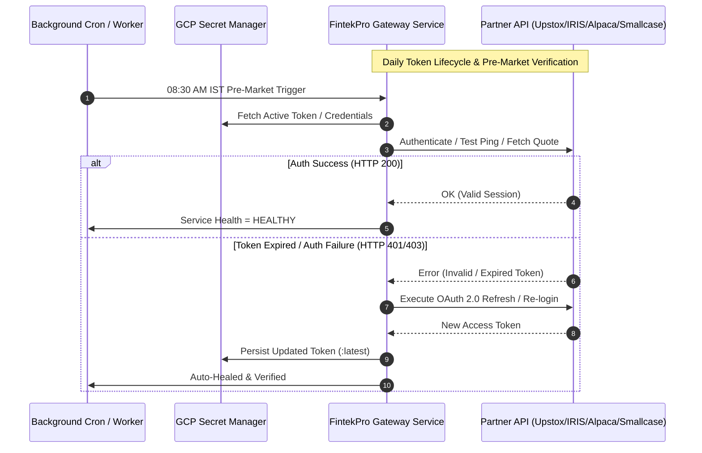
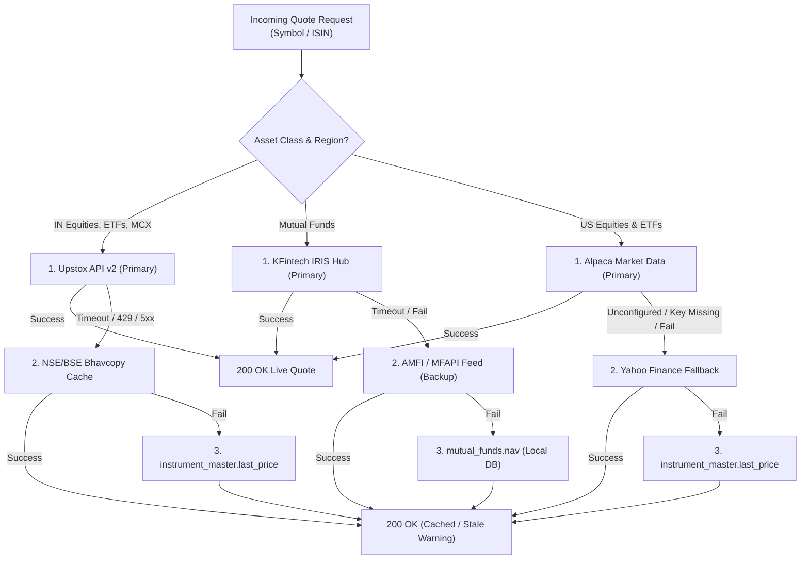

# FintekPro Standard Operating Policy: Third-Party Partner & Broker API Governance (SOP-API v1.0)

**Document Code**: SOP-API-2026-01  
**Effective Date**: November 2026  
**Governing Authorities**: SEBI (Securities and Exchange Board of India), RBI (Reserve Bank of India), CERT-In (Indian Computer Emergency Response Team), US FINRA / SEC (via Alpaca clearing), and DPDP Act 2023  
**Statutory Desks**: Upstox Gateway Desk, KFintech IRIS Hub, Alpaca International Broker Desk, Smallcase Gateway Desk  
**Target Architecture**: Multi-Vendor Resilient API Engine (`server/services/instruments/multi-vendor-resolver.ts`)  

---

## 1. Statutory Mandate, Scope & Architectural Boundary

This Standard Operating Procedure (SOP) defines the non-negotiable operational, technological, and regulatory protocols governing all external third-party Application Programming Interfaces (APIs) connected to the FintekPro ecosystem. 

FintekPro interfaces with licensed institutional infrastructure providers across four critical asset and transaction domains:
1. **Upstox API v2 (RKSV Securities India Pvt. Ltd.)**: Primary licensed exchange market data feed and order routing gateway for Indian Listed Equities (NSE/BSE), Equity Derivatives (F&O), Commodities (MCX), Exchange Traded Funds (ETFs), Sovereign Gold Bonds (SGBs), and Benchmark Indices.
2. **KFintech IRIS Hub (KFin Technologies Ltd.)**: Primary Registrar & Transfer Agent (RTA) gateway for Mutual Funds (Direct & Regular schemes), Corporate Fixed Deposits, National Pension System (NPS), and Specialised Investment Funds (SIF/AIF).
3. **Alpaca Broker API (Alpaca Securities LLC / BMO Harris Bank N.A.)**: FINRA/SIPC registered clearing broker gateway powering US Equity & ETF trading, fractional share custody, and outward SWIFT wire funding for Indian residents under the **RBI Liberalised Remittance Scheme (LRS)**.
4. **Smallcase Gateway (Smallcase Technologies Pvt. Ltd.)**: Non-custodial basket transaction engine, model portfolio rebalancing bridge, and Demat Loan Against Securities (LAS) eligibility evaluator.

---

## 2. Zero-Trust Credential Management & Secret Lifecycle

In strict compliance with **FintekPro Global Coding Rules (GCR v1.0)** and **SEBI CSCRF (Cybersecurity and Cyber Resilience Framework)**:

### 2.1 Storage & Access Isolation
- **No Hardcoded Secrets**: Plaintext API keys, secrets, tokens, or private certificates in code repositories, environment config files, or client-side bundles are strictly prohibited.
- **Google Cloud Secret Manager**: All production credentials reside exclusively in GCP Secret Manager under project `fintekpro` and are mounted into Cloud Run runtime memory via encrypted environment variables:
  - Upstox: `UPSTOX_ACCESS_TOKEN`, `UPSTOX_TOKEN_ISSUED_AT`
  - IRIS: `IRIS_USERNAME`, `IRIS_PASSWORD`, `IRIS_TENANT_CODE`
  - Alpaca: `ALPACA_API_KEY`, `ALPACA_API_SECRET`, `ALPACA_ENV`
  - Smallcase: `SMALLCASE_GATEWAY_NAME`, `SMALLCASE_SECRET`
- **IAM Principle of Least Privilege**: Access to API secret versions is granted strictly to the Cloud Run runtime service account (`fintekpro-app@fintekpro.iam.gserviceaccount.com`). Developer and CI/CD IAM accounts possess no read access to production API keys.

### 2.2 Periodic & Emergency Credential Rotation
1. **Scheduled 90-Day Rotation**: API keys, passwords, and webhook secrets must be rotated every 90 calendar days according to the FintekPro Security Calendar.
2. **Emergency Revocation (< 15 Minutes)**: In the event of suspected token leakage or anomalous API activity:
   - The Security Officer triggers immediate revocation in the provider partner portal.
   - Updated credentials are deployed to GCP Secret Manager via:
     ```bash
     gcloud secrets versions add <SECRET_NAME> --data-file=- <<< "<NEW_SECRET_VALUE>"
     ```
   - Cloud Run automatically loads the `:latest` version on the next request or via container restart.

---

## 3. Provider Authentication & Token Lifecycle SOP



### 3.1 Upstox API v2
- **Token Validity**: Upstox OAuth 2.0 access tokens expire daily at 03:30 AM IST.
- **Daily Pre-Market Renewal SOP (08:30 AM IST)**:
  1. The automated worker verifies token readiness via `upstoxMarketDataService.isReady()`.
  2. If the token is within 1 hour of expiration or invalid, the system alerts the operations team or executes the automated login flow using the registered redirect URI.
  3. Once renewed, `UPSTOX_ACCESS_TOKEN` and `UPSTOX_TOKEN_ISSUED_AT` are updated in Secret Manager.

### 3.2 KFintech IRIS Hub
- **Session Duration**: IRIS tokens expire every 60 minutes.
- **Heartbeat & Re-login SOP**:
  1. Handled by [`iris-service.ts`](file:///Users/sangrammohanty/Documents/GitHub/FintekPro/server/services/iris-service.ts).
  2. The service maintains an in-memory session token with a 5-minute pre-expiry buffer.
  3. Upon receipt of HTTP 401/403, the client re-authenticates automatically using tenant credentials and retries the original request transparently (zero user impact).

### 3.3 Alpaca Broker API
- **Authentication**: Stateless HMAC request headers (`APCA-API-KEY-ID` and `APCA-API-SECRET-KEY`).
- **Endpoint Routing**:
  - Live Trading & Custody: `https://broker-api.alpaca.markets/v1`
  - Market Data (IEX/SIP): `https://data.alpaca.markets/v2`
- **Environment Parity**: Staging environments connect to Alpaca Sandbox (`https://broker-api.sandbox.alpaca.markets/v1`). Production connects strictly to Live Trading with dual-approval key issuance.

### 3.4 Smallcase Gateway
- **Transaction Model**: Smallcase Gateway employs a **Server-Side Generated Transaction Model**. The client browser SDK never communicates directly with Smallcase without a server-signed JWT.
- **JWT Signing Specification**:
  - Algorithm: `HS256` signed using `SMALLCASE_SECRET`.
  - Token Expiration: Strict 15-minute TTL (`exp = now + 900`).
  - User Claims: `sub = smallcaseAuthId` for connected users; guest payloads for unlinked users.
- **Zero-Storage of Broker Passwords**: FintekPro never receives, stores, or processes client broker credentials. Broker authentication occurs strictly inside the Smallcase Gateway SDK.

---

## 4. Rate Limiting, Throttling & Circuit Breakers

To protect partner endpoints and prevent platform-wide cascading failures, all outgoing calls must route through the FintekPro Throttling Layer:

| Provider | Burst Limit | Sustained Cap | Backoff Policy | Circuit Breaker Threshold |
| :--- | :--- | :--- | :--- | :--- |
| **Upstox Market Data** | 50 req/s | 25 req/s | Exponential (50ms $\rightarrow$ 200ms $\rightarrow$ 800ms) | 5 failures in 10s $\rightarrow$ Open 30s |
| **Upstox OMS (Orders)** | 15 req/s | 10 req/s | Exponential + Jitter | 3 consecutive failures $\rightarrow$ Open 60s |
| **KFintech IRIS Hub** | 20 req/s | 15 req/s | 2 retries, 500ms backoff | 5 failures in 15s $\rightarrow$ Open 45s |
| **Alpaca Market Data** | 250 req/min | 200 req/min | 2 retries, 1000ms backoff | 4 failures in 20s $\rightarrow$ Open 60s |
| **Alpaca Broker API** | 120 req/min | 100 req/min | Fail immediately (No blind retries) | 3 failures in 30s $\rightarrow$ Open 120s |
| **Smallcase Gateway** | 60 req/min | 50 req/min | 2 retries, 300ms backoff | 5 failures in 20s $\rightarrow$ Open 30s |

### Circuit Breaker States
1. **CLOSED (Normal)**: All traffic passes to the primary partner API. Latency and error counters tracked.
2. **OPEN (Tripped)**: When error rate exceeds threshold ($\ge 50\%$ over evaluation window), the breaker trips. Requests immediately fail over to the secondary fallback without hitting the partner network.
3. **HALF-OPEN (Recovery Probe)**: After the timeout window elapses, a single probe request is permitted through. If successful, the breaker resets to `CLOSED`; if it fails, the timeout doubles.

---

## 5. Self-Healing Failover & Degraded Mode Operations

In accordance with **FintekPro Self-Healing Rules**: *"Never crash the full system — return partial results with a warning and fail over to secondary providers."*



---

## 6. Regulatory Guardrails & Fiduciary Execution Rules

### 6.1 Non-Autonomous Execution (FASP-AI v1.0 Mandate)
- **Zero Autonomous Trading**: No AI algorithm, scheduled job, or automated webhook may place trades without explicit, non-delegated client confirmation.
- **Advisor & Client Approvals**: Model portfolio rebalances require explicit client approval (via SMS/WhatsApp OTP or authenticated app confirmation) or licensed RIA/CA sign-off.

### 6.2 Upstox Order Routing & SEBI Risk Guardrails
1. **Idempotency**: Every order submission generates a deterministic idempotency key (`ORDER_REQ_{userId}_{isin}_{timestamp}`) preventing duplicate executions on transient network retries.
2. **Pre-Trade Margin Verification**: Order routing checks available funds and DP holding balances before dispatching orders to the Upstox OMS.
3. **Non-Custodial Broker Execution**: FintekPro functions purely as a technology interface. Client funds and securities remain with Upstox / CDSL / NSDL.

### 6.3 KFintech IRIS & SEBI NAV Cut-off Guardrails
1. **Universal NAV Cut-off Enforcement**:
   - Liquid & Overnight Schemes: **1:30 PM IST**
   - Equity, Debt, and Hybrid Schemes: **3:00 PM IST**
2. **Post-Cut-Off Handling**: Orders authorized post-cutoff are assigned an immutable audit timestamp and queued for next-business-day execution (`T+1`).

### 6.4 Alpaca & RBI FEMA LRS Compliance
1. **Cash-Only Enforcement**: Under RBI Liberalised Remittance Scheme rules (max \$250,000 per financial year), Indian residents cannot trade on margin, execute short sales, or trade crypto assets. [`AlpacaKycMapper`](file:///Users/sangrammohanty/Documents/GitHub/FintekPro/server/services/alpaca/onboarding/alpacaKycMapper.ts) strictly restricts accounts to `enabled_assets: ["us_equity"]`.
2. **International SWIFT Wire Clearing Protocol**:
   - Beneficiary Bank: BMO Harris Bank N.A. (Chicago, IL, USA)
   - Remittance Reference (Field 70): Mandatory inclusion of the investor's unique Alpaca Account Number (`APCA-...`).
   - Purpose Code: Mandatory Form A2 submission under RBI Purpose Code **`S0001`** (Indian investment in equity shares abroad).

### 6.5 Smallcase Demat Lending (LAS) Guardrails
1. **SEBI/RBI Loan-to-Value (LTV) Caps**: Loan against listed equity shares is capped at **50% of the approved portfolio valuation** in strict compliance with RBI Master Directions.
2. **Pledge / Depository Lien Marking**: Loan disbursals remain locked until an irrevocable electronic pledge confirmation is acknowledged by NSDL or CDSL.

---

## 7. Audit Logging, Data Privacy & Time Synchronization

1. **Structured Log Standard**: Every external partner call must emit structured JSON logs:
   ```json
   {
     "event": "PARTNER_API_CALL",
     "provider": "upstox",
     "endpoint": "/v2/market-quote/quotes",
     "http_status": 200,
     "latency_ms": 142,
     "status": "success",
     "idempotency_key": "QUOTE_INF204KB14I2_1730951234",
     "timestamp": "2026-11-07T03:48:20.142Z"
   }
   ```
2. **Mandatory PII Masking (DPDP Act 2023)**:
   - Permanent Account Number (PAN): Mask characters 6 through 8 (`ABCDE****F`).
   - Bank Account Numbers: Mask all except last 4 digits (`******1234`).
   - Passwords, OAuth tokens, and client secrets: Omitted entirely from logs.
3. **NTP Time Synchronization (CERT-In Compliance)**:
   - Server clocks on Cloud Run and Cloud SQL sync continuously with the National Physical Laboratory (NPL) NIC NTP pool (`time.nic.in` / `time.google.com`).
   - Maximum allowable clock drift: **$\le \pm 50\text{ms}$**.
4. **Log Retention**: Audit trails of order submissions, API responses, and financial ledger modifications are preserved for a minimum statutory period of **5 years** (SEBI / PMLA mandate).

---

## 8. Incident Management, Alerting & Partner Escalation Matrix

### 8.1 Incident Severity Levels
- **Severity 1 (Critical Partner Outage)**: Primary market data or order routing partner offline during live market hours (09:15 AM – 03:30 PM IST).
  - *Action*: Automatic failover to secondary provider. PagerDuty alert to Lead Systems Engineer within 60 seconds.
- **Severity 2 (Degraded Performance / Latency $> 2000\text{ms}$)**: High latency or sporadic HTTP 429 rate limit errors.
  - *Action*: Circuit breaker trips to HALF-OPEN. Cache TTL doubled temporarily.
- **Severity 3 (Non-Critical Sync Error)**: Nightly master sync batch job failure.
  - *Action*: Automated retry with 15-minute backoff. Slack alert to `#dev-ops`.

### 8.2 Partner Escalation Directory

| Provider | Primary NOC / Support Desk | Escalation Level 2 (Technical) | Escalation Level 3 (Management) |
| :--- | :--- | :--- | :--- |
| **Upstox API Team** | `api-support@upstox.com` | Partner Engineering Lead | Head of Institutional Alliances |
| **KFintech IRIS Desk** | `iris.support@kfintech.com` | Institutional Solutions Head | Chief Technology Officer |
| **Alpaca Broker Operations** | `broker-support@alpaca.markets` | API Integration Specialist | VP, Global Clearing & Partnerships |
| **Smallcase Gateway** | `gateway-support@smallcase.com` | Developer Relations Manager | VP, Engineering |

---

## 9. Regulatory Review & Audit Cadence

This Standard Operating Procedure is reviewed and re-certified on a **semi-annual basis** by the FintekPro Compliance Council and the Principal Officer to incorporate emerging regulatory circulars from SEBI, RBI, and partner broker technical revisions.

*Document Approved by*: FintekPro Legal, Regulatory & Technology Council  
*Distribution*: Engineering, Product, Compliance, Operations, and RIA Advisory Desks  

