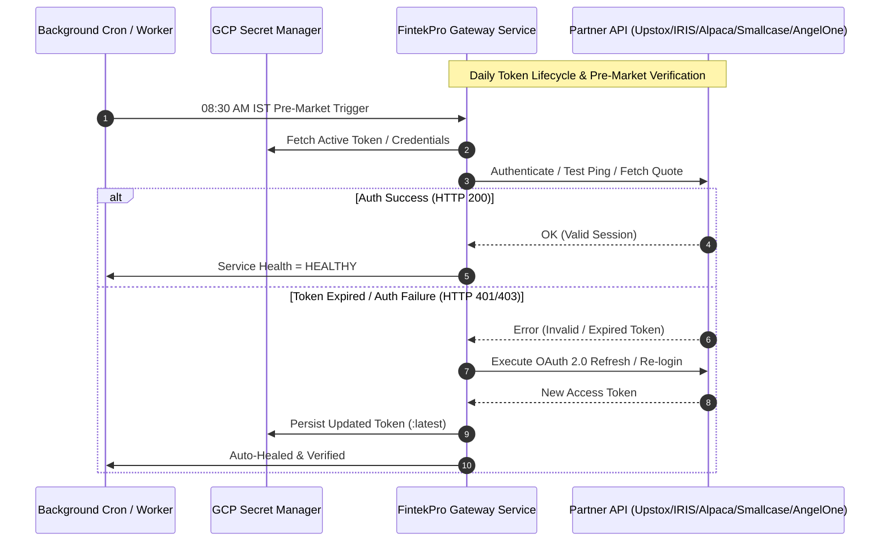
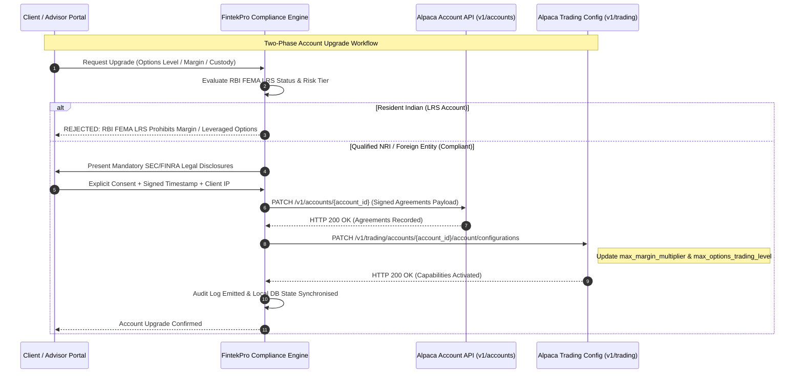
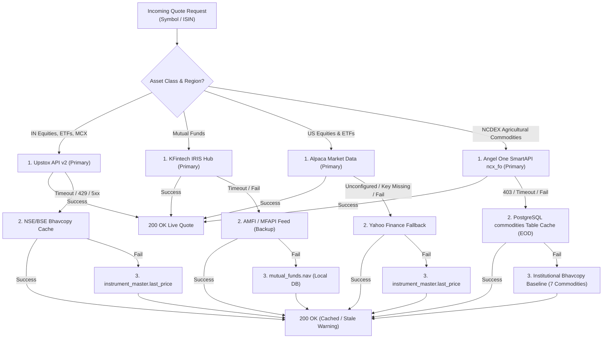

# FintekPro Standard Operating Policy: Third-Party Partner & Broker API Governance (SOP-API v1.2)

**Document Code**: SOP-API-2026-01  
**Effective Date**: November 2026 (Updated: Alpaca Broker Partner API Upgrade, Versioning Governance & RBI-LRS Account Configuration Policy)  
**Governing Authorities**: SEBI (Securities and Exchange Board of India), RBI (Reserve Bank of India), CERT-In (Indian Computer Emergency Response Team), US FINRA / SEC (via Alpaca clearing), and DPDP Act 2023  
**Statutory Desks**: Upstox Gateway Desk, KFintech IRIS Hub, Alpaca International Broker Desk, Smallcase Gateway Desk, Angel One SmartAPI Gateway Desk (NCDEX Commodity Segment)  
**Target Architecture**: Multi-Vendor Resilient API Engine (`server/services/instruments/multi-vendor-resolver.ts`)  

---

## 1. Statutory Mandate, Scope & Architectural Boundary

This Standard Operating Procedure (SOP) defines the non-negotiable operational, technological, and regulatory protocols governing all external third-party Application Programming Interfaces (APIs) connected to the FintekPro ecosystem. 

FintekPro interfaces with licensed institutional infrastructure providers across five critical asset and transaction domains:
1. **Upstox API v3 (RKSV Securities India Pvt. Ltd.)**: Primary licensed exchange market data feed and order routing gateway for Indian Listed Equities (NSE/BSE), Equity Derivatives (F&O), Commodities (MCX), Exchange Traded Funds (ETFs), Sovereign Gold Bonds (SGBs), and Benchmark Indices. Defaulting to API v3 endpoints with Market Price Protection (MPP) and GTT execution.
2. **KFintech IRIS Hub (KFin Technologies Ltd.)**: Primary Registrar & Transfer Agent (RTA) gateway for Mutual Funds (Direct & Regular schemes), Corporate Fixed Deposits, National Pension System (NPS), and Specialised Investment Funds (SIF/AIF).
3. **Alpaca Broker API (Alpaca Securities LLC / BMO Harris Bank N.A.)**: FINRA/SIPC registered clearing broker gateway powering US Equity & ETF trading, fractional share custody, and outward SWIFT wire funding for Indian residents under the **RBI Liberalised Remittance Scheme (LRS)**.
4. **Smallcase Gateway (Smallcase Technologies Pvt. Ltd.)**: Non-custodial basket transaction engine, model portfolio rebalancing bridge, and Demat Loan Against Securities (LAS) eligibility evaluator.
5. **Angel One SmartAPI (Angel One Ltd. - Member: NSE/BSE/MCX/NCDEX)**: Licensed agricultural commodity market data gateway providing real-time quotes, market depth, and historical candlestick feeds for Indian agricultural derivatives on the National Commodity & Derivatives Exchange (NCDEX `ncx_fo` segment) covering statutory inflation benchmarks (Jeera, Turmeric, Guar Seed, Cocudakl, Dhaniya, Castor Seed, Chana). Fills the critical asset coverage gap as Upstox does not support NCDEX.
6. **Finvu Account Aggregator (Cookiejar Technologies Pvt. Ltd. - RBI Licensed NBFC-AA)**: Primary consent-driven financial data aggregation bridge operating on ReBIT AA specifications, providing automated fetching of bank statements, deposits, mutual funds, equities, and insurance for Net Worth calculation and RIA portfolio advisory. (Enrolment governed under [`POLICY_AND_SOP_API_SERVICE_PROVIDER_ENROLMENT.md`](file:///Users/sangrammohanty/Documents/GitHub/FintekPro/docs/POLICY_AND_SOP_API_SERVICE_PROVIDER_ENROLMENT.md)).

---

## 2. Zero-Trust Credential Management & Secret Lifecycle

In strict compliance with **FintekPro Global Coding Rules (GCR v1.0)** and **SEBI CSCRF (Cybersecurity and Cyber Resilience Framework)**:

### 2.1 Storage & Access Isolation
- **No Hardcoded Secrets**: Plaintext API keys, secrets, tokens, or private certificates in code repositories, environment config files, or client-side bundles are strictly prohibited.
- **Google Cloud Secret Manager**: All production credentials reside exclusively in GCP Secret Manager under project `fintekpro` and are mounted into Cloud Run runtime memory via encrypted environment variables:
  - Upstox: `UPSTOX_ACCESS_TOKEN` / `UPSTOX_ANALYTICS_TOKEN`, `UPSTOX_TOKEN_ISSUED_AT`, `UPSTOX_TRADING_ACCESS_TOKEN`, `UPSTOX_CLIENT_ID`, `UPSTOX_API_KEY`, `UPSTOX_REDIRECT_URI`
  - IRIS: `IRIS_USERNAME`, `IRIS_PASSWORD`, `IRIS_TENANT_CODE`
  - Alpaca: `ALPACA_API_KEY`, `ALPACA_API_SECRET`, `ALPACA_ENV`
  - Smallcase: `SMALLCASE_GATEWAY_NAME`, `SMALLCASE_SECRET`
  - Angel One: `ANGEL_API_KEY`, `ANGEL_CLIENT_CODE`, `ANGEL_PIN`, `ANGEL_TOTP_SECRET`, `ANGEL_STATIC_IP`
- **IAM Principle of Least Privilege**: Access to API secret versions is granted strictly to the Cloud Run runtime service account (`fintekpro-app@fintekpro.iam.gserviceaccount.com`). Developer and CI/CD IAM accounts possess no read access to production API keys.

### 2.2 Periodic & Emergency Credential Rotation
1. **Scheduled 90-Day Rotation**: API keys, passwords, and webhook secrets must be rotated every 90 calendar days according to the FintekPro Security Calendar.
2. **Emergency Revocation (< 15 Minutes)**: In the event of suspected token leakage or anomalous API activity:
   - The Security Officer triggers immediate revocation in the provider partner portal.
   - Updated credentials are deployed to GCP Secret Manager via:
     ```bash
     gcloud secrets versions add <SECRET_NAME> --data-file=- <<< "<NEW_SECRET_VALUE>"
     ```
   - Cloud Run automatically loads the `:latest` version on the next request or via container restart.

---

## 3. Provider Authentication & Token Lifecycle SOP



### 3.1 Upstox API v3 & Triangulated Token Architecture

FintekPro enforces a strict three-tier token lifecycle ensuring separation of market data ingestion, institutional treasury trading, and non-custodial client demat execution:

1. **Tier 1: System Analytics Token (`UPSTOX_ANALYTICS_TOKEN` / `UPSTOX_ACCESS_TOKEN`)**:
   - **Scope**: Read-only exchange quotes (NSE/BSE/MCX), Option Greeks, EOD bhavcopy, and V3 WebSocket binary protobuf feeds.
   - **Validity**: Long-lived Developer Analytics Token (1-year validity; current production token valid through August 2027).
   - **Lifecycle SOP**: Zero daily interactive login required. Monitored via automated age-check; proactive alerts fire 30 days prior to annual rotation.

2. **Tier 2: Institutional Treasury & OMS Token (`UPSTOX_TRADING_ACCESS_TOKEN`)**:
   - **Scope**: Secondary market sovereign debt (G-Secs, T-Bills, SDLs, SGBs) and model portfolio treasury routing.
   - **Validity**: Daily enterprise OAuth session expiring at 03:30 AM IST.
   - **Pre-Market Renewal SOP (08:30 AM IST)**:
     - Automated cron checks token validity via `upstoxMarketDataService.isReady()`.
     - Re-authenticates via institutional service credentials if token expired, updating Secret Manager `:latest`.

3. **Tier 3: Client Segregated Demat OAuth Token (`indian_broker_accounts.access_token`)**:
   - **Scope**: Execution within client-owned demat account at Upstox.
   - **Validity**: Session-bound; expires strictly at trading day close (**15:30 IST**) or 24 hours max.
   - **SEBI FASP-AI Mandate**: No autonomous algorithmic trading without client confirmation. Client grants explicit daily consent via 3-legged OAuth dialog (`/api/upstox/oauth/connect`).

### 3.1.1 Upstox API v3 Upgrade Protocol & Execution Guardrails
- **Default V3 OMS Routing**: All equity, derivative, and debt orders route to `https://api.upstox.com/v3/order/place` (and `v3/order/modify`, `v3/order/cancel`).
- **Market Price Protection (MPP)**: Configured via `market_protection` (percentage buffer, default `0` for broker automated protection). Prevents fill execution spikes on illiquid strikes.
- **Good-Til-Triggered (GTT)**: Native stop-loss and entry order support via `/order/gtt/place`.
- **Freeze-Limit Auto-Slicing**: Large institutional baskets automatically pass `slice: true` to prevent rejection at exchange quantity thresholds.

### 3.2 KFintech IRIS Hub
- **Session Duration**: IRIS tokens expire every 60 minutes.
- **Heartbeat & Re-login SOP**:
  1. Handled by [`iris-service.ts`](file:///Users/sangrammohanty/Documents/GitHub/FintekPro/server/services/iris-service.ts).
  2. The service maintains an in-memory session token with a 5-minute pre-expiry buffer.
  3. Upon receipt of HTTP 401/403, the client re-authenticates automatically using tenant credentials and retries the original request transparently (zero user impact).

### 3.3 Alpaca Broker Partner API Architecture, Auth & Upgrade Governance SOP

FintekPro interfaces with Alpaca Securities LLC (`https://broker-api.alpaca.markets`) as a fully-disclosed broker partner to deliver US Equity, ETF, and institutional custody infrastructure under FINRA, SEC, and RBI FEMA regulations.

#### 3.3.1 Authentication, Dual-Tier Environment Parity & Key Management
1. **Stateless HMAC Header Authentication**:
   - All standard Broker REST requests pass:
     - `APCA-API-KEY-ID`: Institutional Partner Key Identifier (`ALPACA_API_KEY` / `ALPACA_BROKER_KEY_ID`).
     - `APCA-API-SECRET-KEY`: Encrypted Secret Key (`ALPACA_API_SECRET` / `ALPACA_BROKER_SECRET_KEY`).
2. **Multi-Tenant OAuth 2.0 Token Generation (AuthX)**:
   - For partner-mediated client authorization flows, bearer tokens are issued via:
     - Live Auth: `POST https://authx.alpaca.markets/v1/oauth2/token`
     - Sandbox Auth: `POST https://authx.sandbox.alpaca.markets/v1/oauth2/token`
   - Tokens pass via `Authorization: Bearer <access_token>` with automated token refresh 15 minutes prior to expiry.
3. **Environment Parity & Zero-Risk Isolation**:
   - **Sandbox Gateway**: `https://broker-api.sandbox.alpaca.markets/v1` (Market data: `https://data.sandbox.alpaca.markets/v2`). Used for integration testing, staging CI/CD, and simulated customer onboarding.
   - **Production Gateway**: `https://broker-api.alpaca.markets/v1` (Market data: `https://data.alpaca.markets/v2`). Provisioned strictly behind Cloud Run egress NAT with dual-approval key distribution from GCP Secret Manager.

#### 3.3.2 Upstream Partner API Upgrade & Breaking Changes Policy
Alpaca enforces a strict two-tier platform modification and versioning policy across all Broker API endpoints:

1. **Backwards-Compatible (Additive / Non-Breaking) Changes**:
   - *Definition*: Appending new optional request parameters, introducing new fields in response JSON payloads, adding non-conflicting route endpoints, modernizing TLS cipher suites, or expanding rate limits.
   - *Upstream Policy*: Alpaca deploys backwards-compatible changes **without mandatory upfront notification or path version changes**.
   - *FintekPro Client Guardrail*: All TypeScript models, Zod validators, and Axios deserializers must implement flexible schema parsing (e.g. `stripUnknown: true` or tolerant JSON deserialization) so that upstream payload expansions never trigger runtime desync or client crashes.
2. **Breaking Changes & Route Versioning Hierarchy**:
   - *Definition*: Modifying or removing existing mandatory request parameters, restructuring response payloads, renaming fields, altering error status codes, or sunsetting features.
   - *Upstream Policy*: Breaking changes are **never introduced into an active version route**. Alpaca isolates breaking changes by incrementing the root URI version (e.g., migrating from `/v1/...` to `/v2/...`).
   - *Sunset Window & Deprecation SLA*: Alpaca provides formal advance notification through the Partner Developer Portal and partner success channels, maintaining a **minimum 60-to-90-calendar-day (2 to 3 months) deprecation grace period** before legacy endpoints are decommissioned.
3. **Sandbox-First Promotion Protocol**:
   - All upstream version upgrades or major structural payload updates (e.g., Journaling JNLC v2, trade event migrations) must undergo an **isolated $\ge 14$-day sandbox validation period** in `broker-api.sandbox.alpaca.markets`.
   - Automated test pipelines must pass all reconciliation tests (`server/tests/trade-reconciliation-engine.test.ts`) before code promotion to production.
4. **OpenAPI Specification Tracking & Modern SDK Policy**:
   - The Engineering Desk periodically pulls Alpaca’s official OpenAPI specifications (`https://broker-api.alpaca.markets/v1/openapi.json`) to detect schema revisions and new regulatory disclosure requirements.
   - Legacy packages (such as `alpaca-trade-api-js` or legacy Python wrappers) are deprecated. FintekPro enforces sovereign native TypeScript HTTP adapters ([`alpaca-broker-service.ts`](file:///Users/sangrammohanty/Documents/GitHub/FintekPro/server/services/alpaca-broker-service.ts) and [`alpacaClient.ts`](file:///Users/sangrammohanty/Documents/GitHub/FintekPro/server/services/alpaca/core/alpacaClient.ts)) with strict TypeScript typings and zero unvetted intermediary wrappers.

#### 3.3.3 Event Streaming Protocol (SSE / WebSocket v2) & Webhook Verification
1. **Event Stream v2 Architecture**:
   - Programmatic account, order, and funding state changes stream over Server-Sent Events (SSE) via `/v2/events/...`:
     - Trade Execution Events: `GET https://broker-api.alpaca.markets/v2/events/trades`
     - Account Status Events: `GET https://broker-api.alpaca.markets/v2/events/accounts/status`
     - Cash Transfers & Wire Events: `GET https://broker-api.alpaca.markets/v2/events/transfers/status`
     - Journaling Events: `GET https://broker-api.alpaca.markets/v2/events/journals/status`
   - Handled by [`alpaca-sse-service.ts`](file:///Users/sangrammohanty/Documents/GitHub/FintekPro/server/services/alpaca-sse-service.ts). Streams maintain persistent HTTP connections with automated heartbeat keep-alives (15–30s ping), exponential reconnection backoff with jitter, and catch-up recovery using the `since` query parameter.
2. **Webhook v2 & Signature Verification Policy**:
   - Webhook notifications delivered to `/api/webhooks/alpaca` must validate the HMAC-SHA256 signature passed in the `Alpaca-Signature` / `X-Alpaca-Signature` header against `ALPACA_WEBHOOK_SECRET`.
   - Every received event ID (`event_id`) is idempotently checked and recorded in the database event journal (`server/services/mpal/events/webhookDispatcher.ts`) before triggering internal state transitions.

#### 3.3.4 Account Upgrade, Agreement Execution & Configuration Workflow SOP
Alpaca Broker API manages account capabilities through a segregated, two-phase upgrade architecture: legal disclosure agreements and trading configuration boundaries.



1. **Phase 1: Legal Disclosures & Agreement Submission**:
   - Upgrading account trading capabilities requires prior execution of relevant legal disclosures.
   - Endpoint: `PATCH https://broker-api.alpaca.markets/v1/accounts/{account_id}`
   - The payload appends signed agreement records:
     ```json
     {
       "agreements": [
         {
           "agreement": "options_agreement",
           "signed_at": "2026-11-23T07:30:00Z",
           "ip_address": "49.207.180.12",
           "revision": "1.0"
         },
         {
           "agreement": "margin_agreement",
           "signed_at": "2026-11-23T07:30:00Z",
           "ip_address": "49.207.180.12",
           "revision": "1.0"
         }
       ]
     }
     ```
   - Supported agreements: `customer_agreement`, `account_agreement`, `margin_agreement`, `options_agreement`, `crypto_agreement`.
   - **Audit Trail Requirement**: The client’s verified IP address, user-agent, and ISO-8601 UTC timestamp must be recorded in the local compliance audit table prior to transmission.

2. **Phase 2: Trading Configuration Modification**:
   - Once agreements are accepted by Alpaca clearing, execution boundaries are elevated via:
   - Endpoint: `PATCH https://broker-api.alpaca.markets/v1/trading/accounts/{account_id}/account/configurations`
   - Key configuration fields:
     - `max_margin_multiplier`: `"1.0"` (Cash only, 1x leverage) or `"2.0"` (Standard Reg T margin, requiring $\ge \$2,000$ equity).
     - `max_options_trading_level`:
       - `0`: Options trading disabled (Default for cash/LRS accounts).
       - `1`: Covered calls and cash-secured equity puts.
       - `2`: Long calls and long puts (Directional speculative options).
       - `3`: Multi-leg spreads, straddles, and advanced options strategies.
     - `fractional_trading`: Boolean flag enabling fractional share trading (enabled by default for FintekPro US portfolios).
     - `pdt_check`: Pattern Day Trader validation (`both`, `entry`, or `exit`). Default is `both`.
     - `suspend_trade`: Emergency administrative trading freeze (`true`/`false`).
   - Managed via [`AccountConfigPanel.tsx`](file:///Users/sangrammohanty/Documents/GitHub/FintekPro/client/src/components/us-trading/AccountConfigPanel.tsx) and `/api/us-trading/broker/accounts/:id/config`.

3. **Customer Identification Program (CIP) & Document Re-verification**:
   - If an account state transitions to `ACTION_REQUIRED` or requires identity remediation during an upgrade or periodic review:
   - Document upload endpoint: `POST https://broker-api.alpaca.markets/v1/accounts/{account_id}/documents`
   - Supported document types: `identity_verification` (Passport/National ID), `address_verification` (Utility bill, bank statement), `w8ben` (Tax treaty certification).
   - FintekPro’s [`alpacaKycMapper.ts`](file:///Users/sangrammohanty/Documents/GitHub/FintekPro/server/services/alpaca/onboarding/alpacaKycMapper.ts) orchestrates multi-document uploads with ASCII 32–126 character sanitization.

4. **IRS Form W-8BEN Re-Certification Lifecycle**:
   - Under US Internal Revenue Code Chapter 3 and Chapter 4 (FATCA), foreign non-resident certifications on Form W-8BEN expire on the **last day of the third calendar year** following execution.
   - The FintekPro Compliance Engine tracks the `w8ben_signed_date` and prompts clients 60 days prior to expiry for electronic re-certification via `PATCH /v1/accounts/{account_id}`. Failure to re-certify results in backup withholding tax penalties (30% on US dividends and gross proceeds).

### 3.4 Smallcase Gateway
- **Transaction Model**: Smallcase Gateway employs a **Server-Side Generated Transaction Model**. The client browser SDK never communicates directly with Smallcase without a server-signed JWT.
- **JWT Signing Specification**:
  - Algorithm: `HS256` signed using `SMALLCASE_SECRET`.
  - Token Expiration: Strict 15-minute TTL (`exp = now + 900`).
  - User Claims: `sub = smallcaseAuthId` for connected users; guest payloads for unlinked users.
- **Zero-Storage of Broker Passwords**: FintekPro never receives, stores, or processes client broker credentials. Broker authentication occurs strictly inside the Smallcase Gateway SDK.

### 3.5 Angel One SmartAPI Partner & Publisher Installation, Auth & Upgrade Policy SOP

FintekPro interfaces with Angel One SmartAPI (`https://apiconnect.angelone.in`) to ingest agricultural commodity derivative data on NCDEX (`ncx_fo` segment), closing the critical asset coverage gap as Upstox does not support NCDEX.

#### 3.5.1 Installation & Package Policy (Node.js & Python SDKs)
1. **Official SDKs**:
   - **Node.js / TypeScript**: Official npm package is `smartapi-javascript`. Fresh installation: `npm i smartapi-javascript`. Upgrade command: `npm i smartapi-javascript@latest`.
   - **Python**: Official PyPI package is `smartapi-python`. Fresh installation: `pip install smartapi-python`. Upgrade command: `pip install smartapi-python --upgrade` (with peer dependencies: `pyotp`, `logzero`, `websocket-client`, `pycryptodome`).
2. **FintekPro Sovereign Zero-Dependency Native Architecture**:
   - In accordance with **FintekPro Global Coding Rules (GCR v1.0)** and supply-chain security standards, FintekPro implements a sovereign native HTTP adapter ([`angel-one-adapter.ts`](file:///Users/sangrammohanty/Documents/GitHub/FintekPro/server/services/adapters/angel-one-adapter.ts)) using Axios and Node.js native `crypto`.
   - **RFC 6238 TOTP Engine**: Dynamically calculates 6-digit TOTP codes from `ANGEL_TOTP_SECRET` using standard Base32 decoding and HMAC-SHA1 without external unvetted dependencies (`pyotp` or unverified wrappers).
3. **SDK Upgrade Cadence & Version Review Policy**:
   - The Engineering Desk conducts quarterly reviews of upstream Angel One developer releases (`angel-one/smartapi-javascript`).
   - If breaking schema changes occur (e.g. SmartAPI v2 protocol revisions, new header signing algorithms, or endpoint deprecations), the native adapter is updated and validated against the Vitest suite ([`angel-one-ncdex.test.ts`](file:///Users/sangrammohanty/Documents/GitHub/FintekPro/server/tests/angel-one-ncdex.test.ts)).

#### 3.5.2 Regulatory Mandate: Static Public IP Whitelisting (SEBI / NSE Guidelines)
- **Mandatory Static IP Whitelisting**: In strict alignment with SEBI circulars and NSE/NCDEX algorithmic and broker gateway guidelines, all programmatic sessions and API order operations **must originate from a pre-registered, whitelisted public static IP address**. Requests originating from dynamic or unwhitelisted residential/cloud IPs are rejected with HTTP 403 / auth error.
- **SmartAPI Dashboard IP Registration**:
  - Up to 5 Static Public IPs can be mapped per API Key on the Angel One SmartAPI developer portal (`smartapi.angelone.in`).
  - The production static IP (`ANGEL_STATIC_IP`, default `8.231.118.86`) is bound to the Cloud Run egress gateway / Cloud NAT.
  - Every outbound API request passes this value in the `X-ClientPublicIP` header.

#### 3.5.3 Two-Factor Authentication (2FA) via RFC 6238 TOTP
- **SMS OTP Deprecation**: Traditional SMS OTPs are fully deprecated and non-compliant for programmatic access.
- **Automated TOTP Handshake**:
  - The login payload pairs `clientcode: ANGEL_CLIENT_CODE`, `password: ANGEL_PIN`, and dynamically generated `totp: generateTOTP(ANGEL_TOTP_SECRET)`.
  - Step size: 30 seconds.
- **CERT-In NTP Clock Drift Enforcement**: Server clocks on Cloud Run must maintain clock drift $\le \pm 50\text{ms}$ with `time.google.com` / `time.nic.in`. Any drift exceeding 25 seconds causes `AB1050` ("Invalid TOTP") handshake rejection by the Angel One gateway.

#### 3.5.4 Partner Auth Endpoints, Header Specification & Token Lifecycle
1. **Authentication Endpoint**: `POST https://apiconnect.angelone.in/rest/auth/partner/v1/loginByPassword` (or `/rest/auth/angelbroking/user/v1/loginByPassword`).
2. **Mandatory Headers**:
   - `Content-Type: application/json`
   - `Accept: application/json`
   - `X-UserType: USER`
   - `X-SourceID: WEB`
   - `X-ClientLocalIP: 127.0.0.1`
   - `X-ClientPublicIP: <ANGEL_STATIC_IP>`
   - `X-MACAddress: 02:00:00:00:00:00`
   - `X-PrivateKey: <ANGEL_API_KEY>`
3. **Session Token Expiration & Caching**:
   - `jwtToken`: Lifetime of **24 hours**. Cached in-memory and proactively refreshed when remaining validity is $< 5\text{ minutes}$.
   - Subsequent calls pass `Authorization: Bearer <jwtToken>`.
   - `refreshToken`: Stored for non-interactive token renewal.
   - `feedToken`: Stored for binary WebSocket market depth streaming.

---

## 4. Rate Limiting, Throttling & Circuit Breakers

To protect partner endpoints and prevent platform-wide cascading failures, all outgoing calls must route through the FintekPro Throttling Layer:

| Provider | Burst Limit | Sustained Cap | Backoff Policy | Circuit Breaker Threshold |
| :--- | :--- | :--- | :--- | :--- |
| **Upstox Market Data** | 50 req/s | 25 req/s | Exponential (50ms $\rightarrow$ 200ms $\rightarrow$ 800ms) | 5 failures in 10s $\rightarrow$ Open 30s |
| **Upstox OMS (Orders)** | 15 req/s | 10 req/s | Exponential + Jitter | 3 consecutive failures $\rightarrow$ Open 60s |
| **KFintech IRIS Hub** | 20 req/s | 15 req/s | 2 retries, 500ms backoff | 5 failures in 15s $\rightarrow$ Open 45s |
| **Alpaca Market Data (SIP/IEX)** | 250 req/min | 200 req/min | 2 retries, 1000ms backoff | 4 failures in 20s $\rightarrow$ Open 60s |
| **Alpaca Broker REST (Trading/Config)** | 120 req/min | 100 req/min | Fail immediately (No blind retries) | 3 failures in 30s $\rightarrow$ Open 120s |
| **Alpaca Account Onboarding / CIP Docs** | 50 req/min | 30 req/min | Exponential (200ms $\rightarrow$ 800ms $\rightarrow$ 2000ms) | 3 failures in 20s $\rightarrow$ Open 60s |
| **Alpaca Event Stream (SSE v2)** | 10 streams | 5 streams | Exponential with Jitter (5s max) | 3 disconnects in 60s $\rightarrow$ Reconnect Backoff |
| **Smallcase Gateway** | 60 req/min | 50 req/min | 2 retries, 300ms backoff | 5 failures in 20s $\rightarrow$ Open 30s |
| **Angel One Market Quotes (ncx_fo)** | 10 req/s | 5 req/s | Exponential (100ms $\rightarrow$ 400ms $\rightarrow$ 1200ms) | 4 failures in 10s $\rightarrow$ Open 30s |
| **Angel One Historical Data** | 3 req/s | 1 req/s | 2 retries, 500ms backoff | 3 failures in 15s $\rightarrow$ Open 60s |
| **Angel One Order OMS (if active)** | 10 req/s | 5 req/s | Fail immediately (No blind retries - TOPS cap) | 3 failures in 20s $\rightarrow$ Open 60s |

### Circuit Breaker States
1. **CLOSED (Normal)**: All traffic passes to the primary partner API. Latency and error counters tracked.
2. **OPEN (Tripped)**: When error rate exceeds threshold ($\ge 50\%$ over evaluation window), the breaker trips. Requests immediately fail over to the secondary fallback without hitting the partner network.
3. **HALF-OPEN (Recovery Probe)**: After the timeout window elapses, a single probe request is permitted through. If successful, the breaker resets to `CLOSED`; if it fails, the timeout doubles.

---

## 5. Self-Healing Failover & Degraded Mode Operations

In accordance with **FintekPro Self-Healing Rules**: *"Never crash the full system — return partial results with a warning and fail over to secondary providers."*



---

## 6. Regulatory Guardrails & Fiduciary Execution Rules

### 6.1 Non-Autonomous Execution (FASP-AI v1.0 Mandate)
- **Zero Autonomous Trading**: No AI algorithm, scheduled job, or automated webhook may place trades without explicit, non-delegated client confirmation.
- **Advisor & Client Approvals**: Model portfolio rebalances require explicit client approval (via SMS/WhatsApp OTP or authenticated app confirmation) or licensed RIA/CA sign-off.

### 6.2 Upstox Order Routing & SEBI Risk Guardrails
1. **Idempotency**: Every order submission generates a deterministic idempotency key (`ORDER_REQ_{userId}_{isin}_{timestamp}`) preventing duplicate executions on transient network retries.
2. **Pre-Trade Margin Verification**: Order routing checks available funds and DP holding balances before dispatching orders to the Upstox OMS.
3. **Non-Custodial Broker Execution**: FintekPro functions purely as a technology interface. Client funds and securities remain with Upstox / CDSL / NSDL.

### 6.3 KFintech IRIS & SEBI NAV Cut-off Guardrails
1. **Universal NAV Cut-off Enforcement**:
   - Liquid & Overnight Schemes: **1:30 PM IST**
   - Equity, Debt, and Hybrid Schemes: **3:00 PM IST**
2. **Post-Cut-Off Handling**: Orders authorized post-cutoff are assigned an immutable audit timestamp and queued for next-business-day execution (`T+1`).

### 6.4 Alpaca, RBI FEMA LRS Compliance & Account Upgrade Statutory Locks

FintekPro enforces strict statutory boundaries between US broker capabilities (Alpaca Broker API) and Indian foreign exchange regulations (RBI Foreign Exchange Management Act - FEMA):

#### 6.4.1 Strict Statutory Prohibition on Margin / Leveraged Derivatives for Resident Indians
1. **Statutory LRS Mandate**: Under the Reserve Bank of India (RBI) Liberalised Remittance Scheme (LRS) Master Directions (statutory remittance ceiling of \$250,000 USD per financial year), resident Indian individuals remitting capital abroad under Purpose Code **`S0001`** (Portfolio investment in foreign equity shares) are **strictly prohibited** from:
   - Borrowing or trading on credit/margin (Reg T or portfolio margin).
   - Executing short sales or uncovered options.
   - Trading leveraged financial derivatives (futures/options) or speculative synthetic instruments.
   - Trading or holding cryptocurrency assets abroad.
2. **Statutory Lock on Account Upgrades**:
   - For all accounts where `country_of_tax_residence = "IND"` or citizenship is Indian:
     - `enabled_assets`: Programmatically locked to `["us_equity"]`.
     - `max_margin_multiplier`: Permanently locked to `"1.0"` (Cash account only).
     - `max_options_trading_level`: Permanently locked to `0` (Options disabled).
   - In accordance with [`AlpacaKycMapper`](file:///Users/sangrammohanty/Documents/GitHub/FintekPro/server/services/alpaca/onboarding/alpacaKycMapper.ts), resident Indian accounts are precluded from signing `margin_agreement` or `crypto_agreement`. Any client attempt to trigger an account upgrade through UI or direct API will be rejected at the FintekPro middleware layer before reaching Alpaca.

#### 6.4.2 Qualified Non-Resident & Corporate Account Upgrade Protocol
1. **Eligible Entities for Trading Upgrades**:
   - Non-Resident Indians (NRIs) with foreign tax residence (e.g. USA, UK, UAE, Singapore) funding accounts through foreign bank accounts outside RBI LRS jurisdiction.
   - Qualified foreign institutional or corporate accounts holding certified non-Indian tax residencies.
2. **Mandatory 4-Tier Upgrade Approval Process**:
   - **Tier 1 (Suitability Scoring)**: Verified liquid net worth $\ge \$25,000$ USD and "aggressive" / "high" investment risk tolerance.
   - **Tier 2 (Explicit Disclosure Consent)**: Execution of Alpaca Margin Agreement and/or Alpaca Options Agreement with verifiable client IP, timestamp, and W-8BEN / W-9 verification.
   - **Tier 3 (Compliance Officer Sign-off)**: Dual-approval gate by FintekPro Principal Officer / Compliance Officer validating source of funds non-applicability of RBI LRS.
   - **Tier 4 (Programmatic Provisioning)**: Sequential execution of `PATCH /v1/accounts/{account_id}` (agreements) followed by `PATCH /v1/trading/accounts/{account_id}/account/configurations`.

#### 6.4.3 International SWIFT Wire Clearing Protocol
1. **Clearing Bank Details**:
   - Beneficiary Bank: BMO Harris Bank N.A. (Chicago, IL, USA)
   - ABA / Routing Transit Number: Alpaca Clearing wire instructions.
2. **Mandatory Remittance Reference (Field 70)**:
   - Outward SWIFT wire messages (MT103) must include the investor's unique Alpaca Account Number (`APCA-...`) in Field 70 (Remittance Information). Failure to include the account number results in wire rejection or suspense hold by BMO Harris Bank.
3. **RBI Form A2 & TCS Verification**:
   - Authorized Dealer (AD Category I) banks require automated generation of Form A2 declaration citing Purpose Code **`S0001`**.
   - Tax Collected at Source (TCS) tracking under Section 206C(1G) of the Indian Income Tax Act (20% TCS above ₹7,00,000 threshold for remittances other than education/medical).

### 6.5 Smallcase Demat Lending (LAS) Guardrails
1. **SEBI/RBI Loan-to-Value (LTV) Caps**: Loan against listed equity shares is capped at **50% of the approved portfolio valuation** in strict compliance with RBI Master Directions.
2. **Pledge / Depository Lien Marking**: Loan disbursals remain locked until an irrevocable electronic pledge confirmation is acknowledged by NSDL or CDSL.

### 6.6 Angel One NCDEX & SEBI Algo Trading / Static IP Guardrails
1. **Strict Market Ingestion Scope**: The Angel One SmartAPI connection is provisioned strictly for agricultural commodity inflation benchmarking, NCDEX spot-futures basis tracking, and derivative analytics (`ncx_fo` segment).
2. **Zero Autonomous Algorithmic Order Routing (FASP-AI v1.0 Mandate)**: In compliance with SEBI algo directives and FintekPro advisory rules, no autonomous trade execution or programmatic position entry may take place through Angel One without explicit, non-delegated client confirmation and licensed advisor sign-off.
3. **SEBI Static IP & TOPS Compliance**:
   - In accordance with SEBI retail algo guidelines, all programmatic traffic must originate strictly from the whitelisted Cloud Run static egress IP (`ANGEL_STATIC_IP`).
   - Order placement frequency (if OMS capabilities are activated in future releases) is bound to the Threshold Order Per Second (TOPS) statutory cap of **10 OPS**.
   - All requests must carry deterministic idempotency keys (`ORDER_REQ_{userId}_{symbolToken}_{timestamp}`) and pre-trade margin verification.

---

## 7. Audit Logging, Data Privacy & Time Synchronization

1. **Structured Log Standard**: Every external partner call must emit structured JSON logs:
   ```json
   {
     "event": "PARTNER_API_CALL",
     "provider": "upstox",
     "endpoint": "/v2/market-quote/quotes",
     "http_status": 200,
     "latency_ms": 142,
     "status": "success",
     "idempotency_key": "QUOTE_INF204KB14I2_1730951234",
     "timestamp": "2026-11-07T03:48:20.142Z"
   }
   ```
2. **Mandatory PII Masking (DPDP Act 2023)**:
   - Permanent Account Number (PAN): Mask characters 6 through 8 (`ABCDE****F`).
   - Bank Account Numbers: Mask all except last 4 digits (`******1234`).
   - Passwords, OAuth tokens, and client secrets: Omitted entirely from logs.
3. **NTP Time Synchronization (CERT-In Compliance)**:
   - Server clocks on Cloud Run and Cloud SQL sync continuously with the National Physical Laboratory (NPL) NIC NTP pool (`time.nic.in` / `time.google.com`).
   - Maximum allowable clock drift: **$\le \pm 50\text{ms}$**.
4. **Log Retention**: Audit trails of order submissions, API responses, and financial ledger modifications are preserved for a minimum statutory period of **5 years** (SEBI / PMLA mandate).

---

## 8. Incident Management, Alerting & Partner Escalation Matrix

### 8.1 Incident Severity Levels
- **Severity 1 (Critical Partner Outage)**: Primary market data or order routing partner offline during live market hours (09:15 AM – 03:30 PM IST).
  - *Action*: Automatic failover to secondary provider. PagerDuty alert to Lead Systems Engineer within 60 seconds.
- **Severity 2 (Degraded Performance / Latency $> 2000\text{ms}$)**: High latency or sporadic HTTP 429 rate limit errors.
  - *Action*: Circuit breaker trips to HALF-OPEN. Cache TTL doubled temporarily.
- **Severity 3 (Non-Critical Sync Error)**: Nightly master sync batch job failure.
  - *Action*: Automated retry with 15-minute backoff. Slack alert to `#dev-ops`.

### 8.2 Partner Escalation Directory

| Provider | Primary NOC / Support Desk | Escalation Level 2 (Technical) | Escalation Level 3 (Management) |
| :--- | :--- | :--- | :--- |
| **Upstox API Team** | `api-support@upstox.com` | Partner Engineering Lead | Head of Institutional Alliances |
| **KFintech IRIS Desk** | `iris.support@kfintech.com` | Institutional Solutions Head | Chief Technology Officer |
| **Alpaca Broker Operations** | `broker-support@alpaca.markets` / `api-support@alpaca.markets` | API Integration Specialist / Partner Engineer | VP, Global Clearing, Partnerships & Compliance |
| **Smallcase Gateway** | `gateway-support@smallcase.com` | Developer Relations Manager | VP, Engineering |
| **Angel One SmartAPI Desk** | `smartapi@angelbroking.com` / `api-support@angelone.in` | Developer Relations Lead | Head of Technology & Alliances |

---

## 9. Regulatory Review & Audit Cadence

This Standard Operating Procedure is reviewed and re-certified on a **semi-annual basis** by the FintekPro Compliance Council and the Principal Officer to incorporate emerging regulatory circulars from SEBI, RBI, and partner broker technical revisions.

---

## 10. Deprecation & Delinking Addendum: External CRM Services (Zoho CRM)

As of November 2026, **all third-party CRM connections (specifically Zoho CRM) are formally delinked, deprecated, and retired** under FintekPro Policy `POL-CRM-2026-01`:

1. **System of Record (SoR)**: FintekPro Native CRM Engine (`lead_registry`, `agent_leads`, `prospect_clients`, `prospect_proposals`) is the exclusive, sovereign System of Record for all non-client lead pipelines, corporate director wealth scores, and KYC onboarding conversions.
2. **Data Isolation & DPDP Sovereignty**: To prevent unneeded third-party exposure of customer PAN, liquid net worth, and investment intent, no prospect or client PII shall be synchronised to external CRM SaaS vendors.
3. **Route & Interface Retirement**: `/agent/crm` navigation links have been eliminated from all agent layouts and redirected to the unified Lead Pipeline (`/agent/leads`). All active acquisition workflows operate natively within FintekPro.

*Document Approved by*: FintekPro Legal, Regulatory & Technology Council  
*Distribution*: Engineering, Product, Compliance, Operations, and RIA Advisory Desks  

