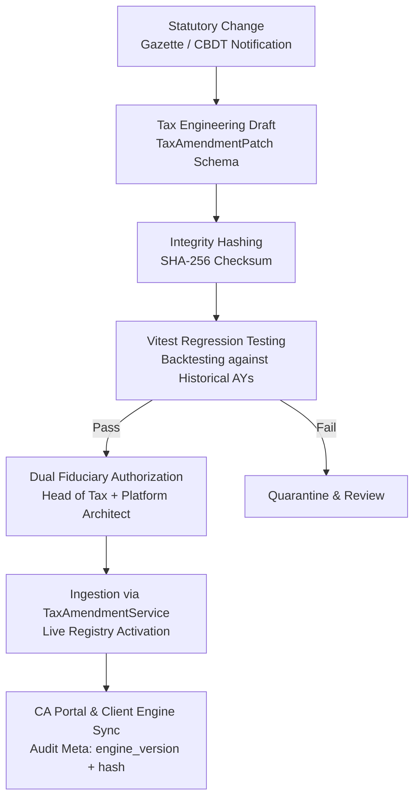

# Standard Operating Procedure (SOP): Income Tax Statutory Amendment Ingestion & Patching

**Document Code**: `FINTEK-SOP-TAX-AMD-2026-01`  
**Standard Version**: SOP-TAX-1.0.0  
**Effective Date**: November 2026  
**Governing Authorities**: Central Board of Direct Taxes (CBDT), Ministry of Finance, Institute of Chartered Accountants of India (ICAI), & SEBI (AI/ML Advisory Framework)  
**Applicability**: Tax Engineering Desk, Compliance Officers, Head of Direct Taxation, Partner CAs, AI Governance Committee  

---

## 1. Statutory Mandate & Purpose

This Standard Operating Procedure establishes the mandatory compliance controls, verification workflows, and testing protocols for ingesting, validating, and activating **statutory tax amendments** across the FintekPro platform.

Under Indian Direct Tax jurisprudence, statutory changes occur via multiple legal instruments:
1. **The Annual Finance Act / Budget**: Overhauling rates, slabs, and exemptions (e.g., Finance (No. 2) Act, 2024).
2. **CBDT Notifications & Circulars**: Clarifying statutory interpretations, prescribing procedural guidelines, and extending statutory filing due dates (e.g., CBDT Circular No. 19/2019 regarding DIN).
3. **Office Memorandums (OMs) & Executive Orders**: Providing administrative carve-outs (e.g., OM 5/2(2)/2021 excluding wholesale/retail traders from MSMED disallowance).
4. **Supreme Court / High Court Precedents**: Authoritative judicial interpretations declaring statutory positions (e.g., *Checkmate Services* on employee PF/ESI under § 36(1)(va)).

Per **FintekPro Global Coding Rules (GCR v1.0)** and **FASP-AI v1.0**, tax calculations must remain **strictly deterministic and auditable**. The platform must support dynamic amendment patching while guaranteeing that historical tax calculations for past Assessment Years remain reproducible without divergence.

---

## 2. Statutory Patch Lifecycle & Governance Architecture



---

## 3. Mandatory Patch Schema Requirements

Every amendment ingested into the FintekPro engine must satisfy the `TaxAmendmentPatch` schema:

1. **`amendmentId`**: Unique screaming snake-case identifier (e.g., `FA_2024_CAPITAL_GAINS_SEC_111A_112A`).
2. **`statutorySource`**: Exact citation of the official gazette, Act section, or circular number (e.g., *Finance (No. 2) Act, 2024, Act No. 15 of 2024*).
3. **`effectiveDate`**: Precise UTC timestamp from which the amendment takes legal effect.
4. **`applicableAssessmentYears`**: Array of assessment years to which the rule applies (e.g., `["2025-26", "2026-27"]`).
5. **`verificationHash`**: Cryptographic SHA-256 digest of the statutory payload to prevent tampering.
6. **`rulesPayload`**: Structured parameters defining rates, slabs, holding periods, disallowances, or exemptions.

---

## 4. Date-Effective Rate Resolution Protocol

To prevent retrospective contamination of historical cases, all calculation engines must invoke date-effective resolution:

- **Transaction Date Driven**:
  For Capital Gains transactions (§ 111A, § 112A, § 112, § 50AA), rates must be determined by the **exact settlement/execution date**, not the filing date.
  - Transactions executed on or before **July 22, 2024**: STCG 15%, LTCG 10% (exemption ₹1,00,000).
  - Transactions executed on or after **July 23, 2024**: STCG 20%, LTCG 12.5% (exemption ₹1,25,000).
- **Assessment Year Driven**:
  For income tax slabs and Chapter VI-A deductions, rates must be determined by the **Assessment Year (AY)** of the case:
  - AY 2024-25: Pre-amendment slabs and standard deduction of ₹50,000.
  - AY 2025-26 & AY 2026-27: Post-amendment Section 115BAC slabs with standard deduction of ₹75,000.

---

## 5. Dual-Authorization & Emergency Ingestion Protocol

1. **Standard Ingestion**:
   - Proposed patches must be submitted via `/api/ca/tax-amendments/ingest`.
   - Requires verification and digital cryptographic approval by both the **Head of Taxation (FCA)** and the **Principal Platform Architect**.
2. **Emergency Due Date Extensions**:
   - In instances where CBDT extends compliance due dates (e.g., Form 10A, ITR filing deadlines under § 139(1), or Tax Audit under § 44AB) with short notice:
   - Compliance Officers can trigger an expedited patch updating `caComplianceCalendarService` immediately upon official issuance.
3. **Audit Trail Logging**:
   - Every amendment patch emits an immutable audit event:
     ```json
     {
       "event": "TAX_AMENDMENT_INGESTED",
       "amendment_id": "FA_2024_CAPITAL_GAINS_SEC_111A_112A",
       "statutory_source": "Finance (No. 2) Act, 2024",
       "verification_hash": "46d8f28b4931a2938a19283f9829103e2849182390a8e1b302c1f928e192a012",
       "ingested_by": "ICAI_STATUTORY_GATEWAY",
       "timestamp": "2024-07-24T00:00:00.000Z"
     }
     ```

---

## 6. Prohibited Practices

- **Zero Hardcoded Ad-Hoc Adjustments**: Modifying tax slabs or rates directly inside controller route handlers or UI components is strictly prohibited.
- **Zero LLM Hallucinated Rates**: Generative AI tools must never compute statutory tax liability or invent tax relief provisions; all computations must be executed by the deterministic `taxAmendmentService` and `indianTaxCalculator`.
- **No Unversioned Overwrites**: Existing statutory rules for older Assessment Years must never be overwritten; new rules must be appended with distinct effective date windows.

